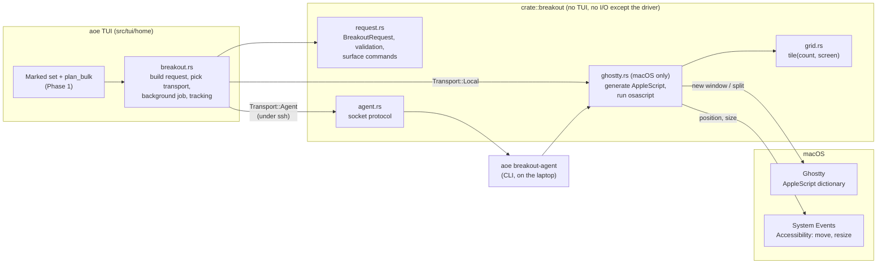
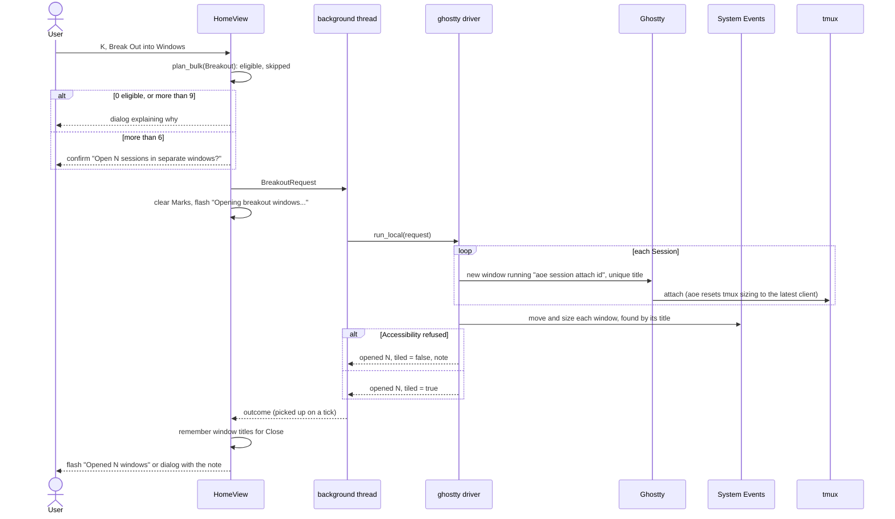
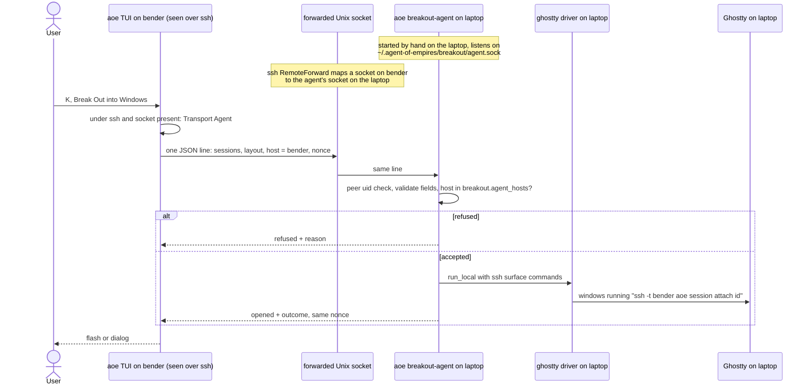
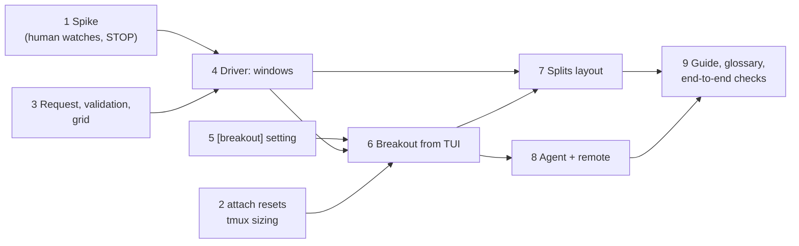

# Breakout Windows (Phase 2) Implementation Plan

> **For agentic workers:** REQUIRED SUB-SKILL: Use superpowers:subagent-driven-development (recommended) or superpowers:executing-plans to implement this plan task-by-task. Steps use checkbox (`- [ ]`) syntax for tracking.

**Goal:** Open the Marked set as tiled Ghostty windows (or splits) outside the aoe TUI, including when aoe runs on another host and the windows open on the laptop.

**Architecture:** A new `crate::breakout` module holds a serialisable Breakout request, a pure grid function and a macOS Ghostty driver that generates AppleScript and runs it with `osascript`. The TUI builds a request from the Marked set and hands it to a transport: the local driver, or a Unix socket forwarded over ssh to `aoe breakout-agent` on the laptop, which runs the same driver.

**Tech Stack:** Rust, `osascript` (AppleScript and JXA), Ghostty 1.4 AppleScript dictionary, macOS Accessibility via System Events, Unix domain sockets, serde JSON lines.

**Spec:** `docs/superpowers/specs/2026-11-19-marks-bulk-actions-breakout-design.md` (section 2 and "Amendments").

**Depends on:** `docs/superpowers/plans/2026-11-19-marks-and-bulk-actions.md` merged first. This plan uses its `marked`, `bulk.rs` (`BulkAction`, `SkipReason`, `BulkCandidate`, `plan_bulk`, `bulk_plan`), `ContextMenuDialog::for_marks` and `clear_marks`.

## Overview

This section is for the human reviewer. It shows what the user sees and where the boundaries are. The tasks below are the instructions for the implementer.

### What the user gets

Mark three to five Sessions, press `K`, choose **Break Out into Windows**. Each marked Session opens in its own Ghostty window, attached to the Session's tmux pane, and the windows are arranged in a grid that fills the screen. aoe keeps running where it was. Detaching in a window closes that window. **Close Breakout Windows** (bulk menu or command palette) closes them all.

A setting picks between two layouts. `windows` (the default, built first) is one Ghostty window per Session. `splits` (opt-in, built second) is one Ghostty window split into panes.

The same action works when aoe runs on another host (bender) and is viewed over ssh from the laptop: the windows open on the laptop, each one running its own ssh to bender.

### Wireframes

Bulk menu after this plan (the first four entries come from Phase 1; "Close" appears only while Breakout windows are tracked):

```
┌───────────────────────────────┐
│ Send Message to Marked        │
│ Restart Marked                │
│ Break Out into Windows        │
│ Show What Would Be Skipped    │
│ Clear Marks                   │
│ Close Breakout Windows        │
└───────────────────────────────┘
```

Layout `windows`, three Sessions. Three separate Ghostty windows, each with its own title bar, sized to thirds of the screen. The aoe window is left alone and ends up behind them.

```
┌ aoe breakout · fix-auth ──┐┌ aoe breakout · rate-limit ┐┌ aoe breakout · dark-mode ─┐
│                           ││                           ││                           │
│  claude                   ││  claude                   ││  codex                    │
│  (tmux attach to the      ││                           ││                           │
│   Session's agent pane)   ││                           ││                           │
│                           ││                           ││                           │
│                           ││                           ││                           │
└───────────────────────────┘└───────────────────────────┘└───────────────────────────┘
```

Layout `splits`, the same three Sessions. One Ghostty window, three panes. No Accessibility permission needed, because Ghostty does the arranging itself.

```
┌ aoe breakout ─────────────────────────────────────────────────────────────────────────┐
│ fix-auth                  │ rate-limit                 │ dark-mode                    │
│                           │                            │                              │
│  claude                   │  claude                    │  codex                       │
│                           │                            │                              │
└───────────────────────────────────────────────────────────────────────────────────────┘
```

The grid by Session count (both layouts):

```
 1          2            3              4           5 or 6          7 to 9
┌─────┐   ┌──┬──┐     ┌──┬──┬──┐     ┌──┬──┐      ┌──┬──┬──┐      ┌──┬──┬──┐
│     │   │  │  │     │  │  │  │     ├──┼──┤      ├──┼──┼──┤      ├──┼──┼──┤
└─────┘   └──┴──┘     └──┴──┴──┘     └──┴──┘      └──┴──┴──┘      ├──┼──┼──┤
                                                  (5 leaves one   └──┴──┴──┘
                                                   cell empty)
```

More than 6 asks first; more than 9 is refused:

```
┌ Break Out ────────────────────────────────────────┐
│ Open 7 sessions in separate windows?              │
│                                                   │
│               [ Open ]   [ Cancel ]               │
└───────────────────────────────────────────────────┘
```

Windows opened but macOS has not granted Accessibility, so they could not be moved:

```
┌ Breakout ─────────────────────────────────────────┐
│ The windows are open but not tiled: macOS has not │
│ granted Accessibility access. ...                 │
│                      [ OK ]                       │
└───────────────────────────────────────────────────┘
```

### Where the code sits



Three boundaries matter:

1. **The request is a plain value.** `BreakoutRequest` is a list of `(session id, title, profile)`, a layout, and optionally a host. It is the only thing that crosses from the TUI to the driver, and the only thing that crosses the wire to the agent. It carries no commands.
2. **Commands are built on the side that runs them.** The driver side turns each validated entry into a fixed command: `<this aoe binary> --profile <p> session attach <id>` locally, or `ssh -t <host> aoe --profile <p> session attach <id>` through the agent. Text from the remote side is never executed.
3. **The driver is the only macOS-specific code.** Ghostty has no AppleScript for window position or size, so creating windows goes through Ghostty and moving them goes through System Events. That second step is what needs the Accessibility permission, and it is the unproven part: Task 1 is a spike that tests it by hand before anything is built on it.

### Local Breakout, step by step



Breakout skips Sessions it cannot attach: structured Sessions (they have no tmux pane; `aoe session attach` refuses them), Sessions whose agent is not running, and anything archived, trashed, or being created or deleted.

Task 2 exists because of the tmux step: aoe sets tmux `window-size latest`, and the CLI attach path does not currently reset sizing the way the TUI attach does, so a Breakout window could be stuck at the preview pane's size.

### Remote Breakout (aoe on bender, windows on the laptop)



Transport choice is automatic: not under ssh and on macOS with Ghostty means local; under ssh with the forwarded socket present means agent; anything else shows "Breakout Unavailable" with the reason. The agent only acts for hosts listed in the laptop's `breakout.agent_hosts`, so a host that can reach the socket still cannot make the laptop ssh somewhere arbitrary.

### Task order



After Task 6 local Breakout works end to end with separate windows. Task 7 adds splits. Task 8 adds bender. Tasks 2, 3 and 5 do not depend on the spike and can go ahead of it.

### Decisions worth a second look

- The Ghostty driver lives in `src/breakout/ghostty.rs` behind a macOS gate. `AGENTS.md` says OS-specific code belongs in `src/process/{macos,linux}.rs`; the clipboard, URL opener and sound code already sit outside it the same way, and this keeps Breakout in one place.
- Structured Sessions are skipped, not opened some other way.
- The agent is started by hand (no launchd job yet), and remote Breakout windows are closed on the laptop, not from the remote TUI.
- Left out: collapsing the Group after a Breakout, and a Tailscale transport. See "Not in this plan".
- If the spike shows Accessibility placement does not work, the fallback is `splits` as the default and `windows` untiled. That is your call at the Task 1 stop point.

## Global Constraints

- Everything in the Phase 1 plan's "Global Constraints" applies, including the `/tmp/aoe-test-env.sh` wrapper for every cargo command.
- **Task 1 is a spike and a stop point.** Its findings can change the AppleScript in Tasks 4, 7 and the placement approach. Do not start Task 4 until Task 1's results are written into this file and the human has seen them.
- Breakout size limits: more than **6** Sessions asks for confirmation; more than **9** is refused.
- Grid: 1 is full screen, 2 side by side, 3 in columns, 4 as 2x2, 5 and 6 as 3x2, 7 to 9 as 3x3.
- The Breakout agent never executes text supplied by the remote side. It builds `ssh -t <host> aoe --profile <profile> session attach <id>` itself from validated fields, and `<host>` must be in the laptop's `breakout.agent_hosts` list.
- Validation patterns: session id and profile `[A-Za-z0-9_][A-Za-z0-9_-]{0,63}` (no leading `-`, so neither can be read as an option); host `[A-Za-z0-9][A-Za-z0-9.-]{0,252}`; nonce 8 to 64 hex characters.
- macOS-only code carries a `#[cfg(target_os = "macos")]` attribute in its own file, so the macOS CI leg (`.github/workflows/tests.yml`, which triggers on a `target_os = "macos"` diff line) covers it.
- AppleScript is generated as Rust strings. Do not add `.applescript` files (embedded assets need `flake.nix` changes).
- New tracing targets use the existing roots: `cli.breakout`, `tui.breakout`.
- After adding the setting, run `cargo xtask gen-settings-keys`; after adding the CLI subcommand, run `cargo xtask gen-docs`. Commit their output. CI fails if either is stale.

## File Structure

| File | Responsibility |
|------|----------------|
| `src/breakout/mod.rs` (new) | Module root; `BreakoutOutcome`; transport-independent entry `run_local` |
| `src/breakout/request.rs` (new) | `BreakoutRequest`, `BreakoutSession`, `BreakoutLayout`, validation, surface commands |
| `src/breakout/grid.rs` (new) | `Rect`, `grid_dims`, `tile` |
| `src/breakout/ghostty.rs` (new, macOS) | Script generation and the `osascript` runner |
| `src/breakout/agent.rs` (new) | Socket protocol: reply types, `serve`, `send` |
| `src/cli/breakout_agent.rs` (new) | `aoe breakout-agent` |
| `src/tui/home/breakout.rs` (new) | Building the request from the Marked set, the background job, tracking, close |
| `src/session/config/mod.rs` | `BreakoutConfig` |
| `src/cli/session.rs` | Size reset in `attach_session` |
| `docs/guides/breakout.md` (new) | User guide: permission, layouts, remote setup |

---

### Task 1: Spike: prove Ghostty window creation and Accessibility placement

**Files:**
- Create (throwaway, not committed): `/tmp/breakout-spike/open.applescript`, `/tmp/breakout-spike/frame.js`, `/tmp/breakout-spike/place.applescript`
- Modify: this plan, section "Spike results" at the end

This task writes no product code. It answers five questions by running scripts on the Mac that will run Breakout. It opens real windows on the user's screen and triggers a macOS permission prompt, so **the human runs it or watches it run**.

- [ ] **Step 1: Open two titled windows**

`/tmp/breakout-spike/open.applescript`:

```applescript
tell application "Ghostty"
    set cfgA to new surface configuration
    set command of cfgA to "/bin/sh -c 'echo spike A; exec cat'"
    set winA to new window with configuration cfgA
    set name override of (focused terminal of selected tab of winA) to "aoe breakout spike A"

    set cfgB to new surface configuration
    set command of cfgB to "/bin/sh -c 'echo spike B; exec cat'"
    set winB to new window with configuration cfgB
    set name override of (focused terminal of selected tab of winB) to "aoe breakout spike B"

    return {id of winA, name of winA, id of winB, name of winB}
end tell
```

Run: `osascript /tmp/breakout-spike/open.applescript`

Record:
1. Does `new window` return a window object (do `id of winA` and `name of winA` work)?
2. Is `set command of cfg to ...` the right way to set the command, or does `new surface configuration` need a record (`{command:"..."}`)? If it errors, read the class in `/Applications/Ghostty.app/Contents/Resources/Ghostty.sdef` (`grep -n -A12 'surface configuration' ...`) and adjust.
3. Does setting the terminal's `name override` change the **window** title that `name of winA` and the title bar show? If not, try `name override of selected tab of winA`.

- [ ] **Step 2: Read the usable screen frame**

`/tmp/breakout-spike/frame.js`:

```javascript
ObjC.import('AppKit');
const screens = $.NSScreen.screens;
const primaryHeight = screens.objectAtIndex(0).frame.size.height;
const v = $.NSScreen.mainScreen.visibleFrame;
// AppKit's origin is bottom-left; System Events wants top-left.
JSON.stringify({
  x: Math.round(v.origin.x),
  y: Math.round(primaryHeight - (v.origin.y + v.size.height)),
  width: Math.round(v.size.width),
  height: Math.round(v.size.height),
});
```

Run: `osascript -l JavaScript /tmp/breakout-spike/frame.js`

Record the JSON. Confirm `y` is the menu bar height (about 25 to 40) on the built-in display and that `mainScreen` is the screen holding the focused window when a second monitor is attached.

- [ ] **Step 3: Place the two windows side by side**

Using the frame from Step 2 (`x`, `y`, `width`, `height`), write `/tmp/breakout-spike/place.applescript` with the left half and right half filled in as numbers:

```applescript
tell application "System Events"
    tell process "Ghostty"
        set a to first window whose name is "aoe breakout spike A"
        set position of a to {0, 38}
        set size of a to {864, 1040}
        set b to first window whose name is "aoe breakout spike B"
        set position of b to {864, 38}
        set size of b to {864, 1040}
    end tell
end tell
```

Run: `osascript /tmp/breakout-spike/place.applescript`

Record:
4. The exact error text and number when Accessibility permission is missing (expected: an error mentioning assistive access, number `-25211` or `-1719`), **which application macOS names in the prompt** (the terminal app, `osascript`, or `aoe`), and whether the windows land correctly after granting it.
5. Whether Ghostty snaps the size to whole terminal cells, leaving gaps, and by how much.

- [ ] **Step 4: Close them**

Run:

```bash
osascript -e 'tell application "Ghostty"
    repeat with w in (every window whose name starts with "aoe breakout spike")
        close window w
    end repeat
end tell'
```

Record whether this closes both without a "process still running" confirmation. If Ghostty asks for confirmation, record the wording and whether `perform action "close_window"` or a Ghostty config key avoids it.

- [ ] **Step 4b: Find out what runs a window's command**

Added after the Task 3 review: the surface command is quoted for POSIX `sh`, and the login shell on the target Mac is fish, which reads quotes and backslashes differently.

Run: `osascript /tmp/breakout-spike/shellprobe.applescript`

The new window prints `parent: <process>` and the arguments it received. Record:

7. The parent process name. `login` or `ghostty` means Ghostty runs the command directly. `fish` (or another shell) means Ghostty wraps the command in the login shell; then Tasks 4 and 7 must pass every surface command as `/bin/sh -c '<command>'` with quoting that also survives that shell, or use a Ghostty option that bypasses it.

Close the window with `/tmp/breakout-spike/close.sh`.

- [ ] **Step 5: Write the results into this plan and stop**

Fill in "Spike results" at the end of this file with the answers and the corrected script text. If any script in Tasks 4 or 7 differs from what worked, edit those tasks now. Commit the plan change:

```bash
git add docs/superpowers/plans/2026-11-19-breakout-windows.md
git commit -m "docs: record breakout spike results

Co-Authored-By: Claude Fable 5.2 <noreply@anthropic.com>"
```

Stop and show the human the results. If Accessibility placement does not work at all, the fallback is to make `splits` the default layout (Task 7) and ship `windows` untiled; that is the human's decision.

---

### Task 2: `aoe session attach` resets tmux sizing

**Files:**
- Modify: `src/cli/session.rs` (`attach_session`, near line 1718)

**Interfaces:**
- Consumes: `crate::tmux::Session::reset_size_to_latest_client(&self)` (`src/tmux/session.rs`, near line 1486).
- Produces: nothing new. Behaviour: a CLI attach no longer inherits the manual size the home preview left on the tmux session.

The home preview resizes every detached tmux session it previews with `resize-window`, which silently switches the session to `window-size manual`. The TUI's own attach undoes that first (`src/tui/app.rs`, near line 3191: "Undo manual preview sizing so the attaching client gets the full terminal"). The CLI attach does not, so a Breakout window would open stuck at the preview pane's size.

- [ ] **Step 1: Make the change**

In `attach_session`, directly before `let mut working = inst.clone();`:

```rust
    // The home preview leaves a detached session at `window-size manual`; without
    // this the attaching client keeps the preview's dimensions.
    tmux_session.reset_size_to_latest_client();
```

- [ ] **Step 2: Check for an existing test seam**

Run: `grep -n "reset_size_to_latest_client" -r src/ tests/`

If a test already asserts this call for the TUI attach, add the matching assertion for the CLI attach in the same style. If none exists (the call is a tmux side effect with no seam today), do not invent a mock; this change is verified in Task 9's manual check, step 3.

- [ ] **Step 3: Build and run the session CLI tests**

Run: `/tmp/aoe-test-env.sh cargo test --lib cli::session`
Expected: pass.

- [ ] **Step 4: Commit**

```bash
cargo fmt
git add src/cli/session.rs
git commit -m "fix(cli): reset tmux window sizing before session attach

Co-Authored-By: Claude Fable 5.2 <noreply@anthropic.com>"
```

---

### Task 3: Breakout request, validation, surface commands and the grid

**Files:**
- Create: `src/breakout/mod.rs`, `src/breakout/request.rs`, `src/breakout/grid.rs`
- Modify: `src/lib.rs` (add `pub mod breakout;` in the alphabetical module list)
- Test: in-module `#[cfg(test)] mod tests` in `request.rs` and `grid.rs`

**Interfaces:**
- Produces:

  ```rust
  // request.rs
  pub const PROTOCOL: u32 = 1;
  pub const MAX_SESSIONS: usize = 9;
  pub const CONFIRM_ABOVE: usize = 6;
  pub enum BreakoutLayout { Windows, Splits }            // serde snake_case, Default = Windows
  pub struct BreakoutSession { pub id: String, pub title: String, pub profile: String }
  pub struct BreakoutRequest { pub protocol: u32, pub nonce: String, pub host: Option<String>, pub layout: BreakoutLayout, pub sessions: Vec<BreakoutSession> }
  impl BreakoutRequest { pub fn validate(&self) -> Result<(), String> }
  pub struct Surface { pub title: String, pub command: String }
  pub fn surfaces(request: &BreakoutRequest, local_exe: &str) -> Vec<Surface>
  // grid.rs
  pub struct Rect { pub x: i32, pub y: i32, pub width: u32, pub height: u32 }
  pub fn grid_dims(count: usize) -> Option<(usize, usize)>      // (columns, rows)
  pub fn tile(count: usize, screen: Rect) -> Option<Vec<Rect>>
  ```

- [ ] **Step 1: Write `grid.rs` with failing tests**

```rust
//! The Breakout grid: how many columns and rows for N surfaces, and each cell's rectangle.

/// A rectangle in screen points, origin at the top-left.
#[derive(Debug, Clone, Copy, PartialEq, Eq, serde::Serialize, serde::Deserialize)]
pub struct Rect {
    pub x: i32,
    pub y: i32,
    pub width: u32,
    pub height: u32,
}

/// `(columns, rows)` for `count` surfaces, or `None` outside 1 to 9.
pub fn grid_dims(count: usize) -> Option<(usize, usize)> {
    let _ = count;
    None
}

/// One rectangle per surface, row by row, filling `screen`.
pub fn tile(count: usize, screen: Rect) -> Option<Vec<Rect>> {
    let _ = (count, screen);
    None
}

#[cfg(test)]
mod tests {
    use super::*;

    const SCREEN: Rect = Rect {
        x: 0,
        y: 38,
        width: 1728,
        height: 1079,
    };

    #[test]
    fn dims_follow_the_spec_table() {
        for (count, want) in [
            (0, None),
            (1, Some((1, 1))),
            (2, Some((2, 1))),
            (3, Some((3, 1))),
            (4, Some((2, 2))),
            (5, Some((3, 2))),
            (6, Some((3, 2))),
            (7, Some((3, 3))),
            (9, Some((3, 3))),
            (10, None),
        ] {
            assert_eq!(grid_dims(count), want, "{count}");
        }
    }

    #[test]
    fn two_surfaces_split_the_width() {
        let cells = tile(2, SCREEN).unwrap();
        assert_eq!(
            cells,
            vec![
                Rect { x: 0, y: 38, width: 864, height: 1079 },
                Rect { x: 864, y: 38, width: 864, height: 1079 },
            ]
        );
    }

    #[test]
    fn cells_cover_the_screen_without_overlap_or_gaps() {
        for count in 1..=9 {
            let cells = tile(count, SCREEN).unwrap();
            assert_eq!(cells.len(), count);
            let (cols, _) = grid_dims(count).unwrap();
            // Each full row's widths sum to the screen width, remainder included.
            let first_row: u32 = cells.iter().take(cols.min(count)).map(|c| c.width).sum();
            assert_eq!(first_row, SCREEN.width, "{count}");
            let last = cells.last().unwrap();
            assert!(last.y as u32 + last.height <= SCREEN.y as u32 + SCREEN.height);
        }
    }

    #[test]
    fn five_surfaces_leave_the_last_cell_empty() {
        let cells = tile(5, SCREEN).unwrap();
        assert_eq!(cells[3].y, cells[4].y, "second row");
        assert_eq!(cells[3].x, 0);
        assert_eq!(cells[4].x, 576);
    }

    #[test]
    fn a_screen_with_an_offset_origin_is_respected() {
        let second = Rect { x: -1920, y: 0, width: 1920, height: 1080 };
        let cells = tile(4, second).unwrap();
        assert_eq!(cells[0], Rect { x: -1920, y: 0, width: 960, height: 540 });
        assert_eq!(cells[3], Rect { x: -960, y: 540, width: 960, height: 540 });
    }
}
```

`src/breakout/mod.rs`:

```rust
//! Breakout: opening Sessions as tiled terminal surfaces outside the aoe TUI.

pub mod grid;
pub mod request;
```

Add `pub mod breakout;` to `src/lib.rs`.

- [ ] **Step 2: Run to verify the grid tests fail**

Create `src/breakout/request.rs` containing only `//! Breakout requests.` so the module compiles, then:

Run: `/tmp/aoe-test-env.sh cargo test --lib breakout::grid`
Expected: all five tests fail (`grid_dims` returns `None`).

- [ ] **Step 3: Implement the grid**

```rust
pub fn grid_dims(count: usize) -> Option<(usize, usize)> {
    match count {
        1 => Some((1, 1)),
        2 => Some((2, 1)),
        3 => Some((3, 1)),
        4 => Some((2, 2)),
        5 | 6 => Some((3, 2)),
        7..=9 => Some((3, 3)),
        _ => None,
    }
}

pub fn tile(count: usize, screen: Rect) -> Option<Vec<Rect>> {
    let (cols, rows) = grid_dims(count)?;
    let cell_w = screen.width / cols as u32;
    let cell_h = screen.height / rows as u32;
    Some(
        (0..count)
            .map(|index| {
                let (col, row) = (index % cols, index / cols);
                // The last column and row absorb the division remainder.
                let width = if col == cols - 1 {
                    screen.width - cell_w * (cols as u32 - 1)
                } else {
                    cell_w
                };
                let height = if row == rows - 1 {
                    screen.height - cell_h * (rows as u32 - 1)
                } else {
                    cell_h
                };
                Rect {
                    x: screen.x + (cell_w * col as u32) as i32,
                    y: screen.y + (cell_h * row as u32) as i32,
                    width,
                    height,
                }
            })
            .collect(),
    )
}
```

Run: `/tmp/aoe-test-env.sh cargo test --lib breakout::grid`
Expected: 5 passed.

- [ ] **Step 4: Write `request.rs` with failing tests**

```rust
//! The Breakout request: which Sessions to open, in what layout, from which host.

use serde::{Deserialize, Serialize};

pub const PROTOCOL: u32 = 1;
/// More Sessions than this are refused.
pub const MAX_SESSIONS: usize = 9;
/// More Sessions than this ask the user to confirm first.
pub const CONFIRM_ABOVE: usize = 6;

#[derive(Debug, Clone, Copy, Default, PartialEq, Eq, Serialize, Deserialize)]
#[serde(rename_all = "snake_case")]
pub enum BreakoutLayout {
    /// One window per Session, tiled across the screen.
    #[default]
    Windows,
    /// One window, split into a grid.
    Splits,
}

#[derive(Debug, Clone, PartialEq, Eq, Serialize, Deserialize)]
#[serde(deny_unknown_fields)]
pub struct BreakoutSession {
    pub id: String,
    pub title: String,
    /// Empty means the default profile.
    pub profile: String,
}

#[derive(Debug, Clone, PartialEq, Eq, Serialize, Deserialize)]
#[serde(deny_unknown_fields)]
pub struct BreakoutRequest {
    pub protocol: u32,
    pub nonce: String,
    /// The host the Sessions run on when it is not this machine.
    pub host: Option<String>,
    pub layout: BreakoutLayout,
    pub sessions: Vec<BreakoutSession>,
}

/// One terminal surface to open.
#[derive(Debug, Clone, PartialEq, Eq)]
pub struct Surface {
    /// Unique window title, used to find the window again.
    pub title: String,
    /// Shell command line the surface runs.
    pub command: String,
}

fn is_name(value: &str) -> bool {
    (1..=64).contains(&value.len())
        && value
            .bytes()
            .all(|b| b.is_ascii_alphanumeric() || b == b'-' || b == b'_')
}

fn is_host(value: &str) -> bool {
    (1..=253).contains(&value.len())
        && value.as_bytes()[0].is_ascii_alphanumeric()
        && value
            .bytes()
            .all(|b| b.is_ascii_alphanumeric() || b == b'-' || b == b'.')
}

impl BreakoutRequest {
    /// Reject anything that could not be turned into a safe command line.
    pub fn validate(&self) -> Result<(), String> {
        let _ = (is_name, is_host);
        Ok(())
    }
}

/// Printable title text for a window: no control characters, at most 60 characters.
fn display_title(title: &str) -> String {
    title.chars().filter(|c| !c.is_control()).take(60).collect()
}

/// Quote one argument for `/bin/sh`.
fn sh_quote(arg: &str) -> String {
    format!("'{}'", arg.replace('\'', r"'\''"))
}

/// The surfaces a validated request opens. `local_exe` is the running aoe binary,
/// used when the Sessions are on this machine.
pub fn surfaces(request: &BreakoutRequest, local_exe: &str) -> Vec<Surface> {
    let _ = (request, local_exe, display_title, sh_quote);
    Vec::new()
}

#[cfg(test)]
mod tests {
    use super::*;

    fn session(id: &str, title: &str, profile: &str) -> BreakoutSession {
        BreakoutSession {
            id: id.to_string(),
            title: title.to_string(),
            profile: profile.to_string(),
        }
    }

    fn request(host: Option<&str>, sessions: Vec<BreakoutSession>) -> BreakoutRequest {
        BreakoutRequest {
            protocol: PROTOCOL,
            nonce: "0123456789abcdef".to_string(),
            host: host.map(str::to_string),
            layout: BreakoutLayout::Windows,
            sessions,
        }
    }

    #[test]
    fn a_plain_request_validates() {
        let r = request(Some("bender"), vec![session("a1b2c3d4e5f60718", "Vikings", "work")]);
        assert_eq!(r.validate(), Ok(()));
        assert_eq!(request(None, vec![session("abc", "T", "")]).validate(), Ok(()));
    }

    #[test]
    fn unsafe_requests_are_rejected() {
        let ok = session("abc", "T", "work");
        let cases: Vec<(&str, BreakoutRequest)> = vec![
            ("no sessions", request(None, vec![])),
            ("too many", request(None, vec![ok.clone(); 10])),
            ("id with a space", request(None, vec![session("a b", "T", "")])),
            ("id with a quote", request(None, vec![session("a'b", "T", "")])),
            ("id starting an option is still a name, profile with slash is not",
                request(None, vec![session("abc", "T", "a/b")])),
            ("host with a space", request(Some("bender; rm"), vec![ok.clone()])),
            ("host starting with a dash", request(Some("-oProxyCommand=x"), vec![ok.clone()])),
            ("empty host", request(Some(""), vec![ok.clone()])),
            ("short nonce", BreakoutRequest { nonce: "abc".into(), ..request(None, vec![ok.clone()]) }),
            ("non-hex nonce", BreakoutRequest { nonce: "zzzzzzzzzz".into(), ..request(None, vec![ok.clone()]) }),
            ("wrong protocol", BreakoutRequest { protocol: 2, ..request(None, vec![ok.clone()]) }),
            ("duplicate ids", request(None, vec![ok.clone(), ok.clone()])),
        ];
        for (name, r) in cases {
            assert!(r.validate().is_err(), "{name}");
        }
    }

    #[test]
    fn unknown_fields_are_rejected_on_the_wire() {
        let json = r#"{"protocol":1,"nonce":"0123456789abcdef","host":null,"layout":"windows","sessions":[],"command":"rm -rf /"}"#;
        assert!(serde_json::from_str::<BreakoutRequest>(json).is_err());
    }

    #[test]
    fn local_surfaces_run_this_binary() {
        let r = request(None, vec![session("a1b2c3d4e5f60718", "Vikings", "work"), session("ffff", "Celts", "")]);
        let got = surfaces(&r, "/Users/me/my bin/aoe");
        assert_eq!(got[0].command, "'/Users/me/my bin/aoe' --profile work session attach a1b2c3d4e5f60718");
        assert_eq!(got[0].title, "aoe breakout \u{b7} Vikings \u{b7} a1b2c3d4");
        assert_eq!(got[1].command, "'/Users/me/my bin/aoe' session attach ffff", "default profile needs no flag");
        assert_eq!(got[1].title, "aoe breakout \u{b7} Celts \u{b7} ffff");
    }

    #[test]
    fn remote_surfaces_go_through_ssh() {
        let r = request(Some("bender"), vec![session("a1b2c3d4e5f60718", "Vikings", "work")]);
        let got = surfaces(&r, "/ignored/aoe");
        assert_eq!(got[0].command, "ssh -t bender aoe --profile work session attach a1b2c3d4e5f60718");
    }

    #[test]
    fn titles_are_made_printable() {
        let r = request(None, vec![session("abc", "a\u{1b}[31mb\n", "")]);
        assert_eq!(surfaces(&r, "aoe")[0].title, "aoe breakout \u{b7} a[31mb \u{b7} abc");
    }
}
```

- [ ] **Step 5: Run to verify the request tests fail**

Run: `/tmp/aoe-test-env.sh cargo test --lib breakout::request`
Expected: `unsafe_requests_are_rejected`, `local_surfaces_run_this_binary`, `remote_surfaces_go_through_ssh` and `titles_are_made_printable` fail.

- [ ] **Step 6: Implement validation and surfaces**

Replace the two stubs:

```rust
impl BreakoutRequest {
    /// Reject anything that could not be turned into a safe command line.
    pub fn validate(&self) -> Result<(), String> {
        if self.protocol != PROTOCOL {
            return Err(format!("unsupported protocol {}", self.protocol));
        }
        let nonce_ok = (8..=64).contains(&self.nonce.len())
            && self.nonce.bytes().all(|b| b.is_ascii_hexdigit());
        if !nonce_ok {
            return Err("malformed nonce".to_string());
        }
        if let Some(host) = &self.host {
            if !is_host(host) {
                return Err("malformed host".to_string());
            }
        }
        if self.sessions.is_empty() {
            return Err("no sessions".to_string());
        }
        if self.sessions.len() > MAX_SESSIONS {
            return Err(format!("more than {MAX_SESSIONS} sessions"));
        }
        let mut seen = std::collections::HashSet::new();
        for session in &self.sessions {
            if !is_name(&session.id) {
                return Err("malformed session id".to_string());
            }
            if !session.profile.is_empty() && !is_name(&session.profile) {
                return Err("malformed profile".to_string());
            }
            if !seen.insert(session.id.as_str()) {
                return Err("duplicate session".to_string());
            }
        }
        Ok(())
    }
}

pub fn surfaces(request: &BreakoutRequest, local_exe: &str) -> Vec<Surface> {
    request
        .sessions
        .iter()
        .map(|session| {
            // Ids, profiles and hosts are validated to a shell-safe alphabet, so only
            // the local binary path needs quoting.
            let mut command = match &request.host {
                Some(host) => format!("ssh -t {host} aoe"),
                None => sh_quote(local_exe),
            };
            if !session.profile.is_empty() {
                command.push_str(&format!(" --profile {}", session.profile));
            }
            command.push_str(&format!(" session attach {}", session.id));
            let short: String = session.id.chars().take(8).collect();
            Surface {
                title: format!(
                    "aoe breakout \u{b7} {} \u{b7} {short}",
                    display_title(&session.title)
                ),
                command,
            }
        })
        .collect()
}
```

Note: `surfaces` must only be called on a request that passed `validate`. Task 4's driver and Task 8's agent both validate first.

- [ ] **Step 7: Run the tests**

Run: `/tmp/aoe-test-env.sh cargo test --lib breakout::`
Expected: 11 passed.

- [ ] **Step 8: Stage, do not commit**

`grid` and `request` have no non-test caller until Task 4. Stage them and commit with Task 4:

```bash
cargo fmt
git add src/breakout src/lib.rs
```

---

### Task 4: The Ghostty driver, separate windows

**Files:**
- Create: `src/breakout/ghostty.rs`
- Modify: `src/breakout/mod.rs`
- Test: in-module tests for script text and error classification

**Interfaces:**
- Consumes: `Surface`, `surfaces`, `BreakoutRequest`, `BreakoutLayout` (Task 3); `Rect`, `tile` (Task 3).
- Produces:

  ```rust
  // mod.rs
  pub struct BreakoutOutcome { pub opened: usize, pub tiled: bool, pub titles: Vec<String>, pub note: Option<String> }
  pub fn supported_here() -> bool
  pub fn run_local(request: &BreakoutRequest) -> Result<BreakoutOutcome, String>
  pub fn close_local(titles: &[String]) -> Result<(), String>
  // ghostty.rs (macOS)
  pub fn open_windows_script(surfaces: &[Surface]) -> String
  pub fn place_script(placements: &[(String, Rect)]) -> String
  pub fn close_script(titles: &[String]) -> String
  pub const FRAME_SCRIPT: &str
  ```

**Before starting:** apply Task 1's "Spike results" to the script text below. The text here matches Ghostty 1.4.1's dictionary as read from `Ghostty.sdef`; the spike is what proves it.

- [ ] **Step 1: Write the failing tests**

Create `src/breakout/ghostty.rs`:

```rust
//! Ghostty driver for Breakout: AppleScript generation and the `osascript` runner.
#![cfg(target_os = "macos")]

use std::io::Write;
use std::process::{Command, Stdio};
use std::time::{Duration, Instant};

use super::grid::Rect;
use super::request::Surface;

/// Escape text for an AppleScript string literal.
fn as_literal(text: &str) -> String {
    format!("\"{}\"", text.replace('\\', "\\\\").replace('"', "\\\""))
}

pub fn open_windows_script(surfaces: &[Surface]) -> String {
    let _ = (surfaces, as_literal);
    String::new()
}

pub fn place_script(placements: &[(String, Rect)]) -> String {
    let _ = placements;
    String::new()
}

pub fn close_script(titles: &[String]) -> String {
    let _ = titles;
    String::new()
}

#[cfg(test)]
mod tests {
    use super::*;

    fn surface(title: &str, command: &str) -> Surface {
        Surface {
            title: title.to_string(),
            command: command.to_string(),
        }
    }

    #[test]
    fn literals_escape_quotes_and_backslashes() {
        assert_eq!(as_literal(r#"a "b" \c"#), r#""a \"b\" \\c""#);
    }

    #[test]
    fn open_script_creates_one_titled_window_per_surface() {
        let script = open_windows_script(&[
            surface("aoe breakout \u{b7} A \u{b7} 1", "'/x/aoe' session attach 1"),
            surface("aoe breakout \u{b7} B \u{b7} 2", "ssh -t bender aoe session attach 2"),
        ]);
        assert_eq!(script.matches("new window with configuration").count(), 2);
        assert!(script.contains(r#"set command of cfg to "'/x/aoe' session attach 1""#));
        assert!(script.contains("set name override of (focused terminal of selected tab of win) to \"aoe breakout \u{b7} B \u{b7} 2\""));
        assert!(script.starts_with("tell application \"Ghostty\""));
        assert!(script.trim_end().ends_with("end tell"));
    }

    #[test]
    fn place_script_sets_position_and_size_by_title() {
        let script = place_script(&[(
            "aoe breakout \u{b7} A \u{b7} 1".to_string(),
            Rect { x: -960, y: 38, width: 864, height: 1079 },
        )]);
        assert!(script.contains("tell process \"Ghostty\""));
        assert!(script.contains("first window whose name is \"aoe breakout \u{b7} A \u{b7} 1\""));
        assert!(script.contains("set position of w to {-960, 38}"));
        assert!(script.contains("set size of w to {864, 1079}"));
    }

    #[test]
    fn close_script_targets_only_the_given_titles() {
        let script = close_script(&["t1".to_string(), "t\"2".to_string()]);
        assert!(script.contains("every window whose name is \"t1\""));
        assert!(script.contains("every window whose name is \"t\\\"2\""));
    }

    #[test]
    fn accessibility_refusals_are_recognised() {
        for text in [
            "execution error: System Events got an error: osascript is not allowed assistive access. (-25211)",
            "execution error: Not authorized to send Apple events to System Events. (-1743)",
        ] {
            assert!(is_permission_error(text), "{text}");
        }
        assert!(!is_permission_error("execution error: Can't get window 1. (-1719)"));
    }
}
```

In `src/breakout/mod.rs` add:

```rust
#[cfg(target_os = "macos")]
pub mod ghostty;
```

- [ ] **Step 2: Run to verify they fail**

Run: `/tmp/aoe-test-env.sh cargo test --lib breakout::ghostty`
Expected: compile error (`is_permission_error` not found), then after adding a stub `fn is_permission_error(_: &str) -> bool { false }`, four failures.

- [ ] **Step 3: Implement script generation**

```rust
/// Open one Ghostty window per surface, each running its command under a unique title.
pub fn open_windows_script(surfaces: &[Surface]) -> String {
    let mut script = String::from("tell application \"Ghostty\"\n");
    for surface in surfaces {
        script.push_str("    set cfg to new surface configuration\n");
        script.push_str(&format!(
            "    set command of cfg to {}\n",
            as_literal(&surface.command)
        ));
        script.push_str("    set win to new window with configuration cfg\n");
        script.push_str(&format!(
            "    set name override of (focused terminal of selected tab of win) to {}\n",
            as_literal(&surface.title)
        ));
    }
    script.push_str("end tell\n");
    script
}

/// Move and size windows through Accessibility, found by their unique titles.
pub fn place_script(placements: &[(String, Rect)]) -> String {
    let mut script =
        String::from("tell application \"System Events\"\n    tell process \"Ghostty\"\n");
    for (title, rect) in placements {
        script.push_str(&format!(
            "        set w to first window whose name is {}\n",
            as_literal(title)
        ));
        script.push_str(&format!(
            "        set position of w to {{{}, {}}}\n",
            rect.x, rect.y
        ));
        script.push_str(&format!(
            "        set size of w to {{{}, {}}}\n",
            rect.width, rect.height
        ));
    }
    script.push_str("    end tell\nend tell\n");
    script
}

/// Close the windows a Breakout opened.
pub fn close_script(titles: &[String]) -> String {
    let mut script = String::from("tell application \"Ghostty\"\n");
    for title in titles {
        script.push_str(&format!(
            "    repeat with w in (every window whose name is {})\n        close window w\n    end repeat\n",
            as_literal(title)
        ));
    }
    script.push_str("end tell\n");
    script
}

/// JXA: the usable frame of the screen with keyboard focus, as top-left-origin JSON.
pub const FRAME_SCRIPT: &str = r#"ObjC.import('AppKit');
const primaryHeight = $.NSScreen.screens.objectAtIndex(0).frame.size.height;
const v = $.NSScreen.mainScreen.visibleFrame;
JSON.stringify({
  x: Math.round(v.origin.x),
  y: Math.round(primaryHeight - (v.origin.y + v.size.height)),
  width: Math.round(v.size.width),
  height: Math.round(v.size.height),
});
"#;

/// Whether `osascript`'s stderr says macOS refused Accessibility or Automation access.
fn is_permission_error(stderr: &str) -> bool {
    stderr.contains("assistive access") || stderr.contains("-25211") || stderr.contains("-1743")
}
```

- [ ] **Step 4: Implement the runner and `run`**

Append to `ghostty.rs`:

```rust
const OSASCRIPT_WAIT: Duration = Duration::from_secs(15);

/// Run a script on `osascript`'s stdin. Returns stdout, or stderr as the error.
fn osascript(language_args: &[&str], script: &str) -> Result<String, String> {
    let mut child = Command::new("osascript")
        .args(language_args)
        .arg("-")
        .stdin(Stdio::piped())
        .stdout(Stdio::piped())
        .stderr(Stdio::piped())
        .spawn()
        .map_err(|e| format!("osascript spawn: {e}"))?;
    if let Some(mut stdin) = child.stdin.take() {
        if let Err(e) = stdin.write_all(script.as_bytes()) {
            let _ = child.kill();
            let _ = child.wait();
            return Err(format!("osascript stdin: {e}"));
        }
    }
    let deadline = Instant::now() + OSASCRIPT_WAIT;
    loop {
        match child.try_wait() {
            Ok(Some(_)) => break,
            Ok(None) if Instant::now() >= deadline => {
                let _ = child.kill();
                let _ = child.wait();
                return Err(format!("osascript timed out after {OSASCRIPT_WAIT:?}"));
            }
            Ok(None) => std::thread::sleep(Duration::from_millis(20)),
            Err(e) => return Err(format!("osascript wait: {e}")),
        }
    }
    let output = child
        .wait_with_output()
        .map_err(|e| format!("osascript output: {e}"))?;
    if output.status.success() {
        Ok(String::from_utf8_lossy(&output.stdout).trim().to_string())
    } else {
        Err(String::from_utf8_lossy(&output.stderr).trim().to_string())
    }
}

/// Whether Ghostty is installed where macOS can launch it.
pub fn ghostty_present() -> bool {
    Command::new("open")
        .args(["-Ra", "Ghostty"])
        .stdout(Stdio::null())
        .stderr(Stdio::null())
        .status()
        .is_ok_and(|status| status.success())
}

/// Open the surfaces as separate windows and tile them.
pub fn run_windows(surfaces: &[Surface]) -> Result<super::BreakoutOutcome, String> {
    osascript(&[], &open_windows_script(surfaces))?;
    let titles: Vec<String> = surfaces.iter().map(|s| s.title.clone()).collect();
    let mut outcome = super::BreakoutOutcome {
        opened: surfaces.len(),
        tiled: false,
        titles: titles.clone(),
        note: None,
    };
    let placed = osascript(&["-l", "JavaScript"], FRAME_SCRIPT)
        .and_then(|json| {
            serde_json::from_str::<Rect>(&json).map_err(|e| format!("screen frame: {e}"))
        })
        .and_then(|screen| {
            super::grid::tile(surfaces.len(), screen).ok_or_else(|| "no grid".to_string())
        })
        .and_then(|cells| {
            let placements: Vec<(String, Rect)> = titles.into_iter().zip(cells).collect();
            osascript(&[], &place_script(&placements)).map(|_| ())
        });
    match placed {
        Ok(()) => outcome.tiled = true,
        Err(error) if is_permission_error(&error) => {
            outcome.note = Some(
                "The windows are open but not tiled: macOS has not granted Accessibility access. \
                 See docs/guides/breakout.md."
                    .to_string(),
            );
        }
        Err(error) => outcome.note = Some(format!("The windows are open but not tiled: {error}")),
    }
    Ok(outcome)
}

pub fn close(titles: &[String]) -> Result<(), String> {
    osascript(&[], &close_script(titles)).map(|_| ())
}
```

If the spike found the windows need a moment before System Events can see their titles, wrap the placement in a retry: up to 10 attempts, 100 ms apart, retrying only when the error is not a permission error. Use a deadline loop like `osascript`'s; no bare fixed sleep before the first attempt.

- [ ] **Step 5: The module-level entry points**

In `src/breakout/mod.rs`:

```rust
use request::{BreakoutLayout, BreakoutRequest};

/// What a Breakout did.
#[derive(Debug, Clone, PartialEq, Eq, serde::Serialize, serde::Deserialize)]
pub struct BreakoutOutcome {
    pub opened: usize,
    pub tiled: bool,
    /// Window titles, kept so the windows can be closed later.
    pub titles: Vec<String>,
    /// Something the user should know, such as a missing permission.
    pub note: Option<String>,
}

/// Whether this machine can open Breakout surfaces itself.
pub fn supported_here() -> bool {
    #[cfg(target_os = "macos")]
    {
        ghostty::ghostty_present()
    }
    #[cfg(not(target_os = "macos"))]
    {
        false
    }
}

/// Validate the request and open its surfaces on this machine.
pub fn run_local(request: &BreakoutRequest) -> Result<BreakoutOutcome, String> {
    request.validate()?;
    #[cfg(target_os = "macos")]
    {
        let exe = std::env::current_exe()
            .map_err(|e| format!("cannot find the aoe binary: {e}"))?;
        let surfaces = request::surfaces(request, &exe.to_string_lossy());
        match request.layout {
            BreakoutLayout::Windows | BreakoutLayout::Splits => ghostty::run_windows(&surfaces),
        }
    }
    #[cfg(not(target_os = "macos"))]
    {
        Err("Breakout needs macOS with Ghostty".to_string())
    }
}

/// Close windows a Breakout opened on this machine.
pub fn close_local(titles: &[String]) -> Result<(), String> {
    #[cfg(target_os = "macos")]
    {
        ghostty::close(titles)
    }
    #[cfg(not(target_os = "macos"))]
    {
        let _ = titles;
        Err("Breakout needs macOS with Ghostty".to_string())
    }
}
```

`Splits` falls back to windows until Task 7 replaces that arm.

- [ ] **Step 6: Run the tests**

Run: `/tmp/aoe-test-env.sh cargo test --lib breakout::`
Expected: 16 passed.

Run: `/tmp/aoe-test-env.sh cargo check --no-default-features --lib --bins --target aarch64-apple-darwin`
Expected: builds (approximates CI's bare-core leg).

- [ ] **Step 7: Stage, do not commit**

`run_local`, `close_local` and `supported_here` get their first caller in Task 6. Stage and commit with Task 6:

```bash
cargo fmt
git add src/breakout src/lib.rs
```

---

### Task 5: The `[breakout]` setting

**Files:**
- Modify: `src/session/config/mod.rs` (`Config` near line 21; a new section struct near `DiffConfig` at line 2420), `src/session/config/settings_schema/registry.rs` (`build_schema`, lines 4 and 23-41), `docs/guides/configuration.md`
- Generated: `web/src/lib/generated/settingsKeys.ts`
- Test: `src/session/config/settings_schema/registry.rs` tests; a serde test next to the struct

**Interfaces:**
- Consumes: `crate::breakout::request::BreakoutLayout` (Task 3).
- Produces: `Config::breakout: BreakoutConfig`; `BreakoutConfig { pub layout: BreakoutLayout, pub agent_hosts: Vec<String> }`.

Read `docs/development/adding-settings.md` first. This is the "new section struct" case, shown on the existing Interaction tab so no new TUI tab or web tab is needed.

- [ ] **Step 1: Write the failing test**

In the `#[cfg(test)]` module of `src/session/config/mod.rs`:

```rust
    #[test]
    fn breakout_section_defaults_and_parses() {
        let config: Config = toml::from_str("").unwrap();
        assert_eq!(
            config.breakout.layout,
            crate::breakout::request::BreakoutLayout::Windows
        );
        assert!(config.breakout.agent_hosts.is_empty());

        let config: Config =
            toml::from_str("[breakout]\nlayout = \"splits\"\nagent_hosts = [\"bender\"]\n")
                .unwrap();
        assert_eq!(
            config.breakout.layout,
            crate::breakout::request::BreakoutLayout::Splits
        );
        assert_eq!(config.breakout.agent_hosts, ["bender"]);
    }
```

Run: `/tmp/aoe-test-env.sh cargo test --lib session::config::tests::breakout_section`
Expected: compile error, no field `breakout`.

- [ ] **Step 2: Add the section**

Near `DiffConfig`:

```rust
/// Breakout: opening marked Sessions as terminal windows outside the TUI
#[derive(Debug, Clone, Default, Serialize, Deserialize, SettingsSection)]
#[setting_section(name = "breakout", category = "Interaction")]
pub struct BreakoutConfig {
    /// How Breakout arranges Sessions: one tiled window each, or one window split into a grid.
    #[serde(default)]
    #[setting(
        label = "Breakout Layout",
        widget = "select",
        options = "windows:Separate windows,splits:One window with splits",
        tui_only
    )]
    pub layout: crate::breakout::request::BreakoutLayout,

    /// Hosts whose aoe may ask this machine's Breakout agent to open windows.
    /// Each name is used as the ssh destination.
    #[serde(default)]
    #[setting(
        label = "Breakout Agent Hosts",
        widget = "list",
        global_only,
        web = "local_only:controls which hosts may open windows on this machine"
    )]
    pub agent_hosts: Vec<String>,
}
```

In `pub struct Config`:

```rust
    #[serde(default)]
    pub breakout: BreakoutConfig,
```

In `registry.rs`: add `BreakoutConfig` to the `use crate::session::config::{...}` list and `out.extend(BreakoutConfig::settings_descriptors());` in `build_schema`.

Check the attribute spellings against `DiffConfig`, the `AttachMode` field (`default_attach_mode`) and one existing `widget = "list"` field. If a section-level `tui_only` exists, prefer it over per-field.

- [ ] **Step 3: Regenerate and document**

Run: `/tmp/aoe-test-env.sh cargo xtask gen-settings-keys`

In `docs/guides/configuration.md`, after the `## Diff` section:

````markdown
## Breakout

```toml
[breakout]
# "windows" (one tiled window per session) or "splits" (one window, split into a grid)
layout = "windows"
# Hosts allowed to ask this machine's Breakout agent to open windows
agent_hosts = []
```

See [Breakout](breakout.md).
````

- [ ] **Step 4: Run the tests**

Run: `/tmp/aoe-test-env.sh cargo test --lib session::config`
Run: `/tmp/aoe-test-env.sh cargo test --lib tui::settings`
Expected: pass, including `schema_has_no_duplicate_paths`.

- [ ] **Step 5: Stage, do not commit**

The fields are read in Task 6 (`layout`) and Task 8 (`agent_hosts`). Stage; Task 6 commits it.

```bash
cargo fmt
git add src/session/config docs/guides/configuration.md web/src/lib/generated/settingsKeys.ts
```

---

### Task 6: Breakout from the TUI

**Files:**
- Create: `src/tui/home/breakout.rs`
- Modify: `src/tui/home/bulk.rs` (`BulkAction`, `SkipReason`, `skip_reason`, `show_bulk_skips`), `src/tui/dialogs/context_menu.rs` (`ContextMenuAction`, `for_marks`), `src/tui/home/input.rs` (`dispatch_context_menu_action`, `dispatch_confirm_submit`, both confirm-cancel lists), `src/tui/home/mod.rs`, `src/tui/home/lifecycle.rs`, `src/tui/app.rs`, `src/tui/home/bindings.rs` (palette-only `CloseBreakout`)
- Test: `src/tui/home/bulk.rs` tests, `src/tui/home/tests/bulk_actions.rs`

**Interfaces:**
- Consumes: Phase 1's `bulk_plan`, `plan_bulk`, `clear_marks`, `for_marks`; `crate::breakout::{run_local, close_local, supported_here, BreakoutOutcome}`; `crate::breakout::request::{BreakoutRequest, BreakoutSession, BreakoutLayout, PROTOCOL, MAX_SESSIONS, CONFIRM_ABOVE}`; `crate::session::config::resolve_config_or_warn(profile: &str) -> Config`; `HomeView::config_profile(&self) -> String`.
- Produces: `BulkAction::Breakout`; `SkipReason::Structured`; `ContextMenuAction::{BulkBreakout, CloseBreakout}`; `ActionId::CloseBreakout`; `HomeView::start_breakout(&mut self)`, `run_breakout(&mut self)`, `close_breakout(&mut self)`, `pub fn tick_breakout(&mut self) -> bool`; fields `pending_breakout: bool`, `breakout_job: Option<std::sync::mpsc::Receiver<Result<BreakoutOutcome, String>>>`, `breakout_titles: Vec<String>`.

- [ ] **Step 1: Write the failing eligibility test**

In `src/tui/home/bulk.rs`'s tests:

```rust
    #[test]
    fn breakout_eligibility() {
        use BulkAction::Breakout;
        assert_eq!(reason_for(Breakout, false, |_| {}), None);
        assert_eq!(
            reason_for(Breakout, false, |c| c.structured = true),
            Some(SkipReason::Structured),
            "the CLI cannot attach a structured view"
        );
        assert_eq!(
            reason_for(Breakout, false, |c| c.pane_alive = false),
            Some(SkipReason::NoAgentPane)
        );
        assert_eq!(
            reason_for(Breakout, false, |c| c.status = Status::Waiting),
            None,
            "a waiting Session is exactly what the user wants to look at"
        );
        assert_eq!(
            reason_for(Breakout, false, |c| c.archived = true),
            Some(SkipReason::Archived)
        );
    }
```

Run: `/tmp/aoe-test-env.sh cargo test --lib tui::home::bulk`
Expected: compile error, no variant `Breakout`.

- [ ] **Step 2: Extend eligibility**

In `bulk.rs`: add `Breakout` to `BulkAction`; add `Structured` to `SkipReason` with label `"structured view (open it in aoe)"`; add arms to `skip_reason`'s `match action`:

```rust
        BulkAction::Breakout if c.structured => Some(SkipReason::Structured),
        BulkAction::Breakout => (!c.pane_alive).then_some(SkipReason::NoAgentPane),
```

In `show_bulk_skips`, add `("Break out", BulkAction::Breakout)` to the list it loops over.

Run: `/tmp/aoe-test-env.sh cargo test --lib tui::home::bulk`
Expected: 4 passed.

- [ ] **Step 3: Write the failing home-view tests**

Append to `src/tui/home/tests/bulk_actions.rs`:

```rust
fn breakout_outcome(opened: usize, tiled: bool, note: Option<&str>) -> crate::breakout::BreakoutOutcome {
    crate::breakout::BreakoutOutcome {
        opened,
        tiled,
        titles: (0..opened).map(|i| format!("t{i}")).collect(),
        note: note.map(str::to_string),
    }
}

#[test]
#[serial]
fn a_finished_breakout_records_its_windows_and_clears_marks() {
    let mut env = create_test_env_with_sessions(2);
    mark_all(&mut env);
    let (tx, rx) = std::sync::mpsc::channel();
    env.view.breakout_job = Some(rx);
    tx.send(Ok(breakout_outcome(2, true, None))).unwrap();

    assert!(env.view.tick_breakout());
    assert_eq!(env.view.breakout_titles, ["t0", "t1"]);
    assert!(env.view.breakout_job.is_none());
    assert!(env.view.info_dialog.is_none());
}

#[test]
#[serial]
fn an_untiled_breakout_shows_the_note() {
    let mut env = create_test_env_with_sessions(1);
    let (tx, rx) = std::sync::mpsc::channel();
    env.view.breakout_job = Some(rx);
    tx.send(Ok(breakout_outcome(1, false, Some("not tiled: grant access")))).unwrap();

    assert!(env.view.tick_breakout());
    assert!(env.view.info_dialog.is_some());
    assert_eq!(env.view.breakout_titles.len(), 1, "the windows are still tracked");
}

#[test]
#[serial]
fn a_failed_breakout_is_reported() {
    let mut env = create_test_env_with_sessions(1);
    let (tx, rx) = std::sync::mpsc::channel();
    env.view.breakout_job = Some(rx);
    tx.send(Err("Ghostty is not installed".to_string())).unwrap();

    assert!(env.view.tick_breakout());
    assert!(env.view.info_dialog.is_some());
    assert!(env.view.breakout_titles.is_empty());
}

#[test]
#[serial]
fn more_than_nine_sessions_is_refused_and_seven_asks_first() {
    let mut env = create_test_env_with_sessions(10);
    mark_all(&mut env);
    make_sendable(&mut env);
    env.view.start_breakout();
    assert!(env.view.info_dialog.is_some(), "ten is refused");
    assert!(!env.view.pending_breakout);

    env.view.info_dialog = None;
    let extra: Vec<String> = env.view.marked_in_view_order().into_iter().skip(7).collect();
    for id in extra {
        env.view.marked.remove(&id);
    }
    env.view.start_breakout();
    assert!(env.view.confirm_dialog.is_some(), "seven asks for confirmation");
    assert!(env.view.pending_breakout);
}
```

Run: `/tmp/aoe-test-env.sh cargo test --lib tui::home::tests::bulk_actions`
Expected: compile error, `breakout_job` not found.

- [ ] **Step 4: Fields**

`src/tui/home/mod.rs`: `mod breakout;` and

```rust
    /// A Breakout confirm (more than six Sessions) is open.
    pub(super) pending_breakout: bool,
    /// The Breakout being opened off the event loop.
    pub(super) breakout_job:
        Option<std::sync::mpsc::Receiver<Result<crate::breakout::BreakoutOutcome, String>>>,
    /// Titles of the Breakout windows this TUI opened and has not closed.
    pub(super) breakout_titles: Vec<String>,
```

`lifecycle.rs`: `pending_breakout: false, breakout_job: None, breakout_titles: Vec::new(),`.

- [ ] **Step 5: Write `src/tui/home/breakout.rs`**

```rust
//! Breakout from the home view: build the request from the Marked set, open the
//! surfaces off the event loop, and remember them so they can be closed.

use crate::breakout::request::{
    BreakoutRequest, BreakoutSession, CONFIRM_ABOVE, MAX_SESSIONS, PROTOCOL,
};

use super::bulk::BulkAction;
use super::*;

impl HomeView {
    /// Check the Marked set and either ask for confirmation or open the Breakout.
    pub(super) fn start_breakout(&mut self) {
        if self.breakout_job.is_some() {
            self.flash_status("A breakout is still opening");
            return;
        }
        if !crate::breakout::supported_here() {
            self.info_dialog = Some(InfoDialog::new(
                "Breakout Unavailable",
                "Breakout needs macOS with Ghostty on the machine showing aoe.",
            ));
            return;
        }
        let plan = self.bulk_plan(BulkAction::Breakout);
        let count = plan.eligible.len();
        if count == 0 {
            self.info_dialog = Some(InfoDialog::sized_to_fit(
                "Nothing to Break Out",
                &format!(
                    "None of the marked sessions can be opened in a window.\n\n{}",
                    plan.skipped_lines()
                ),
            ));
            return;
        }
        if count > MAX_SESSIONS {
            self.info_dialog = Some(InfoDialog::new(
                "Too Many Sessions",
                &format!("Breakout opens at most {MAX_SESSIONS} sessions; {count} are marked."),
            ));
            return;
        }
        if count > CONFIRM_ABOVE {
            if self.confirm_dialog.is_some() {
                return;
            }
            self.pending_breakout = true;
            self.confirm_dialog = Some(
                ConfirmDialog::new(
                    "Break Out",
                    &format!("Open {count} sessions in separate windows?"),
                    "breakout",
                )
                .neutral()
                .buttons("Open", "Cancel"),
            );
            return;
        }
        self.run_breakout();
    }

    /// Build the request and open it on a background thread.
    pub(super) fn run_breakout(&mut self) {
        self.pending_breakout = false;
        let plan = self.bulk_plan(BulkAction::Breakout);
        let sessions: Vec<BreakoutSession> = plan
            .eligible
            .iter()
            .filter_map(|candidate| {
                let inst = self.get_instance(&candidate.id)?;
                Some(BreakoutSession {
                    id: inst.id.clone(),
                    title: inst.title.clone(),
                    profile: inst.source_profile.clone(),
                })
            })
            .collect();
        if sessions.is_empty() {
            return;
        }
        let layout = crate::session::config::resolve_config_or_warn(&self.config_profile())
            .breakout
            .layout;
        let request = BreakoutRequest {
            protocol: PROTOCOL,
            nonce: uuid::Uuid::new_v4().simple().to_string(),
            host: None,
            layout,
            sessions,
        };
        let (tx, rx) = std::sync::mpsc::channel();
        std::thread::spawn(move || {
            let _ = tx.send(crate::breakout::run_local(&request));
        });
        self.breakout_job = Some(rx);
        self.clear_marks();
        self.flash_status("Opening breakout windows...");
    }

    /// Report a finished Breakout. Returns whether the screen needs a redraw.
    pub fn tick_breakout(&mut self) -> bool {
        let Some(job) = self.breakout_job.as_ref() else {
            return false;
        };
        let result = match job.try_recv() {
            Ok(result) => result,
            Err(std::sync::mpsc::TryRecvError::Empty) => return false,
            Err(std::sync::mpsc::TryRecvError::Disconnected) => {
                Err("the breakout worker stopped".to_string())
            }
        };
        self.breakout_job = None;
        match result {
            Ok(outcome) => {
                self.breakout_titles.extend(outcome.titles);
                match outcome.note {
                    Some(note) => {
                        self.info_dialog = Some(InfoDialog::sized_to_fit("Breakout", &note));
                    }
                    None => self.flash_status(format!("Opened {} windows", outcome.opened)),
                }
            }
            Err(error) => {
                tracing::warn!(target: "tui.breakout", %error, "breakout failed");
                self.info_dialog = Some(InfoDialog::sized_to_fit("Breakout Failed", &error));
            }
        }
        true
    }

    /// Close every Breakout window this TUI opened.
    pub(super) fn close_breakout(&mut self) {
        if self.breakout_titles.is_empty() {
            self.flash_status("No breakout windows are open");
            return;
        }
        let titles = std::mem::take(&mut self.breakout_titles);
        match crate::breakout::close_local(&titles) {
            Ok(()) => self.flash_status("Closed breakout windows"),
            Err(error) => {
                self.info_dialog = Some(InfoDialog::sized_to_fit("Close Failed", &error));
            }
        }
    }
}
```

`close_local` runs one short `osascript` on the event loop. If it proves slower than about 200 ms in the manual check, move it onto a thread like `run_breakout`.

The test `more_than_nine_sessions_is_refused_and_seven_asks_first` runs `start_breakout` on a machine that may lack Ghostty (Linux CI). Make `supported_here` overridable in tests the way the codebase overrides other host probes (search `#[cfg(test)]` statics near `web_daemon_pid` or `browser_reachable`), or gate that one test with `#[cfg(target_os = "macos")]` and skip it when `!crate::breakout::supported_here()`. Prefer the override if a precedent exists.

- [ ] **Step 6: Menu, palette and dispatch**

`src/tui/dialogs/context_menu.rs`: add `BulkBreakout` and `CloseBreakout` to `ContextMenuAction`, and change `for_marks` to take whether Breakout windows are open:

```rust
    pub fn for_marks(anchor: (u16, u16), breakout_open: bool) -> Self {
        let mut items = vec![
            (ContextMenuAction::BulkSend, "Send Message to Marked"),
            (ContextMenuAction::BulkRestart, "Restart Marked"),
            (ContextMenuAction::BulkBreakout, "Break Out into Windows"),
            (ContextMenuAction::BulkShowSkipped, "Show What Would Be Skipped"),
            (ContextMenuAction::ClearMarks, "Clear Marks"),
        ];
        if breakout_open {
            items.push((ContextMenuAction::CloseBreakout, "Close Breakout Windows"));
        }
        Self::new(anchor, items)
    }
```

Update both `for_marks` callers (in `bulk.rs` `open_bulk_menu` and `input.rs` `handle_right_click`) to pass `!self.breakout_titles.is_empty()`. Update Phase 1's test `the_bulk_menu_can_clear_marks` to press `Down` four times instead of three.

`src/tui/home/input.rs`:

```rust
            ContextMenuAction::BulkBreakout => self.start_breakout(),
            ContextMenuAction::CloseBreakout => self.close_breakout(),
```

(and add both to that function's trashed-row allowlist). In `dispatch_confirm_submit`:

```rust
            "breakout" => {
                self.run_breakout();
                None
            }
```

In both confirm-cancel lists: `self.pending_breakout = false;`.

`src/tui/home/bindings.rs`: a palette-only action so the windows can be closed after the Marks are gone:

```rust
    /// Close the Breakout windows this TUI opened (palette only; no chord).
    CloseBreakout,
```

```rust
    Binding {
        id: ActionId::CloseBreakout,
        non_strict: &[],
        strict: &[],
        context: Context::Always,
        help: None,
        palette: Some(PaletteMeta {
            title: "Close breakout windows",
            keywords: &["breakout", "windows", "ghostty", "close"],
            group: PaletteGroup::Actions,
        }),
    },
```

`palette_id`: `ActionId::CloseBreakout => "close-breakout",`. `run_action`: `ActionId::CloseBreakout => self.close_breakout(),` plus the trashed-row allowlist.

`src/tui/app.rs`, after `tick_bulk_send`:

```rust
            needs_full_refresh |= self.home.tick_breakout();
```

- [ ] **Step 7: Run the tests**

Run: `/tmp/aoe-test-env.sh cargo test --lib tui::home::tests::bulk_actions`
Run: `/tmp/aoe-test-env.sh cargo test --lib tui::home::bulk`
Run: `/tmp/aoe-test-env.sh cargo test --lib breakout::`
Run: `/tmp/aoe-test-env.sh cargo test --lib tui::home::bindings`
Expected: all pass.

- [ ] **Step 8: Commit (includes Tasks 3, 4 and 5)**

```bash
cargo fmt
git add src/breakout src/lib.rs src/session/config docs/guides/configuration.md web/src/lib/generated/settingsKeys.ts src/tui/home src/tui/dialogs/context_menu.rs src/tui/app.rs
git commit -m "feat(tui): break marked sessions out into tiled ghostty windows

Co-Authored-By: Claude Fable 5.2 <noreply@anthropic.com>"
```

`agent_hosts` is declared but read first in Task 8. It is a serde and settings-schema field, so it is used by the derive and does not trip the dead-code lint.

---

### Task 7: The splits layout

**Files:**
- Modify: `src/breakout/ghostty.rs`, `src/breakout/mod.rs`
- Test: `ghostty.rs` tests

**Interfaces:**
- Consumes: `Surface`, `grid_dims`.
- Produces: `pub fn splits_script(surfaces: &[Surface], window_title: &str) -> String`; `pub fn run_splits(surfaces: &[Surface]) -> Result<BreakoutOutcome, String>`.

Ghostty's `split` command takes a terminal, a `direction` and an optional surface configuration, and (to be confirmed in Step 1) returns the new terminal. A grid of `cols` by `rows` is built by splitting the first terminal `down` into `rows` rows, then splitting each row's terminal `right` until it has its columns.

- [ ] **Step 1: Confirm the split command by hand**

Run:

```bash
grep -n -B2 -A12 'command name="split"' /Applications/Ghostty.app/Contents/Resources/Ghostty.sdef
grep -n -A8 'enumeration name="split direction"' /Applications/Ghostty.app/Contents/Resources/Ghostty.sdef
```

Record the direction names and whether `split` has a `<result>`. Then run a two-pane check:

```bash
osascript -e 'tell application "Ghostty"
    set cfg to new surface configuration
    set command of cfg to "/bin/sh -c \"echo one; exec cat\""
    set win to new window with configuration cfg
    set t1 to focused terminal of selected tab of win
    set cfg2 to new surface configuration
    set command of cfg2 to "/bin/sh -c \"echo two; exec cat\""
    set t2 to split t1 direction right with configuration cfg2
    return id of t2
end tell'
```

If `split` returns nothing, the script must instead re-read `focused terminal of selected tab of win` after each split (the new split takes focus). Use whichever works in Step 3's generator and adjust the test strings to match.

- [ ] **Step 2: Write the failing test**

```rust
    #[test]
    fn splits_script_builds_rows_then_columns() {
        let surfaces: Vec<Surface> = (1..=5)
            .map(|i| surface(&format!("t{i}"), &format!("cmd{i}")))
            .collect();
        let script = splits_script(&surfaces, "aoe breakout \u{b7} 5 sessions");
        assert_eq!(script.matches("new window with configuration").count(), 1);
        assert_eq!(script.matches("direction down").count(), 1, "two rows");
        assert_eq!(script.matches("direction right").count(), 3, "3 + 2 columns");
        for i in 1..=5 {
            assert!(script.contains(&format!("\"cmd{i}\"")), "cmd{i}");
        }
        assert!(script.contains("\"aoe breakout \u{b7} 5 sessions\""));
    }

    #[test]
    fn a_single_surface_needs_no_split() {
        let script = splits_script(&[surface("t", "cmd")], "w");
        assert!(!script.contains("split "));
    }
```

Run: `/tmp/aoe-test-env.sh cargo test --lib breakout::ghostty`
Expected: compile error, `splits_script` not found.

- [ ] **Step 3: Implement**

```rust
/// One window split into the grid: rows first, then each row's columns.
pub fn splits_script(surfaces: &[Surface], window_title: &str) -> String {
    let Some((cols, _)) = super::grid::grid_dims(surfaces.len()) else {
        return String::new();
    };
    let rows: Vec<&[Surface]> = surfaces.chunks(cols).collect();
    let cfg = |script: &mut String, surface: &Surface| {
        script.push_str("    set cfg to new surface configuration\n");
        script.push_str(&format!(
            "    set command of cfg to {}\n",
            as_literal(&surface.command)
        ));
    };
    let mut script = String::from("tell application \"Ghostty\"\n");
    cfg(&mut script, &rows[0][0]);
    script.push_str("    set win to new window with configuration cfg\n");
    script.push_str("    set row1 to focused terminal of selected tab of win\n");
    // Row heads first, each split down from the one above.
    for (index, row) in rows.iter().enumerate().skip(1) {
        cfg(&mut script, &row[0]);
        script.push_str(&format!(
            "    set row{} to split row{} direction down with configuration cfg\n",
            index + 1,
            index
        ));
    }
    // Then each row's remaining columns, split right from the previous cell.
    for (index, row) in rows.iter().enumerate() {
        script.push_str(&format!("    set cell to row{}\n", index + 1));
        for surface in row.iter().skip(1) {
            cfg(&mut script, surface);
            script.push_str("    set cell to split cell direction right with configuration cfg\n");
        }
    }
    script.push_str(&format!(
        "    set name override of selected tab of win to {}\n",
        as_literal(window_title)
    ));
    script.push_str("end tell\n");
    script
}

/// Open the surfaces as one split window.
pub fn run_splits(surfaces: &[Surface]) -> Result<super::BreakoutOutcome, String> {
    let title = format!("aoe breakout \u{b7} {} sessions", surfaces.len());
    osascript(&[], &splits_script(surfaces, &title))?;
    Ok(super::BreakoutOutcome {
        opened: surfaces.len(),
        tiled: true,
        titles: vec![title],
        note: None,
    })
}
```

Successive splits halve the remaining space, so a three-column row comes out 50/25/25. After the splits, equalise them: Ghostty has an `equalize_splits` action, run through the dictionary's `perform action` command. Add before the `name override` line:

```rust
    script.push_str("    perform action \"equalize_splits\" on row1\n");
```

and assert it in the test. Confirm the action name with `ghostty +list-actions | grep -i equal` (the binary is `/Applications/Ghostty.app/Contents/MacOS/ghostty`); if it is absent, leave the uneven split and say so in the guide.

In `mod.rs`'s `run_local`, replace the combined arm:

```rust
        match request.layout {
            BreakoutLayout::Windows => ghostty::run_windows(&surfaces),
            BreakoutLayout::Splits => ghostty::run_splits(&surfaces),
        }
```

Two titles could collide if the user runs two splits Breakouts of the same size; `close_script` closes every window with that title, which is the wanted behaviour for "close breakout windows".

- [ ] **Step 4: Run the tests**

Run: `/tmp/aoe-test-env.sh cargo test --lib breakout::`
Expected: pass.

- [ ] **Step 5: Commit**

```bash
cargo fmt
git add src/breakout
git commit -m "feat(tui): breakout splits layout

Co-Authored-By: Claude Fable 5.2 <noreply@anthropic.com>"
```

---

### Task 8: The Breakout agent and remote Breakout

**Files:**
- Create: `src/breakout/agent.rs`, `src/cli/breakout_agent.rs`
- Modify: `src/breakout/mod.rs`, `src/cli/mod.rs` (module list, lines 3-46), `src/cli/definition.rs` (`Commands` near line 91; `CLI_COMMAND_NAMES` near line 349; `command_name` near line 388), `src/main.rs` (early dispatch block near lines 404-466), `src/tui/home/breakout.rs`
- Generated: `docs/cli/reference.md`
- Test: `agent.rs` in-module tests (socket round trip with a fake opener)

**Interfaces:**
- Consumes: `BreakoutRequest::validate`, `BreakoutOutcome`, `run_local`; `crate::process::peer_uid(&UnixStream) -> Option<u32>`; `crate::session::get_app_dir() -> Result<PathBuf>`; `crate::session::config::Config::load()`.
- Produces:

  ```rust
  // agent.rs
  pub enum AgentResult { Opened, Refused, Failed }                       // serde snake_case
  pub struct AgentReply { pub nonce: String, pub result: AgentResult, pub outcome: Option<BreakoutOutcome>, pub message: Option<String> }
  pub fn socket_path() -> anyhow::Result<PathBuf>                        // <app_dir>/breakout/agent.sock
  pub fn serve(listener: UnixListener, allowed_hosts: Vec<String>, open: impl Fn(&BreakoutRequest) -> Result<BreakoutOutcome, String>)
  pub fn send(socket: &Path, request: &BreakoutRequest, timeout: Duration) -> std::io::Result<AgentReply>
  pub fn close_request / reply: not in this plan; closing remote Breakout windows is done on the laptop.
  ```

The model is `src/tui/focus_requests.rs` (`Control::listen`, `serve`, `read_request`, `send`): one newline-terminated JSON line in, one line out, owner-only socket, peer uid check, size and time limits, no reply to a malformed request.

How the pieces meet: the agent listens on `<app_dir>/breakout/agent.sock` on the laptop. `ssh -R` forwards a socket at the same relative path on the remote host to it. A TUI that runs under ssh (`SSH_CONNECTION` set) and finds that socket sends its request there with `host` set to its own short hostname. The agent checks `host` against `breakout.agent_hosts` and uses it as the ssh destination.

- [ ] **Step 1: Write the failing tests**

Create `src/breakout/agent.rs` with the types, `socket_path`, and stubs for `serve`/`send` that do nothing, plus:

```rust
#[cfg(test)]
mod tests {
    use super::*;
    use crate::breakout::request::{BreakoutLayout, BreakoutSession, PROTOCOL};
    use std::os::unix::fs::PermissionsExt;

    fn request(host: Option<&str>) -> BreakoutRequest {
        BreakoutRequest {
            protocol: PROTOCOL,
            nonce: "0123456789abcdef".to_string(),
            host: host.map(str::to_string),
            layout: BreakoutLayout::Windows,
            sessions: vec![BreakoutSession {
                id: "abc".to_string(),
                title: "Vikings".to_string(),
                profile: String::new(),
            }],
        }
    }

    /// macOS caps socket paths at 104 bytes, so tests bind under /tmp.
    fn start(allowed: &[&str]) -> (tempfile::TempDir, PathBuf, std::sync::mpsc::Receiver<BreakoutRequest>) {
        let dir = tempfile::TempDir::with_prefix_in("aoe-bo-", "/tmp").unwrap();
        let path = dir.path().join("agent.sock");
        let listener = bind(&path).unwrap();
        let allowed: Vec<String> = allowed.iter().map(|h| h.to_string()).collect();
        let (seen_tx, seen_rx) = std::sync::mpsc::channel();
        std::thread::spawn(move || {
            serve(listener, allowed, move |request| {
                let _ = seen_tx.send(request.clone());
                Ok(BreakoutOutcome {
                    opened: request.sessions.len(),
                    tiled: true,
                    titles: vec!["t".to_string()],
                    note: None,
                })
            })
        });
        (dir, path, seen_rx)
    }

    const WAIT: Duration = Duration::from_secs(2);

    #[test]
    fn an_allowed_host_round_trips() {
        let (_dir, path, seen) = start(&["bender"]);
        assert_eq!(
            std::fs::metadata(&path).unwrap().permissions().mode() & 0o777,
            0o600
        );
        let reply = send(&path, &request(Some("bender")), WAIT).unwrap();
        assert_eq!(reply.result, AgentResult::Opened);
        assert_eq!(reply.outcome.unwrap().opened, 1);
        assert_eq!(seen.recv_timeout(WAIT).unwrap().host.as_deref(), Some("bender"));
    }

    #[test]
    fn hosts_off_the_allow_list_and_hostless_requests_are_refused() {
        let (_dir, path, seen) = start(&["bender"]);
        for host in [Some("evil"), None] {
            let reply = send(&path, &request(host), WAIT).unwrap();
            assert_eq!(reply.result, AgentResult::Refused, "{host:?}");
        }
        assert!(seen.try_recv().is_err(), "the opener never ran");
    }

    #[test]
    fn malformed_requests_get_no_reply() {
        let (_dir, path, seen) = start(&["bender"]);
        for bad in [
            "not json\n",
            r#"{"protocol":1,"nonce":"0123456789abcdef","host":"bender","layout":"windows","sessions":[],"command":"x"}"#,
            r#"{"protocol":1,"nonce":"0123456789abcdef","host":"bender","layout":"windows","sessions":[{"id":"a b","title":"t","profile":""}]}"#,
        ] {
            let mut stream = UnixStream::connect(&path).unwrap();
            stream.set_read_timeout(Some(Duration::from_millis(400))).unwrap();
            stream.write_all(bad.as_bytes()).unwrap();
            if !bad.ends_with('\n') {
                stream.write_all(b"\n").unwrap();
            }
            let mut reply = String::new();
            let _ = BufReader::new(&stream).read_line(&mut reply);
            assert!(reply.is_empty(), "{bad}");
        }
        assert!(seen.try_recv().is_err());
    }

    #[test]
    fn an_opener_failure_is_reported() {
        let dir = tempfile::TempDir::with_prefix_in("aoe-bo-", "/tmp").unwrap();
        let path = dir.path().join("agent.sock");
        let listener = bind(&path).unwrap();
        std::thread::spawn(move || {
            serve(listener, vec!["bender".to_string()], |_| Err("no Ghostty".to_string()))
        });
        let reply = send(&path, &request(Some("bender")), WAIT).unwrap();
        assert_eq!(reply.result, AgentResult::Failed);
        assert_eq!(reply.message.as_deref(), Some("no Ghostty"));
    }
}
```

Run: `/tmp/aoe-test-env.sh cargo test --lib breakout::agent`
Expected: the round-trip tests fail or time out against the stubs.

- [ ] **Step 2: Implement `agent.rs`**

```rust
//! The Breakout agent's socket protocol: one JSON line in, one line out.
//!
//! The agent runs on the machine with the screen. A TUI on another host reaches it
//! through an ssh-forwarded socket and asks it to open that host's Sessions.

use std::io::{BufRead, BufReader, Read, Write};
use std::os::unix::fs::PermissionsExt;
use std::os::unix::net::{UnixListener, UnixStream};
use std::path::{Path, PathBuf};
use std::time::Duration;

use serde::{Deserialize, Serialize};

use super::request::BreakoutRequest;
use super::BreakoutOutcome;

const MAX_LINE: u64 = 16 * 1024;
const IO_TIMEOUT: Duration = Duration::from_millis(500);

#[derive(Debug, Clone, Copy, PartialEq, Eq, Serialize, Deserialize)]
#[serde(rename_all = "snake_case")]
pub enum AgentResult {
    Opened,
    /// The host is not on this machine's allow-list.
    Refused,
    Failed,
}

#[derive(Debug, Serialize, Deserialize, PartialEq, Eq)]
#[serde(deny_unknown_fields)]
pub struct AgentReply {
    pub nonce: String,
    pub result: AgentResult,
    pub outcome: Option<BreakoutOutcome>,
    pub message: Option<String>,
}

/// `<app_dir>/breakout/agent.sock`. The same relative path is the ssh forward's
/// remote end, so a TUI looks in its own app dir.
pub fn socket_path() -> anyhow::Result<PathBuf> {
    Ok(crate::session::get_app_dir()?
        .join("breakout")
        .join("agent.sock"))
}

/// Bind an owner-only socket, replacing a stale one.
pub fn bind(path: &Path) -> std::io::Result<UnixListener> {
    if let Some(parent) = path.parent() {
        std::fs::create_dir_all(parent)?;
        std::fs::set_permissions(parent, std::fs::Permissions::from_mode(0o700))?;
    }
    let _ = std::fs::remove_file(path);
    let listener = UnixListener::bind(path)?;
    std::fs::set_permissions(path, std::fs::Permissions::from_mode(0o600))?;
    Ok(listener)
}

fn read_request(stream: &UnixStream) -> Option<BreakoutRequest> {
    let mut line = String::new();
    BufReader::new(stream.take(MAX_LINE))
        .read_line(&mut line)
        .ok()?;
    if !line.ends_with('\n') {
        return None;
    }
    let request: BreakoutRequest = serde_json::from_str(line.trim_end()).ok()?;
    request.validate().ok()?;
    Some(request)
}

fn answer(
    request: &BreakoutRequest,
    allowed_hosts: &[String],
    open: &impl Fn(&BreakoutRequest) -> Result<BreakoutOutcome, String>,
) -> AgentReply {
    let reply = |result, outcome, message| AgentReply {
        nonce: request.nonce.clone(),
        result,
        outcome,
        message,
    };
    // A request with no host would attach Sessions on this machine; the local TUI
    // does that itself, so the agent only serves named, allowed hosts.
    let allowed = request
        .host
        .as_ref()
        .is_some_and(|host| allowed_hosts.contains(host));
    if !allowed {
        return reply(
            AgentResult::Refused,
            None,
            Some("host is not in breakout.agent_hosts on the machine running the agent".to_string()),
        );
    }
    match open(request) {
        Ok(outcome) => reply(AgentResult::Opened, Some(outcome), None),
        Err(error) => reply(AgentResult::Failed, None, Some(error)),
    }
}

/// Serve requests until the listener closes. Malformed requests get no reply.
pub fn serve(
    listener: UnixListener,
    allowed_hosts: Vec<String>,
    open: impl Fn(&BreakoutRequest) -> Result<BreakoutOutcome, String>,
) {
    for stream in listener.incoming().flatten() {
        if crate::process::peer_uid(&stream) != Some(nix::unistd::getuid().as_raw()) {
            continue;
        }
        let _ = stream.set_read_timeout(Some(IO_TIMEOUT));
        let _ = stream.set_write_timeout(Some(IO_TIMEOUT));
        let Some(request) = read_request(&stream) else {
            continue;
        };
        tracing::info!(target: "cli.breakout", host = ?request.host, sessions = request.sessions.len(), "breakout request");
        let reply = answer(&request, &allowed_hosts, &open);
        if let Ok(mut line) = serde_json::to_vec(&reply) {
            line.push(b'\n');
            let mut stream = stream;
            let _ = stream.write_all(&line);
        }
    }
}

/// Send one request and wait for the reply.
pub fn send(
    socket: &Path,
    request: &BreakoutRequest,
    timeout: Duration,
) -> std::io::Result<AgentReply> {
    let mut stream = UnixStream::connect(socket)?;
    stream.set_read_timeout(Some(timeout))?;
    stream.set_write_timeout(Some(timeout))?;
    let mut line = serde_json::to_vec(request)?;
    line.push(b'\n');
    stream.write_all(&line)?;
    let mut reply = String::new();
    BufReader::new(stream.take(MAX_LINE)).read_line(&mut reply)?;
    let reply: AgentReply = serde_json::from_str(reply.trim_end())
        .map_err(|e| std::io::Error::new(std::io::ErrorKind::InvalidData, e))?;
    if reply.nonce != request.nonce {
        return Err(std::io::Error::new(
            std::io::ErrorKind::InvalidData,
            "reply nonce mismatch",
        ));
    }
    Ok(reply)
}
```

Add `pub mod agent;` to `src/breakout/mod.rs`. `BreakoutOutcome` already derives `Serialize, Deserialize` (Task 4). The serve loop's write timeout is short, but the opener runs before the reply and can take seconds, so the client's read timeout (Step 4) is long.

Run: `/tmp/aoe-test-env.sh cargo test --lib breakout::agent`
Expected: 4 passed.

- [ ] **Step 3: The CLI subcommand**

`src/cli/breakout_agent.rs`:

```rust
//! `aoe breakout-agent` command: open Breakout windows on this machine for aoe running elsewhere.

use anyhow::{bail, Context, Result};
use clap::Args;

#[derive(Args)]
pub struct BreakoutAgentArgs {}

#[tracing::instrument(target = "cli.breakout", skip_all)]
pub fn run(_args: BreakoutAgentArgs) -> Result<()> {
    if !crate::breakout::supported_here() {
        bail!("the Breakout agent needs macOS with Ghostty installed");
    }
    let allowed = crate::session::config::Config::load()?.breakout.agent_hosts;
    if allowed.is_empty() {
        bail!(
            "no hosts are allowed yet. Add them to the config file:\n\n[breakout]\nagent_hosts = [\"bender\"]"
        );
    }
    let path = crate::breakout::agent::socket_path()?;
    let listener = crate::breakout::agent::bind(&path)
        .with_context(|| format!("binding {}", path.display()))?;
    println!("Breakout agent listening on {}", path.display());
    println!("Allowed hosts: {}", allowed.join(", "));
    crate::breakout::agent::serve(listener, allowed, crate::breakout::run_local);
    Ok(())
}
```

`run_local` builds `ssh -t <host> aoe ...` commands because the request's `host` is set (Task 3's `surfaces`).

Wire it, following the `Url` command as the template:
1. `src/cli/mod.rs`: `pub mod breakout_agent;` in the alphabetical list.
2. `src/cli/definition.rs`: `use super::breakout_agent::BreakoutAgentArgs;`, and in `Commands`:

   ```rust
       /// Open Breakout windows on this machine for aoe running on another host
       BreakoutAgent(BreakoutAgentArgs),
   ```

   Add `"breakout_agent"` to `CLI_COMMAND_NAMES` and `Commands::BreakoutAgent(_) => "breakout_agent",` to `command_name()`.
3. `src/main.rs`, in the early "No app data or migrations needed" block:

   ```rust
           Some(Commands::BreakoutAgent(args)) => return exit_zero(cli::breakout_agent::run(args)),
   ```

   Match the neighbouring arms' shape exactly (some `await`, some do not; `run` here is synchronous).
4. Run: `/tmp/aoe-test-env.sh cargo xtask gen-docs`

Run: `/tmp/aoe-test-env.sh cargo test --lib cli::definition`
Expected: pass, including `allowlist_covers_every_visible_subcommand`.

- [ ] **Step 4: Choose the transport in the TUI**

In `src/tui/home/breakout.rs`, add:

```rust
/// How long the agent may take to open and tile the windows.
const AGENT_TIMEOUT: std::time::Duration = std::time::Duration::from_secs(30);

/// Where a Breakout from this TUI opens its windows.
enum Transport {
    /// This machine has the screen.
    Local,
    /// aoe is being used over ssh; ask the agent on the machine with the screen.
    Agent { socket: std::path::PathBuf, host: String },
    Unavailable(&'static str),
}

fn under_ssh() -> bool {
    std::env::var_os("SSH_CONNECTION").is_some() || std::env::var_os("SSH_TTY").is_some()
}

fn short_host_name() -> Option<String> {
    let name = nix::unistd::gethostname().ok()?.into_string().ok()?;
    let short = name.split('.').next().unwrap_or_default();
    (!short.is_empty()).then(|| short.to_string())
}

fn transport() -> Transport {
    if under_ssh() {
        let socket = crate::breakout::agent::socket_path().ok().filter(|p| p.exists());
        return match (socket, short_host_name()) {
            (Some(socket), Some(host)) => Transport::Agent { socket, host },
            _ => Transport::Unavailable(
                "aoe is running over ssh and no Breakout agent socket is forwarded. \
                 See docs/guides/breakout.md.",
            ),
        };
    }
    if crate::breakout::supported_here() {
        Transport::Local
    } else {
        Transport::Unavailable("Breakout needs macOS with Ghostty on the machine showing aoe.")
    }
}
```

Change `start_breakout`'s support check to:

```rust
        if let Transport::Unavailable(why) = transport() {
            self.info_dialog = Some(InfoDialog::new("Breakout Unavailable", why));
            return;
        }
```

Change `run_breakout`'s request and thread:

```rust
        let transport = transport();
        let request = BreakoutRequest {
            protocol: PROTOCOL,
            nonce: uuid::Uuid::new_v4().simple().to_string(),
            host: match &transport {
                Transport::Agent { host, .. } => Some(host.clone()),
                _ => None,
            },
            layout,
            sessions,
        };
        let (tx, rx) = std::sync::mpsc::channel();
        std::thread::spawn(move || {
            let result = match transport {
                Transport::Local => crate::breakout::run_local(&request),
                Transport::Agent { socket, .. } => {
                    match crate::breakout::agent::send(&socket, &request, AGENT_TIMEOUT) {
                        Ok(reply) => reply.outcome.ok_or_else(|| {
                            reply
                                .message
                                .unwrap_or_else(|| "the Breakout agent refused".to_string())
                        }),
                        Err(error) => Err(format!("Breakout agent: {error}")),
                    }
                }
                Transport::Unavailable(why) => Err(why.to_string()),
            };
            let _ = tx.send(result);
        });
```

Remote windows are not tracked for closing: in `tick_breakout`, only extend `breakout_titles` when the Breakout was local. Carry that with a `breakout_remote: bool` field set in `run_breakout`, or by having the thread return `outcome.titles` emptied for the agent case; the second needs no new field:

```rust
                        Ok(reply) => reply
                            .outcome
                            .map(|mut outcome| {
                                // Remote windows are closed on the machine that shows them.
                                outcome.titles.clear();
                                outcome
                            })
                            .ok_or_else(|| { /* as above */ }),
```

Use the second form.

- [ ] **Step 5: Test the transport choice**

Add to `src/tui/home/breakout.rs` a test module using the codebase's env guard (`crate::session::test_support::EnvGuard`, as `src/tui/open_url.rs`'s tests do) and `#[serial]`:

```rust
#[cfg(test)]
mod tests {
    use super::*;
    use serial_test::serial;

    #[test]
    #[serial]
    fn over_ssh_without_a_forwarded_socket_breakout_is_unavailable() {
        let _home = crate::session::test_support::isolate_home();
        let _env = crate::session::test_support::EnvGuard::set(&[("SSH_CONNECTION", "1 2 3 4")]);
        assert!(matches!(transport(), Transport::Unavailable(_)));
    }

    #[test]
    #[serial]
    fn over_ssh_with_a_socket_the_agent_is_used() {
        let _home = crate::session::test_support::isolate_home();
        let _env = crate::session::test_support::EnvGuard::set(&[("SSH_CONNECTION", "1 2 3 4")]);
        let path = crate::breakout::agent::socket_path().unwrap();
        let _listener = crate::breakout::agent::bind(&path).unwrap();
        assert!(matches!(transport(), Transport::Agent { .. }));
    }
}
```

Check the real names and signatures of `isolate_home` and `EnvGuard` (`grep -n "pub fn\|pub struct" src/session/test_support.rs`) and use them as they are. If the isolated home makes the socket path longer than 104 bytes on macOS, point the app dir at a `/tmp` directory the way `focus_requests.rs`'s tests do.

Run: `/tmp/aoe-test-env.sh cargo test --lib tui::home::breakout`
Expected: 2 passed.

- [ ] **Step 6: Gates**

Run: `/tmp/aoe-test-env.sh cargo test --lib breakout::`
Run: `/tmp/aoe-test-env.sh cargo test --lib cli::`
Run: `/tmp/aoe-test-env.sh cargo test --lib logging` (the tracing-target root test)
Expected: pass.

- [ ] **Step 7: Commit**

```bash
cargo fmt
git add src/breakout src/cli src/main.rs src/tui/home/breakout.rs docs/cli/reference.md
git commit -m "feat: breakout agent opens windows for aoe running on another host

Co-Authored-By: Claude Fable 5.2 <noreply@anthropic.com>"
```

---

### Task 9: Guide, glossary and end-to-end checks

**Files:**
- Create: `docs/guides/breakout.md`
- Modify: `CONTEXT.md`, `docs/index.md` or the guides index if guides are listed there (`grep -rn "live-mode.md" docs/ | head`)

- [ ] **Step 1: Glossary**

In `CONTEXT.md`, after the **Bulk action** entry:

```markdown
**Breakout**:
Opening the Marked set as tiled terminal windows (or one split window) outside the aoe TUI, each attached to its Session. aoe stays open.
_Avoid_: focus (that is a focus request), pop-out

**Breakout agent**:
A listener on the machine with the screen that opens Breakout windows for an aoe TUI running on another host over ssh.
```

- [ ] **Step 2: Write the guide**

`docs/guides/breakout.md`. Fill the two marked values from Task 1's spike results; everything else is fixed:

````markdown
# Breakout

Breakout opens several sessions as tiled Ghostty windows next to aoe, so you can watch and steer a handful at once. It needs macOS and Ghostty 1.4 or later on the machine whose screen you are looking at.

## Use it

1. Mark sessions with `Space` (see marks in the keyboard help, `?`).
2. Press `K` and choose **Break Out into Windows**.

Each window attaches to one session. Detaching (your tmux detach key) closes that window. To close them all, press `Ctrl+K` and run **Close breakout windows**, or press `K` while sessions are marked.

Up to 9 sessions open at once; more than 6 asks first. Structured-view sessions and sessions whose agent is not running are skipped.

## Layouts

```toml
[breakout]
layout = "windows"   # or "splits"
```

- `windows` (default): one window per session, arranged in a grid on the current screen.
- `splits`: one window split into the grid. Needs no extra permission and moves as one unit.

## Accessibility permission

Arranging separate windows uses macOS Accessibility. The first Breakout shows a system prompt naming SPIKE-RESULT-APP-NAME. Grant it under System Settings, Privacy & Security, Accessibility. Without it the windows still open, just not arranged. The `splits` layout does not need it.

## Window size and the aoe preview

A session's terminal follows whichever client used it most recently. While a Breakout window is attached, the aoe preview shows that window's size. If you also attach the same session inside aoe, the two trade size as you switch between them.

## aoe on another machine

When you run aoe over ssh on another host, a small agent on your Mac opens the windows.

On the Mac:

```toml
# ~/.agent-of-empires/config.toml
[breakout]
agent_hosts = ["bender"]   # ssh destinations allowed to open windows here
```

```sh
aoe breakout-agent
```

In `~/.ssh/config` on the Mac, forward the agent's socket and share connections so each window does not pay a new handshake:

```
Host bender
    RemoteForward /home/YOU/.config/agent-of-empires/breakout/agent.sock /Users/YOU/.agent-of-empires/breakout/agent.sock
    ControlMaster auto
    ControlPath ~/.ssh/cm-%r@%h:%p
    ControlPersist 10m
```

On the remote host, let a new connection replace a stale forwarded socket (`/etc/ssh/sshd_config`):

```
StreamLocalBindUnlink yes
```

Then use Breakout in the remote aoe as usual. The agent only accepts session ids from hosts in `agent_hosts`, and builds the `ssh -t <host> aoe session attach <id>` command itself. `aoe` must be on the remote host's PATH for non-interactive ssh.

Windows opened for a remote aoe are closed from the Mac (close the windows, or detach in each).
````

The remote socket path in the example is the Linux app dir; on a macOS remote it is `~/.agent-of-empires/breakout/agent.sock`. Confirm both against `crate::session::get_app_dir` and state both in the guide. Replace `SPIKE-RESULT-APP-NAME` with the application name recorded in Task 1, Step 3.

- [ ] **Step 3: Manual checks**

Local, with a debug build in a scratch TUI (Phase 1 plan, Task 8, Step 10 shows how to launch it):

1. Mark 2 sessions, `K`, Break Out. Two windows open side by side, each attached to its session.
2. Mark 5. Windows form a 3x2 grid with one empty cell.
3. In one Breakout window, confirm the session fills the window (not stuck at the preview pane's size). This verifies Task 2.
4. Revoke Accessibility for the app named in the prompt, Break Out again: windows open untiled and the dialog explains why.
5. Set `layout = "splits"`: one window, grid of splits.
6. `Ctrl+K`, "Close breakout windows": all Breakout windows close.
7. Mark a structured-view session and a stopped session: "Show What Would Be Skipped" lists both with reasons.

Remote (aoe on bender, viewed from the Mac over ssh):

8. With the agent running and the forward configured, Break Out 3 sessions in the remote TUI: three tiled windows open on the Mac, each running `ssh -t bender aoe session attach ...`.
9. Remove `bender` from `agent_hosts`, restart the agent: the remote TUI shows the refusal message.
10. Stop the agent: the remote TUI reports that the agent is unreachable.

Record results in the PR description.

- [ ] **Step 4: Final gates**

Run: `/tmp/aoe-test-env.sh cargo test --lib breakout:: `
Run: `/tmp/aoe-test-env.sh cargo test --lib tui::home`
Run: `/tmp/aoe-test-env.sh cargo clippy --all-targets 2>&1 | grep -B2 -A8 "src/breakout\|src/cli/breakout_agent\|src/tui/home/breakout"`
Run: `cargo fmt -- --check`
Run: `/tmp/aoe-test-env.sh cargo xtask gen-docs && /tmp/aoe-test-env.sh cargo xtask gen-settings-keys && git status --short docs/cli web/src/lib/generated`
Expected: tests pass, no clippy output for the new files, no formatting diff, no generated-file changes.

Before pushing, run the checks the maintainer's gate does not cover: the Nix embedded-asset check and the web isolated-env check (see the fork's sync notes), and `aoe-gate` for the full suite on Bender.

- [ ] **Step 5: Commit**

```bash
git add docs/guides/breakout.md CONTEXT.md docs/index.md
git commit -m "docs: breakout guide and glossary

Co-Authored-By: Claude Fable 5.2 <noreply@anthropic.com>"
```

---

## Not in this plan

- The stretch from the spec: collapsing the Group when every Session in a Breakout shares it. It touches three grouping modes, one of which is a daemon change that can be refused. Plan it separately if wanted after using Breakout.
- Closing remote Breakout windows from the remote TUI.
- A Tailscale transport instead of the ssh forward.
- A launchd job for the agent. The guide runs it by hand; add the job once the command has settled.

## Spec coverage

| Spec item | Task |
|-----------|------|
| Surface command with the running binary; remote via ssh | 3 |
| Sizing reset on `aoe session attach` | 2 |
| Eligibility (structured, no pane, archived, trashed, transient) | 6 |
| Breakout request value | 3 |
| Grid | 3 |
| Driver: script generation and runner | 4 |
| Tracking and "Close breakout windows" | 6 |
| Availability | 4 (`supported_here`), 8 (`transport`) |
| `[breakout]` setting on the Interaction tab | 5 |
| Platform gate | 4 |
| 2a separate windows, Accessibility, untiled fallback | 1, 4 |
| 2b splits | 7 |
| 2c agent, allow-list, transport, setup guidance | 8, 9 |
| Size limits (6 confirm, 9 refuse) | 6 |
| Error handling for Breakout | 4, 6, 8 |

## Spike results

Run by the owner on 2026-11-20 (Ghostty on macOS, usable frame `{"x":0,"y":31,"width":3440,"height":1409}`). Steps 1, 2, 4 and 4b ran; Step 3 (placement) was not completed, so items 4 and 5 are still open.

1. `new window` return value: the script ran without error and two windows opened, so `new window with configuration` returns a window that accepts `selected tab` / `focused terminal`. The returned ids were not recorded.
2. Surface configuration syntax: `new surface configuration`, then `set command of cfg to "..."`, then `new window with configuration cfg`, as written in Step 1. No change needed.
3. Which `name override` sets the window title: `name override of (focused terminal of selected tab of win)` gave both windows their titles.
4. Accessibility: error text, application named in the prompt, placement result: OPEN. Step 3 was not completed.
5. Cell snapping and gaps: OPEN. Depends on Step 3.
6. Closing windows with a running process: `close.sh` closed the windows (each was running `cat`). Whether a confirmation was shown was not recorded.
7. What runs a window's command (parent process), and the quoting rule that follows: parent is `/usr/bin/login`, so Ghostty runs the command directly and not through the login shell (fish). The `/bin/sh -c '<script>' probe 'it''s' 'a b'` command arrived intact and printed `args: probe its a b`, so POSIX single-quoting of the command string holds. The output cannot tell `a b` as one argument from two; `sh_quote` output is therefore proven for the script argument only. Tasks 4 and 7 keep passing surface commands as written by `attach_command()`; no fish-safe quoting is needed.
