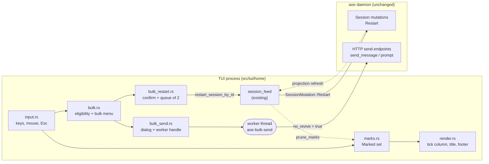
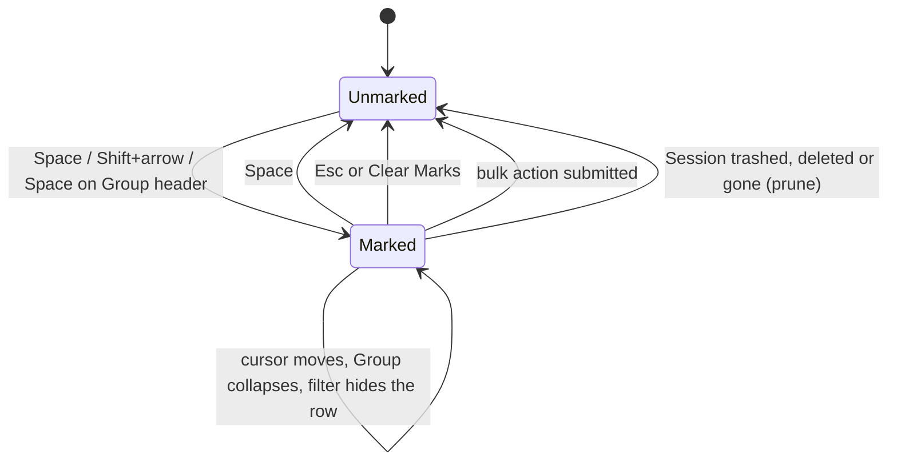
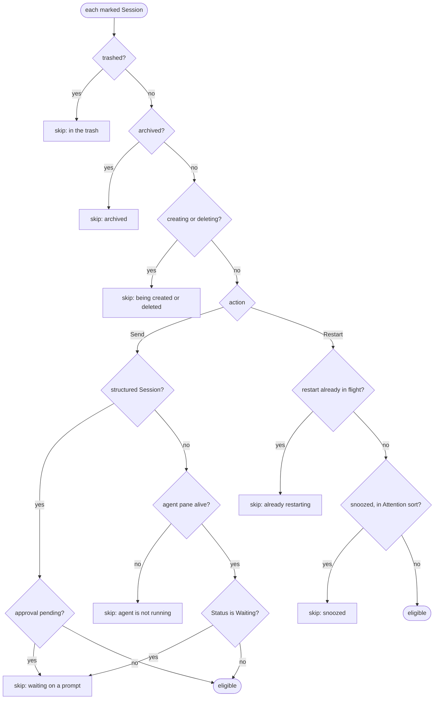
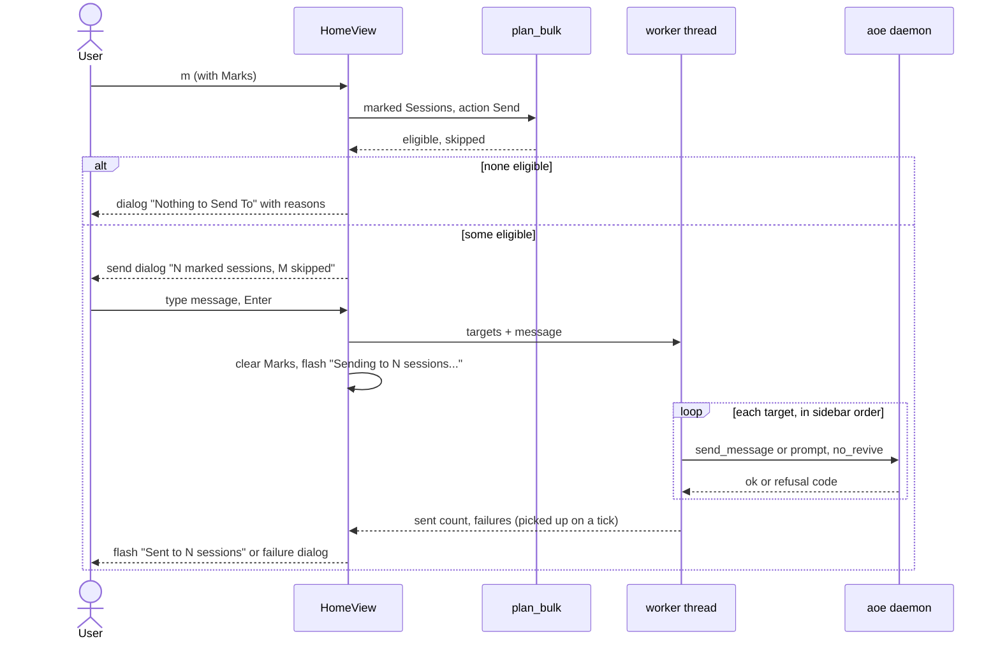
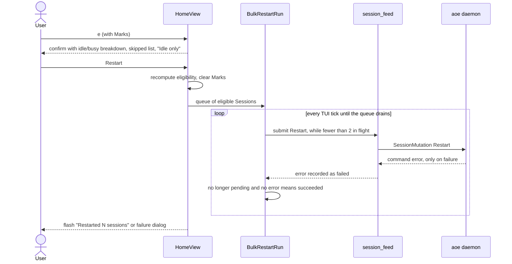
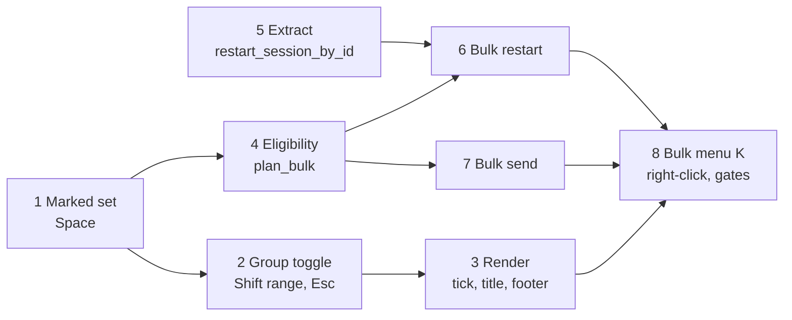

# Marks and Bulk Actions (Phase 1) Implementation Plan

> **For agentic workers:** REQUIRED SUB-SKILL: Use superpowers:subagent-driven-development (recommended) or superpowers:executing-plans to implement this plan task-by-task. Steps use checkbox (`- [ ]`) syntax for tracking.

**Goal:** Let the user arbitrarily mark several Sessions in the TUI sidebar (any rows, in any Group, contiguous or not), then send one message to all of them or restart all of them.

**Architecture:** A TUI-local Marked set on `HomeView` (`src/tui/home/marks.rs`). A pure eligibility function (`bulk.rs`) decides which marked Sessions an action may touch. Bulk restart loops the existing per-session restart through a two-at-a-time queue (`bulk_restart.rs`). Bulk send calls the daemon's send endpoints from a background worker (`bulk_send.rs`), because the TUI's interactive send path holds a single pending send tied to the cursor row.

**Tech Stack:** Rust, ratatui, crossterm, tokio (current-thread runtime inside a worker thread), the existing `crate::tui::worker::Worker`, `crate::acp::client::HttpClient`.

**Spec:** `docs/superpowers/specs/2026-11-19-marks-bulk-actions-breakout-design.md` (sections 1a, 1b, 1c and "Amendments"). Phase 2 (Breakout) has its own plan: `docs/superpowers/plans/2026-11-19-breakout-windows.md`.

## Overview

This section is for the human reviewer. It shows what the user sees and where the boundaries are. The tasks below are the instructions for the implementer.

### What the user gets

Today every sidebar action applies to one Session: the cursor row. This plan adds a second, independent idea, the **Mark**. A Mark is a tick on a Session row. The cursor still moves freely, and the set of ticked rows (the **Marked set**) stays put while it moves. Marks can be on any rows, in any Group, in any order.

Once at least one Session is marked, the two existing keys `m` (send message) and `e` (restart) act on the Marked set instead of the cursor row. With nothing marked they behave exactly as they do today. A new key `K` opens a small menu with the same two actions plus "what would be skipped" and "clear marks".

Marks live only in the running TUI. They are not saved, not sent to the daemon, and not shared with the web dashboard. Quitting aoe drops them.

### Keys

| Key | Nothing marked | One or more marked |
|-----|----------------|--------------------|
| `Space` on a Session row | Mark it | Toggle its Mark |
| `Space` on a Group header | Mark every shown Session in the Group | Same; if all are already marked, unmark them |
| `Shift+Up` / `Shift+Down` | Mark the cursor row, move, mark the row reached | Same (extends the run) |
| `Esc` | Unchanged | Clear all Marks (only after the three existing `Esc` uses have had their turn) |
| `m` | Send to the cursor row (unchanged) | Bulk send to the Marked set |
| `e` | Restart dialog for the cursor row (unchanged) | Bulk restart confirm for the Marked set |
| `K` or right-click on a marked row | Flash "No sessions marked" | Open the bulk menu |

`Shift+Up`/`Shift+Down` currently jump ten rows. That jump is removed; `PageUp`/`PageDown` already cover it.

### Wireframes

Sidebar with three Marks. The tick column appears on every row while anything is marked, so titles stay aligned, and disappears when the Marked set is empty. The title carries the count, the footer carries the hint.

```
┌ Sessions  3 marked ───────────────┐┌ Preview ───────────────────────────┐
│   ▾ api                           ││                                    │
│ ✓   ● fix-auth-timeout     [cc:p] ││  (preview of the cursor row,       │
│ ✓ ▸ ○ add-rate-limit       [cc:p] ││   unchanged by Marks)              │
│     ○ bump-deps            [cx:p] ││                                    │
│   ▾ web                           ││                                    │
│ ✓   ◐ dark-mode            [cc:p] ││                                    │
│     ○ a11y-audit           [cc:p] ││                                    │
│   ▸ infra (4)                     ││                                    │
└───────────────────────────────────┘└────────────────────────────────────┘
 Space mark  K bulk  Esc clear marks   …existing hints…
```

`▸` is the cursor. It is on a marked row here, but need not be.

A Mark can be on a row the sidebar is not showing (its Group is collapsed, or a filter hides it). The Mark is kept and counted:

```
┌ Sessions  3 marked (1 hidden) ────┐
│   ▾ api                           │
│ ✓   ● fix-auth-timeout     [cc:p] │
│ ✓ ▸ ○ add-rate-limit       [cc:p] │
│     ○ bump-deps            [cx:p] │
│   ▸ web (2)                       │
└───────────────────────────────────┘
```

Bulk menu (`K`, or right-click on a marked row):

```
┌───────────────────────────────┐
│ Send Message to Marked        │
│ Restart Marked                │
│ Show What Would Be Skipped    │
│ Clear Marks                   │
└───────────────────────────────┘
```

Bulk send (`m`). This is the existing send dialog; only the target label changes. Skipped Sessions are counted in the label and listed by "Show What Would Be Skipped".

```
┌ > 2 marked sessions, 1 skipped ───────────────────┐
│ rebase onto main and rerun the tests              │
│                                                   │
│                                                   │
└──────────────────────── (existing send hints) ────┘
```

Bulk restart (`e`). The existing confirm dialog, with a breakdown and one checkbox. The checkbox appears only when the set mixes idle and busy Sessions.

```
┌ Restart Marked Sessions ──────────────────────────┐
│ Restart 3 marked sessions?                        │
│                                                   │
│ 2 idle, 1 busy (running, waiting or starting)     │
│                                                   │
│ Each restarts with its current profile, agent     │
│ and arguments.                                    │
│                                                   │
│ Skipped:                                          │
│   old-spike: already restarting                   │
│                                                   │
│ [ ] Idle only (leave 1 busy running)              │
│                                                   │
│              [ Restart ]   [ Cancel ]             │
└───────────────────────────────────────────────────┘
```

Results. If everything worked, a one-line flash in the status bar ("Sent to 2 sessions", "Restarted 3 sessions"). If anything failed, a dialog that names each failure:

```
┌ Bulk Send ────────────────────────────────────────┐
│ Sent to 1 session. 1 did not get the message:     │
│                                                   │
│   dark-mode: not running                          │
│                                                   │
│                      [ OK ]                       │
└───────────────────────────────────────────────────┘
```

### Where the code sits

Everything new is inside the TUI home view. The daemon and its HTTP API are not changed; bulk send calls two endpoints the CLI already uses.



Two boundaries matter:

1. **Marks are view state.** Only `marks.rs` writes the set. Rendering reads it. A projection refresh from the daemon prunes Marks whose Session is gone, trashed or mid-deletion.
2. **Eligibility is a pure function.** `plan_bulk` takes a snapshot of facts about each marked Session and returns two lists, eligible and skipped-with-reason. The confirm text, the send label, the skip list and the actual run all come from that one function, so they cannot disagree.

### Life of a Mark



A bulk action clears the whole Marked set when it is submitted, not when it finishes. A Session in the trash, or one still being created or deleted, cannot be marked.

### Which marked Sessions an action touches



Send skips a Session that is waiting on a permission prompt because the typed text could answer the prompt. Send never starts a dead agent (`no_revive = true`); it reports it instead.

### Bulk send, step by step

The TUI's own send path holds a single pending send tied to the cursor row, so it cannot be looped. Bulk send goes around it: a one-shot worker thread calls the daemon's send endpoints, one Session after another, and the TUI stays responsive while it runs.



One failure does not stop the rest. Cancelling the dialog keeps the Marks.

### Bulk restart, step by step

Restart reuses the per-session restart the single-row `e` already performs, extracted into `restart_session_by_id` (Task 5). Each Session restarts with what it is already running: its own profile, agent and arguments. There is no options dialog in the bulk path. Restarts are staggered two at a time because each one spawns a harness and a launch.



The daemon gives no per-session "restart succeeded" signal. A restart counts as done when it has left the feed's pending set, and as failed only if a command error named it. Eligibility is recomputed when the user confirms, because Sessions can change while the dialog is open.

### Task order



Tasks 1 to 3 give a usable (if pointless) marking UI. Task 4 is staged and committed together with Task 6, its first caller. Tasks 6 and 7 are independent of each other.

### Decisions worth a second look

- `K` is the bulk menu key. The other free letters in both key modes are `J` and `Q`.
- With Marks, `e` skips the restart-options dialog (no per-run model or argument override). The single-row `e` keeps it.
- The ten-row `Shift+Up`/`Shift+Down` jump is removed.
- Marks clear when a bulk action is submitted, not when it completes.
- The confirm has two buttons and an "Idle only" checkbox, because the existing confirm dialog supports exactly that and no third button.

## Global Constraints

- Line numbers in this plan are as of commit `1d27dffc4`. Locate code by the quoted text, not the number.
- Never run `aoe`, `cargo test` or `cargo build` with the session's own environment. Create this wrapper once and prefix every cargo command with it:

  ```bash
  mkdir -p /tmp/aoe-sentinel/claude /tmp/aoe-sentinel/codex
  cat > /tmp/aoe-test-env.sh <<'EOF'
  #!/usr/bin/env bash
  exec env -u AOE_INSTANCE_ID -u AOE_HOOK_BIN -u AOE_PROFILE \
    CLAUDE_CONFIG_DIR=/tmp/aoe-sentinel/claude CODEX_HOME=/tmp/aoe-sentinel/codex "$@"
  EOF
  chmod +x /tmp/aoe-test-env.sh
  ```

- Never set `CARGO_TARGET_DIR` or `RUSTC_WRAPPER`, never run `cargo clean`, run cargo in the foreground.
- Every test must pass when run alone (CI uses `cargo nextest run`, one process per test). TUI home tests are `#[test] #[serial]`.
- No dead code and no `#[allow(dead_code)]`. Every commit must build without unused-item warnings; where a helper's first caller is in a later task, this plan says to stage it and commit the two together.
- Every new source file starts with a `//!` line. Comments are short and only for non-obvious reasons. No em dashes or `--` as prose separators in docs and comments.
- Use the glossary terms: Session, Mark, Marked set, Bulk action, Group, Status. "Selection" means the cursor row.
- The marker colour is the existing `theme.accent`. Do not add a theme colour.
- Commit messages: conventional commits, lowercase subject, for example `feat(tui): mark sessions in the sidebar`. End each with `Co-Authored-By: Claude Fable 5.2 <noreply@anthropic.com>`. The pre-commit hook runs `cargo fmt -- --check`, so run `cargo fmt` before committing.
- Do not hand-edit `CHANGELOG.md` or `docs/cli/reference.md`.
- Bulk restart: at most **2** restarts in flight. Bulk send passes `no_revive = true`.

## File Structure

| File | Responsibility |
|------|----------------|
| `src/tui/home/marks.rs` (new) | The Marked set: toggle, group toggle, range extension, clear, prune, view-order listing, title text |
| `src/tui/home/bulk.rs` (new) | `BulkAction`, `SkipReason`, `BulkCandidate`, `BulkPlan`, `plan_bulk`; building candidates from the Marked set; the bulk menu |
| `src/tui/home/bulk_restart.rs` (new) | Bulk restart confirm, the two-at-a-time queue, result tracking, summary |
| `src/tui/home/bulk_send.rs` (new) | Bulk send dialog, the background send worker, summary |
| `src/tui/home/tests/marks.rs` (new) | Tests for Marks |
| `src/tui/home/tests/bulk_actions.rs` (new) | Tests for bulk send and bulk restart through the home view |
| `src/tui/home/mod.rs` | New fields, `mod` lines |
| `src/tui/home/lifecycle.rs` | Field init, prune call |
| `src/tui/home/bindings.rs` | New `ActionId`s and bindings, `Space` label |
| `src/tui/home/input.rs` | Action dispatch, `Esc`, retargeting, confirm routing, send-dialog routing |
| `src/tui/home/operations.rs` | Extract `restart_session_by_id` |
| `src/tui/home/status.rs` | Feed command errors to the bulk restart tracker |
| `src/tui/home/render.rs`, `icons.rs` | Marker gutter, title count, footer hint |
| `src/tui/components/help.rs` | Navigation help text |
| `src/tui/dialogs/context_menu.rs`, `command_palette.rs` | Bulk menu, palette exemptions |
| `src/tui/app.rs` | Two new tick calls |
| `CONTEXT.md` | Glossary terms |

---

### Task 1: The Marked set and the `Space` toggle

**Files:**
- Create: `src/tui/home/marks.rs`, `src/tui/home/tests/marks.rs`
- Modify: `src/tui/home/mod.rs` (struct `HomeView` near line 455; `mod` list), `src/tui/home/lifecycle.rs` (struct literal near line 292; `refresh_projection_presentation` near line 589), `src/tui/home/bindings.rs`, `src/tui/home/input.rs` (`run_action` near line 3486), `src/tui/dialogs/command_palette.rs` (`PALETTE_EXEMPT` near line 616), `src/tui/home/tests/mod.rs` (module list near line 195), `CONTEXT.md`

**Interfaces:**
- Consumes: `HomeView::get_instance(&self, id: &str) -> Option<&Instance>`, `self.flat_items: Vec<Item>`, `self.cursor: usize`.
- Produces: field `HomeView::marked: std::collections::HashSet<String>`; `HomeView::markable(&self, id: &str) -> bool`; `toggle_mark_at_cursor(&mut self)`; `prune_marks(&mut self)`; `ActionId::ToggleMark`.

- [ ] **Step 1: Write the failing tests**

Create `src/tui/home/tests/marks.rs`:

```rust
//! Marks: toggling, Group headers, range extension, clearing and pruning.

use super::*;

fn space() -> KeyEvent {
    key(KeyCode::Char(' '))
}

fn put_cursor(env: &mut TestEnv, row: usize) {
    env.view.cursor = row;
    env.view.update_selected();
}

#[test]
#[serial]
fn space_toggles_the_mark_on_the_cursor_session() {
    let mut env = create_test_env_with_sessions(3);
    put_cursor(&mut env, 1);
    let id = session_id_at(&env.view, 1).unwrap();

    env.view.handle_key(space(), None);
    assert!(env.view.marked.contains(&id));
    assert_eq!(env.view.cursor, 1, "marking does not move the cursor");

    env.view.handle_key(space(), None);
    assert!(env.view.marked.is_empty());
}

#[test]
#[serial]
fn space_marks_in_strict_mode_too() {
    let mut env = create_test_env_with_sessions(2);
    env.view.strict_hotkeys = true;
    put_cursor(&mut env, 0);
    env.view.handle_key(space(), None);
    assert_eq!(env.view.marked.len(), 1);
}

#[test]
#[serial]
fn a_trashed_session_loses_its_mark_on_prune() {
    let mut env = create_test_env_with_sessions(2);
    put_cursor(&mut env, 0);
    env.view.handle_key(space(), None);
    let id = session_id_at(&env.view, 0).unwrap();

    env.view
        .mutate_instance(&id, |inst| inst.trashed_at = Some(chrono::Utc::now()));
    env.view.prune_marks();
    assert!(env.view.marked.is_empty());
}

#[test]
#[serial]
fn a_mark_on_a_vanished_session_is_pruned() {
    let mut env = create_test_env_with_sessions(1);
    env.view.marked.insert("no-such-session".to_string());
    env.view.prune_marks();
    assert!(env.view.marked.is_empty());
}
```

Register it in `src/tui/home/tests/mod.rs`, in the alphabetical `mod` list (after `mod keys_and_nav;` or wherever `marks` sorts):

```rust
mod marks;
```

If `trashed_at` is not the field name on `Instance`, find the setter the Trash tests use (`grep -n "trashed_at\|fn trash" src/session/instance/*.rs`) and use it.

- [ ] **Step 2: Run the tests to verify they fail**

Run: `/tmp/aoe-test-env.sh cargo test --lib tui::home::tests::marks`
Expected: compile error, `no field 'marked' on type 'HomeView'`.

- [ ] **Step 3: Add the field**

In `src/tui/home/mod.rs`, next to `restart_in_flight`:

```rust
    /// Sessions carrying a Mark. Local to this TUI; never persisted.
    pub(super) marked: std::collections::HashSet<String>,
```

In the same file's `mod` list add `mod marks;`.

In `src/tui/home/lifecycle.rs`, in the `Self { ... }` literal next to `restart_in_flight: std::collections::HashSet::new(),`:

```rust
            marked: std::collections::HashSet::new(),
```

- [ ] **Step 4: Write `marks.rs`**

Create `src/tui/home/marks.rs`:

```rust
//! The Marked set: transient Marks on sidebar Sessions, the target of Bulk actions.

use super::*;

impl HomeView {
    /// Whether a Mark may sit on this Session.
    pub(super) fn markable(&self, id: &str) -> bool {
        self.get_instance(id).is_some_and(|inst| {
            !inst.is_trashed() && !matches!(inst.status, Status::Creating | Status::Deleting)
        })
    }

    /// Toggle the Mark on the cursor row's Session.
    pub(super) fn toggle_mark_at_cursor(&mut self) {
        let Some(Item::Session { id, .. }) = self.flat_items.get(self.cursor) else {
            return;
        };
        let id = id.clone();
        if !self.marked.remove(&id) && self.markable(&id) {
            self.marked.insert(id);
        }
    }

    /// Drop Marks whose Session is gone, trashed or mid-deletion.
    pub(super) fn prune_marks(&mut self) {
        if self.marked.is_empty() {
            return;
        }
        let keep: std::collections::HashSet<String> = self
            .marked
            .iter()
            .filter(|id| self.markable(id))
            .cloned()
            .collect();
        self.marked = keep;
    }
}
```

- [ ] **Step 5: Prune on every projection refresh**

In `src/tui/home/lifecycle.rs`, in `refresh_projection_presentation`, directly before `self.rebuild_flat_items_keeping_cursor();`:

```rust
        self.prune_marks();
```

- [ ] **Step 6: Add the action and its binding**

In `src/tui/home/bindings.rs`:

1. Add to `enum ActionId` (near the other row actions):

   ```rust
       /// Toggle the Mark on the cursor row (a Group header toggles all its Sessions).
       ToggleMark,
   ```

2. Add to `BINDINGS`, next to the `SendMessage` entry:

   ```rust
       Binding {
           id: ActionId::ToggleMark,
           non_strict: &[k(' ')],
           strict: &[k(' ')],
           context: Context::Always,
           help: Some(HelpMeta {
               section: HelpSection::Actions,
               desc: "Mark or unmark for bulk actions",
           }),
           palette: None,
       },
   ```

3. Add an arm to `palette_id`:

   ```rust
           ActionId::ToggleMark => "toggle-mark",
   ```

4. In `format_chord`, before the existing `match`, so the help overlay shows a readable label:

   ```rust
       if c.code == KeyCode::Char(' ') && !c.ctrl && !c.alt {
           return "Space".to_string();
       }
   ```

In `src/tui/dialogs/command_palette.rs`, add to `PALETTE_EXEMPT`:

```rust
        (ActionId::ToggleMark, "acts on the cursor row, which the palette covers"),
```

- [ ] **Step 7: Dispatch the action**

In `src/tui/home/input.rs`, in `run_action`'s `match id`, next to the `ActionId::SendMessage` arm:

```rust
            ActionId::ToggleMark => self.toggle_mark_at_cursor(),
```

If the neighbouring arms are blocks that end in `None`, write it as `ActionId::ToggleMark => { self.toggle_mark_at_cursor(); None }` to match.

- [ ] **Step 8: Run the tests**

Run: `/tmp/aoe-test-env.sh cargo test --lib tui::home::tests::marks`
Expected: 4 passed.

Run: `/tmp/aoe-test-env.sh cargo test --lib tui::home::bindings`
Run: `/tmp/aoe-test-env.sh cargo test --lib tui::dialogs::command_palette`
Expected: all pass (these enforce unique kebab-case ids, palette coverage and help-row rules).

- [ ] **Step 9: Add the glossary terms**

In `CONTEXT.md`, under `### Sessions`, after the **Unread** entry:

```markdown
**Mark**:
A transient flag the user puts on a Session in the sidebar so a Bulk action can target it. Local to one TUI and never saved.
_Avoid_: select, selection (that is the cursor row)

**Marked set**:
Every Session currently carrying a Mark.

**Bulk action**:
An action applied to every eligible Session in the Marked set, such as sending one message or restarting.
```

- [ ] **Step 10: Commit**

```bash
cargo fmt
git add src/tui/home/marks.rs src/tui/home/tests/marks.rs src/tui/home/tests/mod.rs src/tui/home/mod.rs src/tui/home/lifecycle.rs src/tui/home/bindings.rs src/tui/home/input.rs src/tui/dialogs/command_palette.rs CONTEXT.md
git commit -m "feat(tui): mark sessions in the sidebar with space

Co-Authored-By: Claude Fable 5.2 <noreply@anthropic.com>"
```

---

### Task 2: Group-header toggle, range extension and `Esc`

**Files:**
- Modify: `src/tui/home/marks.rs`, `src/tui/home/bindings.rs`, `src/tui/home/input.rs` (`dispatch_action_key` near lines 3262-3316, `run_action` preamble near 3486-3541), `src/tui/components/help.rs` (near line 115), `src/tui/dialogs/command_palette.rs`
- Test: `src/tui/home/tests/marks.rs`

**Interfaces:**
- Consumes: `marked`, `markable`, `toggle_mark_at_cursor` from Task 1; `HomeView::shown_session_ids(&self) -> Vec<String>` (`highlight_ops.rs:26`); `HomeView::active_sessions_in_selected_group(&self) -> Vec<String>` (`operations.rs:1082`); `HomeView::move_cursor(&mut self, delta: i32)`.
- Produces: `HomeView::extend_marks(&mut self, delta: i32)`; `HomeView::clear_marks(&mut self) -> bool`; `ActionId::ExtendMarkUp`, `ActionId::ExtendMarkDown`, `ActionId::ClearMarks`.

- [ ] **Step 1: Write the failing tests**

Append to `src/tui/home/tests/marks.rs`:

```rust
fn shift(code: KeyCode) -> KeyEvent {
    KeyEvent::new(code, KeyModifiers::SHIFT)
}

fn group_row(env: &TestEnv, group: &str) -> usize {
    env.view
        .flat_items
        .iter()
        .position(|item| matches!(item, Item::Group { path, .. } if path == group))
        .expect("group header row")
}

#[test]
#[serial]
fn space_on_a_group_header_marks_then_unmarks_its_sessions() {
    // ungrouped sessions, 2 in "work", 1 in "work/projects"
    let mut env = create_test_env_with_group_sessions();
    let row = group_row(&env, "work");
    put_cursor(&mut env, row);

    env.view.handle_key(space(), None);
    assert_eq!(env.view.marked.len(), 3, "nested group sessions are included");

    env.view.handle_key(space(), None);
    assert!(env.view.marked.is_empty(), "all marked, so the header unmarks");
}

#[test]
#[serial]
fn a_partly_marked_group_becomes_fully_marked() {
    let mut env = create_test_env_with_group_sessions();
    let row = group_row(&env, "work");
    put_cursor(&mut env, row + 1);
    env.view.handle_key(space(), None);
    assert_eq!(env.view.marked.len(), 1);

    put_cursor(&mut env, row);
    env.view.handle_key(space(), None);
    assert_eq!(env.view.marked.len(), 3);
}

#[test]
#[serial]
fn shift_arrows_extend_marks_one_row_at_a_time() {
    let mut env = create_test_env_with_sessions(5);
    put_cursor(&mut env, 1);

    env.view.handle_key(shift(KeyCode::Down), None);
    env.view.handle_key(shift(KeyCode::Down), None);
    assert_eq!(env.view.cursor, 3, "moves one row per press, not ten");
    let expected: std::collections::HashSet<String> = (1..=3)
        .map(|row| session_id_at(&env.view, row).unwrap())
        .collect();
    assert_eq!(env.view.marked, expected);

    env.view.handle_key(shift(KeyCode::Up), None);
    assert_eq!(env.view.cursor, 2);
    assert_eq!(env.view.marked, expected, "extending back keeps existing marks");
}

#[test]
#[serial]
fn esc_clears_marks_only_after_the_search_is_cleared() {
    let mut env = create_test_env_with_sessions(3);
    put_cursor(&mut env, 0);
    env.view.handle_key(space(), None);
    env.view.search_query = tui_input::Input::new("zzz".to_string());

    env.view.handle_key(key(KeyCode::Esc), None);
    assert!(env.view.search_query.value().is_empty());
    assert_eq!(env.view.marked.len(), 1, "first Esc clears the committed search");

    env.view.handle_key(key(KeyCode::Esc), None);
    assert!(env.view.marked.is_empty(), "second Esc clears the marks");
}
```

If `search_query` is not a `tui_input::Input`, build it the way `tests/search.rs` does.

- [ ] **Step 2: Run to verify they fail**

Run: `/tmp/aoe-test-env.sh cargo test --lib tui::home::tests::marks`
Expected: the four new tests fail (group header marks 0, Shift+Down moves the cursor to row 4 by a ten-row jump clamp, Esc leaves the mark).

- [ ] **Step 3: Group toggle and range extension in `marks.rs`**

Replace `toggle_mark_at_cursor` and add the helpers:

```rust
    /// Toggle the Mark on the cursor row. On a Group header, mark every Session the
    /// Group shows, or unmark them when all are already marked.
    pub(super) fn toggle_mark_at_cursor(&mut self) {
        match self.flat_items.get(self.cursor) {
            Some(Item::Session { id, .. }) => {
                let id = id.clone();
                if !self.marked.remove(&id) && self.markable(&id) {
                    self.marked.insert(id);
                }
            }
            Some(Item::Group { .. }) => self.toggle_group_marks(),
            None => {}
        }
    }

    /// Collapsed children are absent from `flat_items`, so membership comes from the
    /// Group helper, narrowed to what the active filters show.
    fn toggle_group_marks(&mut self) {
        let shown: std::collections::HashSet<String> =
            self.shown_session_ids().into_iter().collect();
        let members: Vec<String> = self
            .active_sessions_in_selected_group()
            .into_iter()
            .filter(|id| shown.contains(id) && self.markable(id))
            .collect();
        if members.is_empty() {
            return;
        }
        if members.iter().all(|id| self.marked.contains(id)) {
            for id in &members {
                self.marked.remove(id);
            }
        } else {
            self.marked.extend(members);
        }
    }

    /// Drop every Mark. Returns whether there were any.
    pub(super) fn clear_marks(&mut self) -> bool {
        let had = !self.marked.is_empty();
        self.marked.clear();
        had
    }

    /// Mark the cursor row, step the cursor, and mark the row reached.
    pub(super) fn extend_marks(&mut self, delta: i32) {
        self.mark_cursor_session();
        self.move_cursor(delta);
        self.mark_cursor_session();
    }

    fn mark_cursor_session(&mut self) {
        if let Some(Item::Session { id, .. }) = self.flat_items.get(self.cursor) {
            let id = id.clone();
            if self.markable(&id) {
                self.marked.insert(id);
            }
        }
    }
```

- [ ] **Step 4: Bindings**

In `src/tui/home/bindings.rs`, add to `enum ActionId`:

```rust
    /// Mark the cursor row and the row above it, moving the cursor up.
    ExtendMarkUp,
    /// Mark the cursor row and the row below it, moving the cursor down.
    ExtendMarkDown,
    /// Drop every Mark (palette and `Esc`; no chord of its own).
    ClearMarks,
```

Add to `BINDINGS` after the `ToggleMark` entry:

```rust
    Binding {
        id: ActionId::ExtendMarkUp,
        non_strict: &[shift_code(KeyCode::Up)],
        strict: &[shift_code(KeyCode::Up)],
        context: Context::Always,
        help: Some(HelpMeta {
            section: HelpSection::Actions,
            desc: "Extend marks upward",
        }),
        palette: None,
    },
    Binding {
        id: ActionId::ExtendMarkDown,
        non_strict: &[shift_code(KeyCode::Down)],
        strict: &[shift_code(KeyCode::Down)],
        context: Context::Always,
        help: Some(HelpMeta {
            section: HelpSection::Actions,
            desc: "Extend marks downward",
        }),
        palette: None,
    },
    Binding {
        id: ActionId::ClearMarks,
        non_strict: &[],
        strict: &[],
        context: Context::Always,
        help: None,
        palette: Some(PaletteMeta {
            title: "Clear marks",
            keywords: &["unmark", "deselect", "bulk"],
            group: PaletteGroup::Actions,
        }),
    },
```

Add to `palette_id`:

```rust
        ActionId::ExtendMarkUp => "extend-mark-up",
        ActionId::ExtendMarkDown => "extend-mark-down",
        ActionId::ClearMarks => "clear-marks",
```

Add to `PALETTE_EXEMPT` in `command_palette.rs`:

```rust
        (ActionId::ExtendMarkUp, "a cursor movement, not a command"),
        (ActionId::ExtendMarkDown, "a cursor movement, not a command"),
```

- [ ] **Step 5: Dispatch, trashed-row allowlist, dead arms, `Esc`**

In `src/tui/home/input.rs`:

1. `run_action` arms:

   ```rust
               ActionId::ExtendMarkUp => self.extend_marks(-1),
               ActionId::ExtendMarkDown => self.extend_marks(1),
               ActionId::ClearMarks => {
                   if !self.clear_marks() {
                       self.flash_status("No sessions marked");
                   }
               }
   ```

2. In `run_action`'s preamble there is a `matches!` allowlist of actions that still run when `selected_is_trashed()`. Add `ActionId::ExtendMarkUp | ActionId::ExtendMarkDown | ActionId::ClearMarks` to it, so the cursor can still move through the Trash shelf with Shift held. `markable` keeps trashed rows unmarked.

3. In `dispatch_action_key`'s navigation `match`, delete these two arms. The registry now resolves Shift+Up/Down first, so they are dead:

   ```rust
               KeyCode::Up if key.modifiers.contains(KeyModifiers::SHIFT) => self.move_cursor(-10),
               KeyCode::Down if key.modifiers.contains(KeyModifiers::SHIFT) => self.move_cursor(10),
   ```

4. In `dispatch_action_key`'s `Esc` match, add a fourth arm **after** the `ViewMode::Tool(_)` arm and before `_ => {}`:

   ```rust
               KeyCode::Esc if !self.marked.is_empty() => {
                   self.marked.clear();
                   return None;
               }
   ```

- [ ] **Step 6: Fix the navigation help text**

In `src/tui/components/help.rs` (near line 115) the row reads `("PgUp/Dn", "Move 10 (also Shift+\u{2191}/\u{2193}, { })")`. Change the description to:

```rust
"Move 10 (also { })"
```

- [ ] **Step 7: Run the tests**

Run: `/tmp/aoe-test-env.sh cargo test --lib tui::home::tests::marks`
Expected: 8 passed.

Run: `/tmp/aoe-test-env.sh cargo test --lib tui::home::bindings`
Run: `/tmp/aoe-test-env.sh cargo test --lib tui::home::tests::keys_and_nav`
Run: `/tmp/aoe-test-env.sh cargo test --lib tui::components::help`
Expected: all pass. If `shared_help_chords_document_their_guard` fails, a help row shares a label with another; reword the new `desc`, do not change the test.

- [ ] **Step 8: Commit**

```bash
cargo fmt
git add src/tui/home/marks.rs src/tui/home/bindings.rs src/tui/home/input.rs src/tui/components/help.rs src/tui/dialogs/command_palette.rs src/tui/home/tests/marks.rs
git commit -m "feat(tui): mark whole groups, extend marks with shift-arrows, clear with esc

Co-Authored-By: Claude Fable 5.2 <noreply@anthropic.com>"
```

---

### Task 3: Show Marks in the sidebar

**Files:**
- Modify: `src/tui/home/icons.rs`, `src/tui/home/render.rs` (`render_item_line` near lines 1992 and 2190-2208; list title near line 1637; `render_status_bar` near lines 4870 and 4960), `src/tui/home/marks.rs`
- Test: `src/tui/home/tests/marks.rs`

**Interfaces:**
- Consumes: `marked`.
- Produces: `ICON_MARK: &str`; `HomeView::marks_title(&self) -> Option<String>`.

- [ ] **Step 1: Write the failing tests**

Append to `src/tui/home/tests/marks.rs`:

```rust
#[test]
#[serial]
fn a_marked_row_shows_the_marker_and_others_stay_aligned() {
    let mut env = create_test_env_with_sessions(2);
    put_cursor(&mut env, 0);
    let unmarked_before = rendered_row_text(&env.view, &env.view.flat_items[1].clone());

    env.view.handle_key(space(), None);
    let marked = rendered_row_text(&env.view, &env.view.flat_items[0].clone());
    let unmarked = rendered_row_text(&env.view, &env.view.flat_items[1].clone());

    assert!(marked.starts_with(crate::tui::home::icons::ICON_MARK));
    assert_eq!(
        unmarked,
        format!("  {unmarked_before}"),
        "unmarked rows are padded by the marker column"
    );
}

#[test]
#[serial]
fn the_sidebar_title_counts_marks_and_hidden_marks() {
    let mut env = create_test_env_with_group_sessions();
    let row = group_row(&env, "work");
    put_cursor(&mut env, row);
    env.view.handle_key(space(), None);
    assert_eq!(env.view.marks_title().as_deref(), Some("3 marked"));
    assert!(render_home_to_string(&mut env.view, 120, 40).contains("3 marked"));

    // Collapse "work": its sessions leave the list but stay marked.
    env.view.handle_key(key(KeyCode::Left), None);
    assert_eq!(
        env.view.marks_title().as_deref(),
        Some("3 marked (3 hidden)")
    );
}

#[test]
#[serial]
fn no_marks_means_no_title_text() {
    let env = create_test_env_with_sessions(1);
    assert_eq!(env.view.marks_title(), None);
}
```

If `Left` does not collapse a Group header in this harness, use the key the existing collapse tests use (`grep -n "collapsed" src/tui/home/tests/pickers_groups_sort.rs | head`). If `render_home_to_string` takes `&HomeView`, drop the `mut`.

- [ ] **Step 2: Run to verify they fail**

Run: `/tmp/aoe-test-env.sh cargo test --lib tui::home::tests::marks`
Expected: compile error, `ICON_MARK` and `marks_title` not found.

- [ ] **Step 3: Icon and title text**

In `src/tui/home/icons.rs`:

```rust
/// Marker for a Session in the Marked set. Single-width, like every sidebar glyph.
pub const ICON_MARK: &str = "\u{2713}";
```

In `src/tui/home/marks.rs`, inside the `impl`:

```rust
    /// Sidebar title text for the Marked set, or `None` when nothing is marked.
    pub(super) fn marks_title(&self) -> Option<String> {
        if self.marked.is_empty() {
            return None;
        }
        let visible = self
            .flat_items
            .iter()
            .filter(|item| matches!(item, Item::Session { id, .. } if self.marked.contains(id)))
            .count();
        let total = self.marked.len();
        let hidden = total - visible;
        Some(if hidden == 0 {
            format!("{total} marked")
        } else {
            format!("{total} marked ({hidden} hidden)")
        })
    }
```

- [ ] **Step 4: Marker column in `render_item_line`**

In `src/tui/home/render.rs`, in `render_item_line`, directly after `let mut line_spans = Vec::with_capacity(6);` and before the `if favorite_gutter {` block:

```rust
        // The column exists on every row while anything is marked, so titles stay aligned.
        if !self.marked.is_empty() {
            let marked = matches!(item, Item::Session { id, .. } if self.marked.contains(id));
            line_spans.push(if marked {
                let mark_style = Style::default().fg(theme.accent).bold();
                Span::styled(
                    format!("{ICON_MARK} "),
                    if is_selected {
                        selected_row_style(mark_style, theme)
                    } else {
                        mark_style
                    },
                )
            } else {
                Span::raw("  ")
            });
        }
```

Import `ICON_MARK` the same way `ICON_FAVORITE` is imported in that file. Bump the `Vec::with_capacity(6)` to `7`. If the function computes a title width budget that subtracts the favorite gutter (search the function for `favorite_gutter`), subtract 2 more when `!self.marked.is_empty()` in the same place.

- [ ] **Step 5: Title count**

In `render.rs`, in the sidebar list title code, directly after the `if !self.legacy_duplicate_reports.is_empty() { ... }` block:

```rust
        if let Some(marks) = self.marks_title() {
            title.push_str(&format!("  {marks}"));
        }
```

- [ ] **Step 6: Footer hint**

In `render_status_bar`, next to the committed-search hint (`if committed_search { ... groups.push((0, kc('n'), hint)); }`), add:

```rust
        if !self.marked.is_empty() {
            let hint = vec![
                Span::styled("Space", key_style),
                Span::styled(" mark ", desc_style),
                Span::styled("Esc", key_style),
                Span::styled(" clear marks", desc_style),
            ];
            groups.push((0, None, hint));
        }
```

Add the same block in the trashed-selection branch of that function (near line 4960), which builds its own `groups`.

- [ ] **Step 7: Run the tests**

Run: `/tmp/aoe-test-env.sh cargo test --lib tui::home::tests::marks`
Expected: 11 passed.

Run: `/tmp/aoe-test-env.sh cargo test --lib tui::home::tests::footer_toolbar`
Expected: pass (no marks in those tests, so the footer is unchanged).

- [ ] **Step 8: Commit**

```bash
cargo fmt
git add src/tui/home/icons.rs src/tui/home/render.rs src/tui/home/marks.rs src/tui/home/tests/marks.rs
git commit -m "feat(tui): show marks in the sidebar gutter, title and footer

Co-Authored-By: Claude Fable 5.2 <noreply@anthropic.com>"
```

---

### Task 4: Bulk eligibility

**Files:**
- Create: `src/tui/home/bulk.rs`
- Modify: `src/tui/home/mod.rs` (`mod bulk;`)
- Test: in-module `#[cfg(test)] mod tests` in `bulk.rs` (pure logic)

**Interfaces:**
- Consumes: `marked` from Task 1; `Instance` fields `status`, `title`, `agent_pane.state`; `Instance::is_trashed/is_archived/is_snoozed/is_structured`; `HomeView::structured_pending_approvals: HashMap<String, Vec<PendingApproval>>`; `HomeView::restart_in_flight`.
- Produces:

  ```rust
  pub(super) enum BulkAction { Send, Restart }
  pub(super) enum SkipReason { Trashed, Archived, Transient, NoAgentPane, AwaitingPermission, RestartInFlight, Snoozed }
  impl SkipReason { pub(super) fn label(self) -> &'static str }
  pub(super) struct BulkCandidate { pub id: String, pub title: String, pub status: Status, pub trashed: bool, pub archived: bool, pub snoozed: bool, pub structured: bool, pub pane_alive: bool, pub awaiting_approval: bool, pub restart_in_flight: bool }
  impl BulkCandidate { pub(super) fn is_busy(&self) -> bool }
  pub(super) struct BulkPlan { pub eligible: Vec<BulkCandidate>, pub skipped: Vec<(BulkCandidate, SkipReason)> }
  impl BulkPlan { pub(super) fn skipped_lines(&self) -> String }
  pub(super) fn plan_bulk(action: BulkAction, candidates: Vec<BulkCandidate>, attention_sort: bool) -> BulkPlan
  impl HomeView { pub(super) fn marked_in_view_order(&self) -> Vec<String>; pub(super) fn bulk_plan(&self, action: BulkAction) -> BulkPlan }
  ```

- [ ] **Step 1: Write the file with failing tests first**

Create `src/tui/home/bulk.rs` with only the types, a `plan_bulk` that returns everything as eligible, and the tests:

```rust
//! Bulk actions on the Marked set: which marked Sessions an action may touch, and why not.

use super::*;

#[derive(Debug, Clone, Copy, PartialEq, Eq)]
pub(super) enum BulkAction {
    Send,
    Restart,
}

#[derive(Debug, Clone, Copy, PartialEq, Eq)]
pub(super) enum SkipReason {
    Trashed,
    Archived,
    Transient,
    NoAgentPane,
    AwaitingPermission,
    RestartInFlight,
    Snoozed,
}

impl SkipReason {
    pub(super) fn label(self) -> &'static str {
        match self {
            Self::Trashed => "in the trash",
            Self::Archived => "archived",
            Self::Transient => "being created or deleted",
            Self::NoAgentPane => "agent is not running",
            Self::AwaitingPermission => "waiting on a prompt",
            Self::RestartInFlight => "already restarting",
            Self::Snoozed => "snoozed",
        }
    }
}

/// The facts eligibility needs about one marked Session, captured so the rule is pure.
#[derive(Debug, Clone)]
pub(super) struct BulkCandidate {
    pub id: String,
    pub title: String,
    pub status: Status,
    pub trashed: bool,
    pub archived: bool,
    pub snoozed: bool,
    pub structured: bool,
    pub pane_alive: bool,
    pub awaiting_approval: bool,
    pub restart_in_flight: bool,
}

impl BulkCandidate {
    /// Mid-work: a restart would interrupt it.
    pub(super) fn is_busy(&self) -> bool {
        matches!(
            self.status,
            Status::Running | Status::Waiting | Status::Starting
        )
    }
}

pub(super) struct BulkPlan {
    pub eligible: Vec<BulkCandidate>,
    pub skipped: Vec<(BulkCandidate, SkipReason)>,
}

impl BulkPlan {
    /// One `title: reason` line per skipped Session.
    pub(super) fn skipped_lines(&self) -> String {
        self.skipped
            .iter()
            .map(|(candidate, reason)| format!("  {}: {}", candidate.title, reason.label()))
            .collect::<Vec<_>>()
            .join("\n")
    }
}

pub(super) fn plan_bulk(
    _action: BulkAction,
    candidates: Vec<BulkCandidate>,
    _attention_sort: bool,
) -> BulkPlan {
    BulkPlan {
        eligible: candidates,
        skipped: Vec::new(),
    }
}

#[cfg(test)]
mod tests {
    use super::*;

    fn candidate(title: &str) -> BulkCandidate {
        BulkCandidate {
            id: title.to_string(),
            title: title.to_string(),
            status: Status::Idle,
            trashed: false,
            archived: false,
            snoozed: false,
            structured: false,
            pane_alive: true,
            awaiting_approval: false,
            restart_in_flight: false,
        }
    }

    fn reason_for(
        action: BulkAction,
        attention: bool,
        edit: impl FnOnce(&mut BulkCandidate),
    ) -> Option<SkipReason> {
        let mut c = candidate("s");
        edit(&mut c);
        let plan = plan_bulk(action, vec![c], attention);
        plan.skipped.first().map(|(_, reason)| *reason)
    }

    #[test]
    fn send_eligibility() {
        use BulkAction::Send;
        assert_eq!(reason_for(Send, false, |_| {}), None);
        assert_eq!(
            reason_for(Send, false, |c| c.trashed = true),
            Some(SkipReason::Trashed)
        );
        assert_eq!(
            reason_for(Send, false, |c| c.archived = true),
            Some(SkipReason::Archived)
        );
        assert_eq!(
            reason_for(Send, false, |c| c.status = Status::Creating),
            Some(SkipReason::Transient)
        );
        assert_eq!(
            reason_for(Send, false, |c| c.pane_alive = false),
            Some(SkipReason::NoAgentPane)
        );
        assert_eq!(
            reason_for(Send, false, |c| c.status = Status::Waiting),
            Some(SkipReason::AwaitingPermission)
        );
        // A structured Session has no agent pane; only a pending approval blocks it.
        assert_eq!(
            reason_for(Send, false, |c| {
                c.structured = true;
                c.pane_alive = false;
            }),
            None
        );
        assert_eq!(
            reason_for(Send, false, |c| {
                c.structured = true;
                c.awaiting_approval = true;
            }),
            Some(SkipReason::AwaitingPermission)
        );
        // A running Session takes the message as queued input.
        assert_eq!(reason_for(Send, false, |c| c.status = Status::Running), None);
    }

    #[test]
    fn restart_eligibility() {
        use BulkAction::Restart;
        assert_eq!(reason_for(Restart, false, |_| {}), None);
        assert_eq!(
            reason_for(Restart, false, |c| c.pane_alive = false),
            None,
            "a stopped Session can be restarted"
        );
        assert_eq!(
            reason_for(Restart, false, |c| c.status = Status::Deleting),
            Some(SkipReason::Transient)
        );
        assert_eq!(
            reason_for(Restart, false, |c| c.restart_in_flight = true),
            Some(SkipReason::RestartInFlight)
        );
        assert_eq!(
            reason_for(Restart, true, |c| c.snoozed = true),
            Some(SkipReason::Snoozed),
            "matches the single restart under Attention sort"
        );
        assert_eq!(reason_for(Restart, false, |c| c.snoozed = true), None);
        assert_eq!(
            reason_for(Restart, false, |c| c.archived = true),
            Some(SkipReason::Archived)
        );
    }

    #[test]
    fn plan_keeps_order_and_splits() {
        let mut dead = candidate("b");
        dead.pane_alive = false;
        let plan = plan_bulk(
            BulkAction::Send,
            vec![candidate("a"), dead, candidate("c")],
            false,
        );
        let titles: Vec<&str> = plan.eligible.iter().map(|c| c.title.as_str()).collect();
        assert_eq!(titles, ["a", "c"]);
        assert_eq!(plan.skipped_lines(), "  b: agent is not running");
    }
}
```

Add `mod bulk;` to `src/tui/home/mod.rs`.

- [ ] **Step 2: Run to verify the tests fail**

Run: `/tmp/aoe-test-env.sh cargo test --lib tui::home::bulk`
Expected: `send_eligibility`, `restart_eligibility` and `plan_keeps_order_and_splits` fail on the first non-`None` assertion.

- [ ] **Step 3: Implement the rule and the candidate builder**

Replace the stub `plan_bulk` and add `skip_reason` and the `HomeView` glue:

```rust
pub(super) fn plan_bulk(
    action: BulkAction,
    candidates: Vec<BulkCandidate>,
    attention_sort: bool,
) -> BulkPlan {
    let mut plan = BulkPlan {
        eligible: Vec::new(),
        skipped: Vec::new(),
    };
    for candidate in candidates {
        match skip_reason(action, &candidate, attention_sort) {
            Some(reason) => plan.skipped.push((candidate, reason)),
            None => plan.eligible.push(candidate),
        }
    }
    plan
}

fn skip_reason(action: BulkAction, c: &BulkCandidate, attention_sort: bool) -> Option<SkipReason> {
    if c.trashed {
        return Some(SkipReason::Trashed);
    }
    if c.archived {
        return Some(SkipReason::Archived);
    }
    if matches!(c.status, Status::Creating | Status::Deleting) {
        return Some(SkipReason::Transient);
    }
    match action {
        BulkAction::Send if c.structured => c
            .awaiting_approval
            .then_some(SkipReason::AwaitingPermission),
        BulkAction::Send if !c.pane_alive => Some(SkipReason::NoAgentPane),
        // Text typed at a permission prompt could answer it.
        BulkAction::Send => (c.status == Status::Waiting).then_some(SkipReason::AwaitingPermission),
        BulkAction::Restart if c.restart_in_flight => Some(SkipReason::RestartInFlight),
        BulkAction::Restart => (c.snoozed && attention_sort).then_some(SkipReason::Snoozed),
    }
}

impl HomeView {
    /// Marked Sessions in sidebar order, then any the sidebar does not show, by title.
    pub(super) fn marked_in_view_order(&self) -> Vec<String> {
        let mut ordered: Vec<String> = self
            .flat_items
            .iter()
            .filter_map(|item| match item {
                Item::Session { id, .. } if self.marked.contains(id) => Some(id.clone()),
                _ => None,
            })
            .collect();
        let mut hidden: Vec<&String> = self
            .marked
            .iter()
            .filter(|id| !ordered.contains(id))
            .collect();
        hidden.sort_by_key(|id| self.get_instance(id).map(|inst| inst.title.clone()));
        ordered.extend(hidden.into_iter().cloned());
        ordered
    }

    /// Split the Marked set into the Sessions `action` may touch and the rest.
    pub(super) fn bulk_plan(&self, action: BulkAction) -> BulkPlan {
        let candidates = self
            .marked_in_view_order()
            .into_iter()
            .filter_map(|id| {
                let inst = self.get_instance(&id)?;
                Some(BulkCandidate {
                    title: inst.title.clone(),
                    status: inst.status,
                    trashed: inst.is_trashed(),
                    archived: inst.is_archived(),
                    snoozed: inst.is_snoozed(),
                    structured: inst.is_structured(),
                    pane_alive: inst.agent_pane.state == crate::session::PanePresence::Alive,
                    awaiting_approval: self
                        .structured_pending_approvals
                        .get(&id)
                        .is_some_and(|pending| !pending.is_empty()),
                    restart_in_flight: self.restart_in_flight.contains(&id),
                    id,
                })
            })
            .collect();
        plan_bulk(
            action,
            candidates,
            self.sort_order == crate::session::config::SortOrder::Attention,
        )
    }
}
```

If `Status` is not `Copy`, clone it.

`bulk_plan` and `marked_in_view_order` get their first callers in Task 6, and the repo forbids dead code. So Task 4 is staged here and committed together with Task 6 (Task 6 Step 9). Task 6 also adds this ordering test to `src/tui/home/tests/bulk_actions.rs`; it is listed there.

- [ ] **Step 4: Run the tests**

Run: `/tmp/aoe-test-env.sh cargo test --lib tui::home::bulk`
Expected: 3 passed.

- [ ] **Step 5: Stage, do not commit**

```bash
cargo fmt
git add src/tui/home/bulk.rs src/tui/home/mod.rs
```

Task 6 Step 9 commits these files.

---

### Task 5: Extract `restart_session_by_id`

**Files:**
- Modify: `src/tui/home/operations.rs` (`restart_selected_session_with_wake`, near lines 404-484)
- Test: `src/tui/home/tests/archive_restart_grouping.rs` (existing tests must keep passing; one new test)

**Interfaces:**
- Consumes: existing fields `restart_in_flight`, `restart_cooldown_at`, `session_feed`, `sort_order`; `refuse_start_if_shelved(&mut self, id: &str) -> bool`.
- Produces:

  ```rust
  pub(super) enum RestartSubmit { Submitted, Skipped, Refused(String) }
  pub(super) fn restart_session_by_id(&mut self, id: &str, new_profile: Option<&str>, new_tool: Option<&str>, new_extra_args: Option<&str>, new_command_override: Option<&str>, for_update: bool) -> RestartSubmit
  ```

- [ ] **Step 1: Write the failing test**

Append to `src/tui/home/tests/archive_restart_grouping.rs`:

```rust
#[test]
#[serial]
fn restart_by_id_does_not_need_the_cursor() {
    let mut env = create_test_env_with_sessions(2);
    let other = env.view.instance_at(1).id.clone();
    env.view.selected_session = Some(env.view.instance_at(0).id.clone());
    let mut respond = env.view.session_feed.command_driver_for_test();

    let outcome = env
        .view
        .restart_session_by_id(&other, None, None, None, None, false);

    assert!(matches!(
        outcome,
        crate::tui::home::operations::RestartSubmit::Submitted
    ));
    assert!(env.view.restart_in_flight.contains(&other));
    assert!(respond(Ok(crate::daemon::RuntimeCursor {
        epoch: "test".into(),
        revision: 2,
    }))
    .is_some_and(|(target, mutation)| target == other
        && matches!(mutation, crate::daemon::SessionMutation::Restart(_))));

    // A second submit inside the cooldown is a skip, not an error.
    let again = env
        .view
        .restart_session_by_id(&other, None, None, None, None, false);
    assert!(matches!(
        again,
        crate::tui::home::operations::RestartSubmit::Skipped
    ));
}
```

If `operations` is a private module of `home`, re-export the enum from `home/mod.rs` with `pub(super) use operations::RestartSubmit;` and name it `RestartSubmit` in the test (tests do `use super::*;`).

- [ ] **Step 2: Run to verify it fails**

Run: `/tmp/aoe-test-env.sh cargo test --lib tui::home::tests::archive_restart_grouping::restart_by_id`
Expected: compile error, `restart_session_by_id` not found.

- [ ] **Step 3: Extract**

In `src/tui/home/operations.rs`, above the `impl HomeView` block that holds the restart functions:

```rust
/// What a restart request did.
pub(super) enum RestartSubmit {
    /// Sent to the daemon; the Session is now in `restart_in_flight`.
    Submitted,
    /// Not sent: transient row, shelved, in flight already, or inside the key-repeat cooldown.
    Skipped,
    /// The runtime refused the request before it was sent.
    Refused(String),
}
```

Replace `restart_selected_session_with_wake` with a thin wrapper plus the id-keyed function. The body of `restart_session_by_id` is the old function's body, with the selected-session lookup removed, each silent `return Ok(())` turned into `RestartSubmit::Skipped`, and the submit failure returned instead of shown:

```rust
    /// `for_update` sends no wake-up message and has the daemon refuse a session that is no longer
    /// idle.
    fn restart_selected_session_with_wake(
        &mut self,
        new_profile: Option<&str>,
        new_tool: Option<&str>,
        new_extra_args: Option<&str>,
        new_command_override: Option<&str>,
        for_update: bool,
    ) -> anyhow::Result<()> {
        let Some(id) = self.selected_session.clone() else {
            return Ok(());
        };
        if let RestartSubmit::Refused(error) = self.restart_session_by_id(
            &id,
            new_profile,
            new_tool,
            new_extra_args,
            new_command_override,
            for_update,
        ) {
            self.info_dialog = Some(InfoDialog::new(
                "Restart failed",
                &format!("{error}\nReconnect the runtime and try again."),
            ));
        }
        Ok(())
    }

    /// Submit a restart for one Session, whatever the cursor is on. Launch edits travel
    /// with the command; `None` keeps what the Session already runs.
    pub(super) fn restart_session_by_id(
        &mut self,
        id: &str,
        new_profile: Option<&str>,
        new_tool: Option<&str>,
        new_extra_args: Option<&str>,
        new_command_override: Option<&str>,
        for_update: bool,
    ) -> RestartSubmit {
        // A daemon start for this row is already in flight. The start runs
        // off the event loop now, so the 1.5s keyboard-repeat debounce below
        // does not cover a deliberate second press during a multi-second
        // start. Without this guard a duplicate submit would churn the
        // still-booting agent a second time.
        if self.restart_in_flight.contains(id) {
            return RestartSubmit::Skipped;
        }

        if self.refuse_start_if_shelved(id) {
            return RestartSubmit::Skipped;
        }

        // Skip transient rows. Snoozed rows only skip when the user is
        // in Attention sort; see method doc.
        let in_attention = self.sort_order == crate::session::config::SortOrder::Attention;
        let wake_snooze = match self.get_instance(id) {
            Some(inst) => {
                let snoozed = inst.is_snoozed();
                if matches!(inst.status, Status::Creating | Status::Deleting)
                    || (snoozed && in_attention)
                {
                    return RestartSubmit::Skipped;
                }
                snoozed && !in_attention
            }
            None => return RestartSubmit::Skipped,
        };

        // Spam-debounce. Holding `e` or pressing it twice fast otherwise
        // races overlapping restart_with_size calls.
        let now = std::time::Instant::now();
        if let Some(prev) = self.restart_cooldown_at.get(id) {
            if now.duration_since(*prev) < std::time::Duration::from_millis(1500) {
                return RestartSubmit::Skipped;
            }
        }
        let body = crate::daemon::RestartSessionBody {
            size: crate::terminal::get_size().and_then(|(cols, rows)| {
                Some(crate::daemon::TerminalSize {
                    cols: std::num::NonZeroU16::new(cols)?,
                    rows: std::num::NonZeroU16::new(rows)?,
                })
            }),
            profile: new_profile.map(str::to_owned),
            tool: new_tool.map(str::to_owned),
            extra_args: new_extra_args.map(str::to_owned),
            command_override: new_command_override.map(str::to_owned),
            unsnooze: wake_snooze,
            wake_message: for_update.then(String::new),
            only_if_idle: for_update,
            ..Default::default()
        };
        if let Err(error) = self
            .session_feed
            .submit(id.to_owned(), crate::daemon::SessionMutation::Restart(body))
        {
            return RestartSubmit::Refused(error.to_string());
        }
        self.restart_cooldown_at.insert(id.to_owned(), now);
        self.restart_in_flight.insert(id.to_owned());
        RestartSubmit::Submitted
    }
```

Before replacing, diff the old body against this one line by line. If the old function has anything this text lacks (it was read in two pieces), keep the old logic and only apply the three mechanical changes described above.

- [ ] **Step 4: Run the tests**

Run: `/tmp/aoe-test-env.sh cargo test --lib tui::home::tests::archive_restart_grouping`
Expected: all existing restart tests pass, plus `restart_by_id_does_not_need_the_cursor`.

Run: `/tmp/aoe-test-env.sh cargo test --lib tui::home::tests::status_rows_menu::restart`
Expected: pass.

- [ ] **Step 5: Commit**

`restart_session_by_id` is used by the wrapper, so this commit stands on its own. Leave Task 4's staged `bulk.rs` out of it:

```bash
cargo fmt
git restore --staged src/tui/home/bulk.rs src/tui/home/mod.rs
git add src/tui/home/operations.rs src/tui/home/tests/archive_restart_grouping.rs
git commit -m "refactor(tui): restart a session by id instead of the cursor row

Co-Authored-By: Claude Fable 5.2 <noreply@anthropic.com>"
```

If you added a `RestartSubmit` re-export to `mod.rs`, commit that one line with this task using `git add -p src/tui/home/mod.rs`, leaving the `mod bulk;` line for Task 6.

---

### Task 6: Bulk restart

**Files:**
- Create: `src/tui/home/bulk_restart.rs`, `src/tui/home/tests/bulk_actions.rs`
- Modify: `src/tui/home/mod.rs` (fields, `mod`), `src/tui/home/lifecycle.rs` (init), `src/tui/home/input.rs` (`run_action` top; `dispatch_confirm_submit` near line 1532; the two confirm-cancel lists near lines 1869-1882 and 2741-2751), `src/tui/home/status.rs` (`present_command_errors` near line 451), `src/tui/app.rs` (tick chain near line 1429), `src/tui/home/tests/mod.rs`

**Interfaces:**
- Consumes: `bulk_plan`, `BulkAction`, `BulkPlan`, `BulkCandidate::is_busy` (Task 4); `restart_session_by_id`, `RestartSubmit` (Task 5); `clear_marks` (Task 1); `ConfirmDialog::new(title: &str, message: &str, action: &str)`, `.buttons(yes: &str, no: &str)`, `.checkbox(key: &'static str, label: &str)`; `self.confirm_checked: Vec<&'static str>`; `session_feed.has_pending(&str) -> bool`; `SessionCommandError { id, message, .. }`; `flash_status`; `InfoDialog::sized_to_fit(title: &str, message: &str)`.
- Produces: `HomeView::open_bulk_restart_confirm(&mut self)`; `start_bulk_restart(&mut self, idle_only: bool)`; `note_bulk_restart_errors(&mut self, errors: &[SessionCommandError])`; `pub fn tick_bulk_restart(&mut self) -> bool`; fields `pending_bulk_restart: Option<bulk::BulkPlan>`, `bulk_restart: Option<bulk_restart::BulkRestartRun>`.

- [ ] **Step 1: Write the failing tests**

Create `src/tui/home/tests/bulk_actions.rs`:

```rust
//! Bulk actions on the Marked set, driven through the home view.

use super::*;

fn mark_all(env: &mut TestEnv) {
    let ids: Vec<String> = env
        .view
        .flat_items
        .iter()
        .filter_map(|item| match item {
            Item::Session { id, .. } => Some(id.clone()),
            _ => None,
        })
        .collect();
    env.view.marked.extend(ids);
}

fn applied() -> Result<crate::daemon::RuntimeCursor, String> {
    Ok(crate::daemon::RuntimeCursor {
        epoch: "test".into(),
        revision: 2,
    })
}

#[test]
#[serial]
fn marks_are_listed_in_sidebar_order() {
    let mut env = create_test_env_with_sessions(3);
    let first = session_id_at(&env.view, 0).unwrap();
    let third = session_id_at(&env.view, 2).unwrap();
    env.view.marked.insert(third.clone());
    env.view.marked.insert(first.clone());
    assert_eq!(env.view.marked_in_view_order(), vec![first, third]);
}

#[test]
#[serial]
fn restart_key_with_marks_opens_the_bulk_confirm() {
    let mut env = create_test_env_with_sessions(3);
    mark_all(&mut env);

    env.view.handle_key(key(KeyCode::Char('e')), None);

    assert!(env.view.confirm_dialog.is_some(), "bulk confirm, not the restart options dialog");
    assert_eq!(
        env.view.pending_bulk_restart.as_ref().map(|plan| plan.eligible.len()),
        Some(3)
    );
}

#[test]
#[serial]
fn cancelling_the_confirm_keeps_marks_and_drops_the_plan() {
    let mut env = create_test_env_with_sessions(2);
    mark_all(&mut env);
    env.view.handle_key(key(KeyCode::Char('e')), None);
    env.view.handle_key(key(KeyCode::Esc), None);

    assert!(env.view.pending_bulk_restart.is_none());
    assert!(env.view.bulk_restart.is_none());
    assert_eq!(env.view.marked.len(), 2);
}

#[test]
#[serial]
fn confirmed_bulk_restart_runs_two_at_a_time_and_clears_marks() {
    let mut env = create_test_env_with_sessions(3);
    mark_all(&mut env);
    let mut respond = env.view.session_feed.command_driver_for_test();

    env.view.handle_key(key(KeyCode::Char('e')), None);
    env.view.handle_key(key(KeyCode::Char('y')), None);

    assert!(env.view.marked.is_empty(), "marks clear once the action is submitted");
    assert_eq!(env.view.restart_in_flight.len(), 2, "at most two in flight");

    // Finish the first two; the third is submitted on the next tick.
    assert!(respond(applied()).is_some());
    assert!(respond(applied()).is_some());
    assert!(respond(applied()).is_none(), "the third has not been submitted yet");
    env.view.apply_restart_results();
    env.view.tick_bulk_restart();
    assert!(respond(applied()).is_some_and(|(_, mutation)| matches!(
        mutation,
        crate::daemon::SessionMutation::Restart(body)
            if body.profile.is_none() && body.tool.is_none() && body.extra_args.is_none()
    )));

    env.view.apply_restart_results();
    env.view.tick_bulk_restart();
    assert!(env.view.bulk_restart.is_none(), "the run ends when the queue drains");
    assert_eq!(env.view.status_flash_text().as_deref(), Some("Restarted 3 sessions"));
}

#[test]
#[serial]
fn a_refused_restart_is_reported_in_the_summary() {
    let mut env = create_test_env_with_sessions(2);
    mark_all(&mut env);
    let mut respond = env.view.session_feed.command_driver_for_test();

    env.view.handle_key(key(KeyCode::Char('e')), None);
    env.view.handle_key(key(KeyCode::Char('y')), None);
    assert!(respond(applied()).is_some());
    assert!(respond(Err("lifecycle_busy".into())).is_some());
    env.view.apply_restart_results();
    env.view.tick_bulk_restart();

    assert!(env.view.bulk_restart.is_none());
    assert!(env.view.info_dialog.is_some(), "failures are listed in a dialog");
}
```

Register `mod bulk_actions;` in `src/tui/home/tests/mod.rs`.

Notes for adapting to the harness, to settle while making the tests pass and not by weakening them:
- If `create_test_env_with_sessions` seeds a Status that `e` treats differently, set `inst.status = Status::Idle` with `mutate_instance` for each Session first.
- `status_flash_text()` is the accessor `render_status_bar` uses; if it is private to `render.rs`, assert on `env.view.status_flash.as_ref().map(|(text, _)| text.as_str())`.
- If `command_driver_for_test()` resolves a command only after a snapshot is applied, follow `restart_refusal_preserves_pending_fork_without_local_launch` in `archive_restart_grouping.rs` for the exact call sequence between `respond(..)` and `apply_restart_results()`.

- [ ] **Step 2: Run to verify they fail**

Run: `/tmp/aoe-test-env.sh cargo test --lib tui::home::tests::bulk_actions`
Expected: compile error, `pending_bulk_restart` not found.

- [ ] **Step 3: Fields**

In `src/tui/home/mod.rs`: add `mod bulk_restart;` and, next to `pending_highlight_bulk`:

```rust
    /// The plan shown in the open bulk-restart confirm.
    pub(super) pending_bulk_restart: Option<bulk::BulkPlan>,
    /// The bulk restart in progress, if any.
    pub(super) bulk_restart: Option<bulk_restart::BulkRestartRun>,
```

In `lifecycle.rs`'s struct literal:

```rust
            pending_bulk_restart: None,
            bulk_restart: None,
```

- [ ] **Step 4: Write `bulk_restart.rs`**

```rust
//! Bulk restart: confirm, then restart marked Sessions two at a time.

use std::collections::{HashMap, VecDeque};

use super::bulk::BulkAction;
use super::operations::RestartSubmit;
use super::*;

/// Checkbox key on the bulk-restart confirm.
pub(super) const BULK_RESTART_IDLE_ONLY: &str = "idle_only";

/// Each restart spawns a harness and a launch, so they are staggered.
const BULK_RESTART_CONCURRENCY: usize = 2;

/// A bulk restart in progress. Entries are `(session id, title)`.
pub(super) struct BulkRestartRun {
    waiting: VecDeque<(String, String)>,
    in_flight: HashMap<String, String>,
    succeeded: usize,
    failed: Vec<(String, String)>,
}

impl HomeView {
    /// Show what a bulk restart would do and ask before doing it.
    pub(super) fn open_bulk_restart_confirm(&mut self) {
        if self.confirm_dialog.is_some() {
            return;
        }
        if self.bulk_restart.is_some() {
            self.flash_status("A bulk restart is still running");
            return;
        }
        let plan = self.bulk_plan(BulkAction::Restart);
        if plan.eligible.is_empty() {
            self.info_dialog = Some(InfoDialog::sized_to_fit(
                "Nothing to Restart",
                &format!(
                    "None of the marked sessions can be restarted.\n\n{}",
                    plan.skipped_lines()
                ),
            ));
            return;
        }
        let total = plan.eligible.len();
        let busy = plan.eligible.iter().filter(|c| c.is_busy()).count();
        let noun = if total == 1 { "session" } else { "sessions" };
        let mut message = format!(
            "Restart {total} marked {noun}?\n\n{} idle, {busy} busy (running, waiting or starting)\n\n\
             Each restarts with its current profile, agent and arguments.",
            total - busy
        );
        if !plan.skipped.is_empty() {
            message.push_str(&format!("\n\nSkipped:\n{}", plan.skipped_lines()));
        }
        let mut dialog = ConfirmDialog::new("Restart Marked Sessions", &message, "bulk_restart")
            .buttons("Restart", "Cancel");
        if busy > 0 && busy < total {
            dialog = dialog.checkbox(
                BULK_RESTART_IDLE_ONLY,
                &format!("Idle only (leave {busy} busy running)"),
            );
        }
        self.pending_bulk_restart = Some(plan);
        self.confirm_dialog = Some(dialog);
    }

    /// Start the confirmed bulk restart. Eligibility is recomputed, since Sessions may
    /// have changed while the confirm was open.
    pub(super) fn start_bulk_restart(&mut self, idle_only: bool) {
        if self.pending_bulk_restart.take().is_none() {
            return;
        }
        let plan = self.bulk_plan(BulkAction::Restart);
        let waiting: VecDeque<(String, String)> = plan
            .eligible
            .into_iter()
            .filter(|c| !(idle_only && c.is_busy()))
            .map(|c| (c.id, c.title))
            .collect();
        self.clear_marks();
        if waiting.is_empty() {
            self.flash_status("Nothing left to restart");
            return;
        }
        self.bulk_restart = Some(BulkRestartRun {
            waiting,
            in_flight: HashMap::new(),
            succeeded: 0,
            failed: Vec::new(),
        });
        self.pump_bulk_restart();
    }

    /// Submit waiting restarts up to the concurrency limit.
    fn pump_bulk_restart(&mut self) {
        let Some(mut run) = self.bulk_restart.take() else {
            return;
        };
        while run.in_flight.len() < BULK_RESTART_CONCURRENCY {
            let Some((id, title)) = run.waiting.pop_front() else {
                break;
            };
            // Another change for this Session (an access stamp, say) is still in
            // flight; a restart now would be refused. Retry on the next tick.
            if self.session_feed.has_pending(&id) {
                run.waiting.push_front((id, title));
                break;
            }
            match self.restart_session_by_id(&id, None, None, None, None, false) {
                RestartSubmit::Submitted => {
                    run.in_flight.insert(id, title);
                }
                RestartSubmit::Skipped => run
                    .failed
                    .push((title, "no longer restartable".to_string())),
                RestartSubmit::Refused(error) => run.failed.push((title, error)),
            }
        }
        self.bulk_restart = Some(run);
    }

    /// Record daemon errors against the bulk restart they belong to. Called from
    /// `present_command_errors`, the one place every command error passes through.
    pub(super) fn note_bulk_restart_errors(
        &mut self,
        errors: &[crate::tui::session_feed::SessionCommandError],
    ) {
        let Some(run) = self.bulk_restart.as_mut() else {
            return;
        };
        for error in errors {
            if let Some(title) = run.in_flight.remove(&error.id) {
                run.failed.push((title, error.message.clone()));
            }
        }
    }

    /// Advance the bulk restart: count finished restarts, submit the next ones, and
    /// report when the queue drains. Returns whether the screen needs a redraw.
    pub fn tick_bulk_restart(&mut self) -> bool {
        let Some(mut run) = self.bulk_restart.take() else {
            return false;
        };
        // A plain restart reports no per-session success: it is done when it has left
        // the pending set, and it failed only if an error was recorded for it.
        let finished: Vec<String> = run
            .in_flight
            .keys()
            .filter(|id| !self.session_feed.has_pending(id))
            .cloned()
            .collect();
        let progressed = !finished.is_empty();
        for id in finished {
            run.in_flight.remove(&id);
            run.succeeded += 1;
        }
        let waiting_before = run.waiting.len();
        self.bulk_restart = Some(run);
        self.pump_bulk_restart();
        let Some(run) = self.bulk_restart.take() else {
            return progressed;
        };
        if !run.waiting.is_empty() || !run.in_flight.is_empty() {
            let pumped = run.waiting.len() != waiting_before;
            self.bulk_restart = Some(run);
            return progressed || pumped;
        }
        let noun = if run.succeeded == 1 { "session" } else { "sessions" };
        if run.failed.is_empty() {
            self.flash_status(format!("Restarted {} {noun}", run.succeeded));
        } else {
            let lines: Vec<String> = run
                .failed
                .iter()
                .map(|(title, error)| format!("  {title}: {error}"))
                .collect();
            self.info_dialog = Some(InfoDialog::sized_to_fit(
                "Bulk Restart",
                &format!(
                    "Restarted {} {noun}. {} did not restart:\n\n{}",
                    run.succeeded,
                    run.failed.len(),
                    lines.join("\n")
                ),
            ));
        }
        true
    }
}
```

If `SessionCommandError.message` has another name, use the field `present_command_errors` formats into its "Runtime change" dialog.

- [ ] **Step 5: Wire it in**

`src/tui/home/input.rs`:

1. At the very top of `run_action`, before the creating-stub and trashed-row checks, so the cursor row does not gate a bulk action:

   ```rust
           // With Marks present, restart and send act on the Marked set.
           if !self.marked.is_empty() && id == ActionId::Restart {
               self.open_bulk_restart_confirm();
               return None;
           }
   ```

2. In `dispatch_confirm_submit`, next to the `"highlight_bulk"` arm:

   ```rust
               "bulk_restart" => {
                   let checked = std::mem::take(&mut self.confirm_checked);
                   self.start_bulk_restart(
                       checked.contains(&super::bulk_restart::BULK_RESTART_IDLE_ONLY),
                   );
                   None
               }
   ```

3. In **both** confirm-cancel paths (keyboard near line 2741 and mouse near line 1869), where `self.pending_highlight_bulk = None;` is cleared, add:

   ```rust
                           self.pending_bulk_restart = None;
   ```

`src/tui/home/status.rs`, first line of `present_command_errors`, before `if errors.is_empty()`:

```rust
        self.note_bulk_restart_errors(&errors);
```

`src/tui/app.rs`, directly after `needs_full_refresh |= self.home.apply_restart_results();`:

```rust
            needs_full_refresh |= self.home.tick_bulk_restart();
```

- [ ] **Step 6: Run the tests**

Run: `/tmp/aoe-test-env.sh cargo test --lib tui::home::tests::bulk_actions`
Expected: 5 passed.

- [ ] **Step 7: Run the neighbouring suites**

Run: `/tmp/aoe-test-env.sh cargo test --lib tui::home::tests::archive_restart_grouping`
Run: `/tmp/aoe-test-env.sh cargo test --lib tui::home::bulk`
Run: `/tmp/aoe-test-env.sh cargo test --lib tui::home::tests::marks`
Expected: all pass.

- [ ] **Step 8: Lint**

Run: `/tmp/aoe-test-env.sh cargo clippy --lib 2>&1 | grep -A6 "tui/home/\(bulk\|marks\|operations\)"`
Expected: no output (no warnings in the touched files).

- [ ] **Step 9: Commit (includes Task 4's staged files)**

```bash
cargo fmt
git add src/tui/home/bulk.rs src/tui/home/bulk_restart.rs src/tui/home/mod.rs src/tui/home/lifecycle.rs src/tui/home/input.rs src/tui/home/status.rs src/tui/app.rs src/tui/home/tests/bulk_actions.rs src/tui/home/tests/mod.rs
git commit -m "feat(tui): restart every marked session, two at a time

Co-Authored-By: Claude Fable 5.2 <noreply@anthropic.com>"
```

---

### Task 7: Bulk send

**Files:**
- Create: `src/tui/home/bulk_send.rs`
- Modify: `src/tui/home/mod.rs` (fields, `mod`), `src/tui/home/lifecycle.rs` (init), `src/tui/home/input.rs` (`run_action` top; the send-dialog result handling near lines 3046-3063), `src/tui/app.rs` (tick chain)
- Test: `src/tui/home/tests/bulk_actions.rs`; in-module test in `bulk_send.rs` for the refusal wording

**Interfaces:**
- Consumes: `bulk_plan`, `BulkAction::Send` (Task 4); `clear_marks`; `crate::tui::worker::Worker<Req, Res>` (`spawn(thread_name: &str, handler)`, `request(&self, Req)`, `try_recv(&self) -> Result<Res, mpsc::TryRecvError>`, `#[cfg(test)] seeded_for_test(thread_name: &str, result: Res)`); `crate::acp::client::{locate_daemon, HttpClient, HttpError}`; `HttpClient::send_message(&self, session_id: &str, message: &str, no_revive: bool) -> Result<(), HttpError>`; `HttpClient::prompt(&self, session_id: &str, text: &str, no_revive: bool) -> Result<PromptDispatchWire, HttpError>`; `SendMessageDialog::new(session_title: &str)`.
- Produces: `HomeView::open_bulk_send_dialog(&mut self)`; `submit_bulk_send(&mut self, targets: Vec<BulkSendTarget>, message: String)`; `pub fn tick_bulk_send(&mut self) -> bool`; fields `pending_bulk_send: Option<Vec<bulk_send::BulkSendTarget>>`, `bulk_send_worker: Option<bulk_send::BulkSendWorker>`.

- [ ] **Step 1: Write the failing tests**

Append to `src/tui/home/tests/bulk_actions.rs`:

```rust
fn make_sendable(env: &mut TestEnv) {
    let ids: Vec<String> = env.view.marked.iter().cloned().collect();
    for id in ids {
        env.view.mutate_instance(&id, |inst| {
            inst.status = Status::Idle;
            inst.agent_pane.state = crate::session::PanePresence::Alive;
        });
    }
}

#[test]
#[serial]
fn send_key_with_marks_opens_one_dialog_for_all_eligible_sessions() {
    let mut env = create_test_env_with_sessions(3);
    mark_all(&mut env);
    make_sendable(&mut env);
    let waiting = env.view.marked_in_view_order()[0].clone();
    env.view
        .mutate_instance(&waiting, |inst| inst.status = Status::Waiting);

    env.view.handle_key(key(KeyCode::Char('m')), None);

    assert!(env.view.send_message_dialog.is_some());
    let targets = env.view.pending_bulk_send.as_ref().expect("bulk targets");
    assert_eq!(targets.len(), 2, "the waiting session is skipped");
    assert!(targets.iter().all(|target| target.id != waiting));
    assert!(
        env.view.pending_send_session.is_none(),
        "the single-session send slot is not used"
    );
}

#[test]
#[serial]
fn cancelling_the_bulk_send_dialog_keeps_marks() {
    let mut env = create_test_env_with_sessions(2);
    mark_all(&mut env);
    make_sendable(&mut env);
    env.view.handle_key(key(KeyCode::Char('m')), None);
    env.view.handle_key(key(KeyCode::Esc), None);

    assert!(env.view.pending_bulk_send.is_none());
    assert_eq!(env.view.marked.len(), 2);
}

#[test]
#[serial]
fn nothing_sendable_explains_why() {
    let mut env = create_test_env_with_sessions(2);
    mark_all(&mut env);
    let ids: Vec<String> = env.view.marked.iter().cloned().collect();
    for id in ids {
        env.view.mutate_instance(&id, |inst| {
            inst.agent_pane.state = crate::session::PanePresence::Dead;
        });
    }

    env.view.handle_key(key(KeyCode::Char('m')), None);

    assert!(env.view.send_message_dialog.is_none());
    assert!(env.view.info_dialog.is_some());
}

#[test]
#[serial]
fn a_finished_bulk_send_reports_the_count() {
    let mut env = create_test_env_with_sessions(1);
    env.view.bulk_send_worker = Some(crate::tui::home::bulk_send::BulkSendWorker::seeded_for_test(
        crate::tui::home::bulk_send::BulkSendResult {
            sent: 3,
            failed: Vec::new(),
        },
    ));

    assert!(env.view.tick_bulk_send());
    assert!(env.view.bulk_send_worker.is_none());
    assert!(env.view.info_dialog.is_none());
}

#[test]
#[serial]
fn a_bulk_send_with_failures_lists_them() {
    let mut env = create_test_env_with_sessions(1);
    env.view.bulk_send_worker = Some(crate::tui::home::bulk_send::BulkSendWorker::seeded_for_test(
        crate::tui::home::bulk_send::BulkSendResult {
            sent: 1,
            failed: vec![("Vikings".to_string(), "not running".to_string())],
        },
    ));

    assert!(env.view.tick_bulk_send());
    assert!(env.view.info_dialog.is_some());
}
```

- [ ] **Step 2: Run to verify they fail**

Run: `/tmp/aoe-test-env.sh cargo test --lib tui::home::tests::bulk_actions`
Expected: compile error, `pending_bulk_send` not found.

- [ ] **Step 3: Fields**

`src/tui/home/mod.rs`: add `mod bulk_send;` and, next to `pending_send_session`:

```rust
    /// Targets of the open bulk send dialog. Set instead of `pending_send_session`.
    pub(super) pending_bulk_send: Option<Vec<bulk_send::BulkSendTarget>>,
    /// The bulk send being delivered, if any. Dropped when its result arrives.
    pub(super) bulk_send_worker: Option<bulk_send::BulkSendWorker>,
```

`lifecycle.rs` struct literal:

```rust
            pending_bulk_send: None,
            bulk_send_worker: None,
```

- [ ] **Step 4: Write `bulk_send.rs`**

```rust
//! Bulk send: one message to every eligible marked Session.
//!
//! Delivery goes through the daemon's send endpoints on a worker thread. The home
//! view's interactive send holds one pending send tied to the cursor row, so it
//! cannot be looped.

use crate::acp::client::{locate_daemon, HttpClient, HttpError};
use crate::tui::worker::Worker;

use super::bulk::BulkAction;
use super::*;

pub(super) struct BulkSendTarget {
    pub id: String,
    pub title: String,
    pub structured: bool,
}

pub(super) struct BulkSendRequest {
    pub targets: Vec<BulkSendTarget>,
    pub message: String,
}

pub(super) struct BulkSendResult {
    pub sent: usize,
    /// `(title, reason)` for each Session the message did not reach.
    pub failed: Vec<(String, String)>,
}

/// The daemon answers a refusal with a short code; the wording lives here.
fn refusal_text(error: HttpError) -> String {
    let HttpError::Server { body, .. } = &error else {
        return error.to_string();
    };
    match body.as_str() {
        "session_not_running" => "not running".to_string(),
        "session_archived" => "archived".to_string(),
        "session_trashed" => "in the trash".to_string(),
        "session_transient" => "being created or deleted".to_string(),
        _ => error.to_string(),
    }
}

/// Send to each target in turn. One failure does not stop the rest.
async fn deliver(request: BulkSendRequest) -> BulkSendResult {
    let fail_all = |reason: String, targets: Vec<BulkSendTarget>| BulkSendResult {
        sent: 0,
        failed: targets
            .into_iter()
            .map(|target| (target.title, reason.clone()))
            .collect(),
    };
    let endpoint = match locate_daemon().await {
        Ok(endpoint) => endpoint,
        Err(error) => return fail_all(error.to_string(), request.targets),
    };
    let client = match HttpClient::new(endpoint) {
        Ok(client) => client,
        Err(error) => return fail_all(error.to_string(), request.targets),
    };
    let mut result = BulkSendResult {
        sent: 0,
        failed: Vec::new(),
    };
    for target in request.targets {
        // `no_revive`: a dead agent fails here instead of being started.
        let outcome = if target.structured {
            client
                .prompt(&target.id, &request.message, true)
                .await
                .map(|_| ())
        } else {
            client
                .send_message(&target.id, &request.message, true)
                .await
        };
        match outcome {
            Ok(()) => result.sent += 1,
            Err(error) => result.failed.push((target.title, refusal_text(error))),
        }
    }
    result
}

/// One-shot background sender. Spawned per bulk send and dropped with its result.
pub(super) struct BulkSendWorker {
    worker: Worker<BulkSendRequest, BulkSendResult>,
}

impl BulkSendWorker {
    fn spawn() -> Self {
        let runtime = tokio::runtime::Builder::new_current_thread()
            .enable_all()
            .build();
        Self {
            worker: Worker::spawn("aoe-bulk-send", move |request: BulkSendRequest| {
                match runtime.as_ref() {
                    Ok(runtime) => runtime.block_on(deliver(request)),
                    Err(error) => BulkSendResult {
                        sent: 0,
                        failed: request
                            .targets
                            .into_iter()
                            .map(|target| (target.title, format!("send worker: {error}")))
                            .collect(),
                    },
                }
            }),
        }
    }

    #[cfg(test)]
    pub(crate) fn seeded_for_test(result: BulkSendResult) -> Self {
        Self {
            worker: Worker::seeded_for_test("aoe-bulk-send-test", result),
        }
    }
}

impl HomeView {
    /// Open the compose dialog for every marked Session that can take a message.
    pub(super) fn open_bulk_send_dialog(&mut self) {
        if self.bulk_send_worker.is_some() {
            self.flash_status("A bulk send is still running");
            return;
        }
        let plan = self.bulk_plan(BulkAction::Send);
        if plan.eligible.is_empty() {
            self.info_dialog = Some(InfoDialog::sized_to_fit(
                "Nothing to Send To",
                &format!(
                    "None of the marked sessions can take a message.\n\n{}",
                    plan.skipped_lines()
                ),
            ));
            return;
        }
        let count = plan.eligible.len();
        let noun = if count == 1 { "session" } else { "sessions" };
        let label = if plan.skipped.is_empty() {
            format!("{count} marked {noun}")
        } else {
            format!("{count} marked {noun}, {} skipped", plan.skipped.len())
        };
        self.pending_bulk_send = Some(
            plan.eligible
                .into_iter()
                .map(|c| BulkSendTarget {
                    id: c.id,
                    title: c.title,
                    structured: c.structured,
                })
                .collect(),
        );
        let mut dialog = SendMessageDialog::new(&label);
        if let Some(buf) = self.pending_paste.take() {
            if !buf.is_empty() {
                dialog.handle_paste(&buf);
            }
        }
        self.send_message_dialog = Some(dialog);
    }

    /// Hand the message to the worker and clear the Marks.
    pub(super) fn submit_bulk_send(&mut self, targets: Vec<BulkSendTarget>, message: String) {
        if message.trim().is_empty() || targets.is_empty() {
            return;
        }
        let count = targets.len();
        let worker = BulkSendWorker::spawn();
        worker.worker.request(BulkSendRequest { targets, message });
        self.bulk_send_worker = Some(worker);
        self.clear_marks();
        let noun = if count == 1 { "session" } else { "sessions" };
        self.flash_status(format!("Sending to {count} {noun}..."));
    }

    /// Report a finished bulk send. Returns whether the screen needs a redraw.
    pub fn tick_bulk_send(&mut self) -> bool {
        let Some(worker) = self.bulk_send_worker.as_ref() else {
            return false;
        };
        let result = match worker.worker.try_recv() {
            Ok(result) => result,
            Err(std::sync::mpsc::TryRecvError::Empty) => return false,
            Err(std::sync::mpsc::TryRecvError::Disconnected) => BulkSendResult {
                sent: 0,
                failed: vec![("bulk send".to_string(), "the send worker stopped".to_string())],
            },
        };
        self.bulk_send_worker = None;
        let noun = if result.sent == 1 { "session" } else { "sessions" };
        if result.failed.is_empty() {
            self.flash_status(format!("Sent to {} {noun}", result.sent));
        } else {
            let lines: Vec<String> = result
                .failed
                .iter()
                .map(|(title, reason)| format!("  {title}: {reason}"))
                .collect();
            self.info_dialog = Some(InfoDialog::sized_to_fit(
                "Bulk Send",
                &format!(
                    "Sent to {} {noun}. {} did not get the message:\n\n{}",
                    result.sent,
                    result.failed.len(),
                    lines.join("\n")
                ),
            ));
        }
        true
    }
}

#[cfg(test)]
mod tests {
    use super::*;

    #[test]
    fn refusal_codes_get_plain_wording() {
        for (code, want) in [
            ("session_not_running", "not running"),
            ("session_archived", "archived"),
            ("session_trashed", "in the trash"),
        ] {
            let error = HttpError::Server {
                status: 409,
                body: code.to_string(),
            };
            assert_eq!(refusal_text(error), want, "{code}");
        }
    }
}
```

Check `HttpError::Server`'s real fields in `src/acp/client/http.rs` and build it the same way in the test (the field names `status` and `body` are taken from how `src/cli/send.rs` matches it; `status` may be a `reqwest::StatusCode`). If `locate_daemon` or `HttpClient` are re-exported elsewhere, import them as `src/tui/approval_poller.rs` does.

- [ ] **Step 5: Wire it in**

`src/tui/home/input.rs`:

1. Extend the block added at the top of `run_action` in Task 6:

   ```rust
           // With Marks present, restart and send act on the Marked set.
           if !self.marked.is_empty() {
               match id {
                   ActionId::Restart => {
                       self.open_bulk_restart_confirm();
                       return None;
                   }
                   ActionId::SendMessage => {
                       self.open_bulk_send_dialog();
                       return None;
                   }
                   _ => {}
               }
           }
   ```

2. In the send-dialog handler (`if let Some(dialog) = &mut self.send_message_dialog {`):

   ```rust
                   DialogResult::Cancel => {
                       self.send_message_dialog = None;
                       self.pending_send_session = None;
                       self.pending_bulk_send = None;
                       self.pending_send_target = live_send::LiveSendTarget::Agent;
                   }
                   DialogResult::Submit(message) => {
                       self.send_message_dialog = None;
                       if let Some(targets) = self.pending_bulk_send.take() {
                           self.submit_bulk_send(targets, message);
                           return None;
                       }
                       if let Some(session_id) = self.pending_send_session.take() {
   ```

   Then run `grep -n "pending_send_session" src/tui/home/*.rs` and apply the same two changes at every other place the send dialog is submitted or cancelled (the mouse path on the dialog's hint buttons is one).

`src/tui/app.rs`, after the `tick_bulk_restart` line from Task 6:

```rust
            needs_full_refresh |= self.home.tick_bulk_send();
```

- [ ] **Step 6: Run the tests**

Run: `/tmp/aoe-test-env.sh cargo test --lib tui::home::tests::bulk_actions`
Expected: 10 passed.

Run: `/tmp/aoe-test-env.sh cargo test --lib tui::home::bulk_send`
Expected: 1 passed.

Run: `/tmp/aoe-test-env.sh cargo test --lib tui::home::tests::default_attach_mode`
Run: `/tmp/aoe-test-env.sh cargo test --lib tui::home::tests::status_rows_menu`
Expected: pass (single-session send is unchanged when nothing is marked).

- [ ] **Step 7: Commit**

```bash
cargo fmt
git add src/tui/home/bulk_send.rs src/tui/home/mod.rs src/tui/home/lifecycle.rs src/tui/home/input.rs src/tui/app.rs src/tui/home/tests/bulk_actions.rs
git commit -m "feat(tui): send one message to every marked session

Co-Authored-By: Claude Fable 5.2 <noreply@anthropic.com>"
```

---

### Task 8: The bulk menu, right-click, palette and final gates

**Files:**
- Modify: `src/tui/dialogs/context_menu.rs` (`ContextMenuAction`, a new constructor near `for_empty_sidebar` at line 518), `src/tui/home/bulk.rs`, `src/tui/home/bindings.rs`, `src/tui/home/input.rs` (`run_action`; `handle_right_click` near line 5642; `dispatch_context_menu_action` near line 5826), `src/tui/home/render.rs` (footer hint)
- Test: `src/tui/home/tests/bulk_actions.rs`

**Interfaces:**
- Consumes: `open_bulk_send_dialog`, `open_bulk_restart_confirm`, `clear_marks`, `bulk_plan`, `HomeView::cursor_row_anchor(&self) -> (u16, u16)` (used at `highlight_ops.rs:82`).
- Produces: `ContextMenuAction::{BulkSend, BulkRestart, BulkShowSkipped, ClearMarks}`; `ContextMenuDialog::for_marks(anchor: (u16, u16)) -> Self`; `ActionId::BulkMenu` on `K`; `HomeView::open_bulk_menu(&mut self, anchor: (u16, u16))`; `HomeView::show_bulk_skips(&mut self)`.

- [ ] **Step 1: Write the failing tests**

Append to `src/tui/home/tests/bulk_actions.rs`:

```rust
fn shift_k() -> KeyEvent {
    KeyEvent::new(KeyCode::Char('K'), KeyModifiers::SHIFT)
}

#[test]
#[serial]
fn shift_k_opens_the_bulk_menu_only_with_marks() {
    let mut env = create_test_env_with_sessions(2);
    env.view.handle_key(shift_k(), None);
    assert!(env.view.context_menu.is_none());
    assert!(env.view.status_flash.is_some(), "explains that nothing is marked");

    mark_all(&mut env);
    env.view.handle_key(shift_k(), None);
    assert!(env.view.context_menu.is_some());
}

#[test]
#[serial]
fn shift_k_works_in_strict_mode() {
    let mut env = create_test_env_with_sessions(2);
    env.view.strict_hotkeys = true;
    mark_all(&mut env);
    env.view.handle_key(shift_k(), None);
    assert!(env.view.context_menu.is_some());
}

#[test]
#[serial]
fn the_bulk_menu_restart_entry_opens_the_confirm() {
    let mut env = create_test_env_with_sessions(2);
    mark_all(&mut env);
    env.view.handle_key(shift_k(), None);
    // Entries: Send, Restart, Show skipped, Clear marks.
    env.view.handle_key(key(KeyCode::Down), None);
    env.view.handle_key(key(KeyCode::Enter), None);

    assert!(env.view.context_menu.is_none());
    assert!(env.view.pending_bulk_restart.is_some());
}

#[test]
#[serial]
fn the_bulk_menu_can_clear_marks() {
    let mut env = create_test_env_with_sessions(2);
    mark_all(&mut env);
    env.view.handle_key(shift_k(), None);
    for _ in 0..3 {
        env.view.handle_key(key(KeyCode::Down), None);
    }
    env.view.handle_key(key(KeyCode::Enter), None);
    assert!(env.view.marked.is_empty());
}
```

- [ ] **Step 2: Run to verify they fail**

Run: `/tmp/aoe-test-env.sh cargo test --lib tui::home::tests::bulk_actions`
Expected: the four new tests fail (`K` does nothing).

- [ ] **Step 3: Menu actions and constructor**

In `src/tui/dialogs/context_menu.rs`, add to `enum ContextMenuAction`:

```rust
    /// Send one message to the Marked set.
    BulkSend,
    /// Restart the Marked set after a confirm.
    BulkRestart,
    /// List the marked Sessions each bulk action would skip, with reasons.
    BulkShowSkipped,
    /// Drop every Mark.
    ClearMarks,
```

Next to `for_empty_sidebar`:

```rust
    /// The menu of Bulk actions on the Marked set.
    pub fn for_marks(anchor: (u16, u16)) -> Self {
        Self::new(
            anchor,
            vec![
                (ContextMenuAction::BulkSend, "Send Message to Marked"),
                (ContextMenuAction::BulkRestart, "Restart Marked"),
                (ContextMenuAction::BulkShowSkipped, "Show What Would Be Skipped"),
                (ContextMenuAction::ClearMarks, "Clear Marks"),
            ],
        )
    }
```

If `ContextMenuAction` has an exhaustive `match` elsewhere in that file (a label or hotkey lookup), add arms for the four variants following the neighbouring ones.

- [ ] **Step 4: Open the menu and show skips**

Append to the `impl HomeView` in `src/tui/home/bulk.rs`:

```rust
    /// Open the Bulk action menu, or say why not.
    pub(super) fn open_bulk_menu(&mut self, anchor: (u16, u16)) {
        if self.marked.is_empty() {
            self.flash_status("No sessions marked. Space marks the cursor row");
            return;
        }
        self.context_menu = Some(ContextMenuDialog::for_marks(anchor));
    }

    /// List what each Bulk action would skip.
    pub(super) fn show_bulk_skips(&mut self) {
        let mut sections = Vec::new();
        for (name, action) in [("Send", BulkAction::Send), ("Restart", BulkAction::Restart)] {
            let plan = self.bulk_plan(action);
            sections.push(if plan.skipped.is_empty() {
                format!("{name}: all {} marked sessions", plan.eligible.len())
            } else {
                format!(
                    "{name}: {} of {} marked sessions. Skipped:\n{}",
                    plan.eligible.len(),
                    plan.eligible.len() + plan.skipped.len(),
                    plan.skipped_lines()
                )
            });
        }
        self.info_dialog = Some(InfoDialog::sized_to_fit(
            "Marked Sessions",
            &sections.join("\n\n"),
        ));
    }
```

- [ ] **Step 5: Binding for `K`**

In `src/tui/home/bindings.rs`, add to `ActionId`:

```rust
    /// Open the menu of Bulk actions on the Marked set.
    BulkMenu,
```

Add to `BINDINGS` after `ClearMarks`:

```rust
    Binding {
        id: ActionId::BulkMenu,
        non_strict: &[k('K')],
        strict: &[k('K')],
        context: Context::Always,
        help: Some(HelpMeta {
            section: HelpSection::Actions,
            desc: "Bulk actions on marked sessions",
        }),
        palette: Some(PaletteMeta {
            title: "Bulk actions on marked sessions",
            keywords: &["marked", "bulk", "many", "multi", "all"],
            group: PaletteGroup::Actions,
        }),
    },
```

Add to `palette_id`:

```rust
        ActionId::BulkMenu => "bulk-menu",
```

Check how an existing uppercase-only binding spells its chord (for example the strict `SendMessage` chord `k('M')`) and match it. The strict-mode test `strict_bare_lowercase_action_letters_are_unbound` is unaffected because `K` is uppercase.

- [ ] **Step 6: Dispatch**

`src/tui/home/input.rs`:

1. `run_action` arm:

   ```rust
               ActionId::BulkMenu => {
                   let anchor = self.cursor_row_anchor();
                   self.open_bulk_menu(anchor);
               }
   ```

   Add `ActionId::BulkMenu` to the trashed-row allowlist in `run_action`'s preamble (the Marked set, not the cursor row, is the target).

2. `dispatch_context_menu_action`: add the four variants to its trashed-row allowlist, and these arms to its `match action`:

   ```rust
               ContextMenuAction::BulkSend => self.open_bulk_send_dialog(),
               ContextMenuAction::BulkRestart => self.open_bulk_restart_confirm(),
               ContextMenuAction::BulkShowSkipped => self.show_bulk_skips(),
               ContextMenuAction::ClearMarks => {
                   self.clear_marks();
               }
   ```

   Match the arm shape of the neighbours (some return `None` explicitly).

3. `handle_right_click`: after the cursor has been moved to the clicked row and before the row-type special cases, add:

   ```rust
           // A right-click on a marked row offers the Bulk actions for the whole set.
           if matches!(self.flat_items.get(idx), Some(Item::Session { id, .. }) if self.marked.contains(id))
           {
               self.context_menu = Some(ContextMenuDialog::for_marks(anchor));
               return;
           }
   ```

   Use the function's own names for the clicked row index and anchor (`idx` and `anchor` in the current code), and its own early-return shape.

- [ ] **Step 7: Footer hint**

In `src/tui/home/render.rs`, in both copies of the Marks hint added in Task 3, insert the bulk key between `mark` and `Esc`:

```rust
                Span::styled("K", key_style),
                Span::styled(" bulk ", desc_style),
```

- [ ] **Step 8: Run the tests**

Run: `/tmp/aoe-test-env.sh cargo test --lib tui::home::tests::bulk_actions`
Expected: 14 passed.

Run: `/tmp/aoe-test-env.sh cargo test --lib tui::home::bindings`
Run: `/tmp/aoe-test-env.sh cargo test --lib tui::dialogs`
Run: `/tmp/aoe-test-env.sh cargo test --lib tui::home::tests::right_click_context_menu`
Expected: all pass.

- [ ] **Step 9: Whole-area gates**

Run: `/tmp/aoe-test-env.sh cargo test --lib tui::`
Expected: pass. Known host-only failures unrelated to this work are listed in the maintainer's notes (`tmux::session::tests::test_container_env_file_does_not_mutate_host_process_environment`, `hooks::dir_guard::tests::init_rejects_every_mode_but_0o700`); none are under `tui::`.

Run: `/tmp/aoe-test-env.sh cargo clippy --all-targets 2>&1 | grep -B2 -A8 "src/tui/home/\(bulk\|marks\)\|src/tui/dialogs/context_menu"`
Expected: no output.

Run: `cargo fmt -- --check`
Expected: no output.

- [ ] **Step 10: Manual check in a scratch TUI**

Build and run a dev TUI in its own tmux window, with the session environment cleared:

```bash
/tmp/aoe-test-env.sh cargo build
env -u CLAUDE_CONFIG_DIR -u AOE_INSTANCE_ID -u AOE_HOOK_BIN -u AOE_PROFILE ./target/debug/aoe
```

The debug build uses its own app dir (`~/.agent-of-empires-dev`) and tmux prefix (`aoe_dev_`), so it cannot touch real Sessions. Create three scratch Sessions, then check:

1. `Space` marks and unmarks; the gutter shows the marker and the title shows `N marked`.
2. `Space` on a Group header marks its Sessions; collapsing the Group shows `(M hidden)`.
3. `Shift+Down` twice marks three rows.
4. `K` opens the menu; "Show What Would Be Skipped" lists reasons.
5. `m` opens "N marked sessions"; the message reaches every eligible Session and the Marks clear.
6. `e` shows the breakdown; confirming restarts two at a time; the flash reports the count.
7. `Esc` clears Marks; with nothing marked, `m` and `e` behave exactly as before.

Record what you saw in the PR description.

- [ ] **Step 11: Commit**

```bash
cargo fmt
git add src/tui/dialogs/context_menu.rs src/tui/home/bulk.rs src/tui/home/bindings.rs src/tui/home/input.rs src/tui/home/render.rs src/tui/home/tests/bulk_actions.rs
git commit -m "feat(tui): bulk action menu on K, right-click and the palette

Co-Authored-By: Claude Fable 5.2 <noreply@anthropic.com>"
```

---

## Spec coverage

| Spec item | Task |
|-----------|------|
| 1a state, `Space`, lifetime, pruning | 1 |
| 1a Group header, `Shift+Up/Down`, `Esc` order | 2 |
| 1a rendering (gutter, title, footer) | 3 |
| 1b eligibility function | 4 |
| 1b entry points (`m`, `e` retarget; `K`; palette; right-click) | 6, 7, 8 |
| 1b bulk send through daemon endpoints, structured Sessions, summary | 7 |
| 1c confirm with breakdown and `Idle only` | 6 |
| 1c plain restart per Session, two in flight, summary | 5, 6 |
| Error handling: collect outcomes, re-check before executing | 6 (`start_bulk_restart` replans), 7 (per-target results) |
| Glossary | 1 |

Not in this plan: section 2 (Breakout), which is `docs/superpowers/plans/2026-11-19-breakout-windows.md`.
